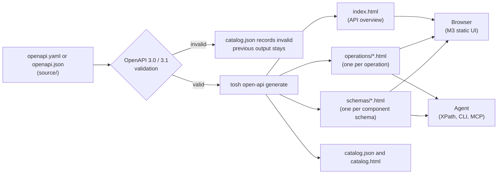
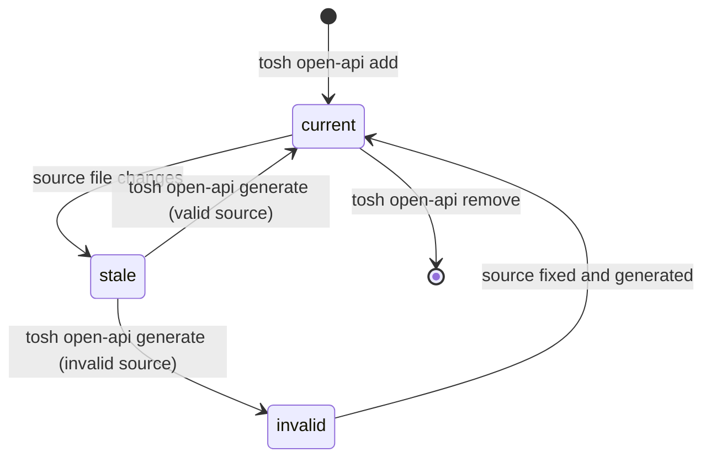
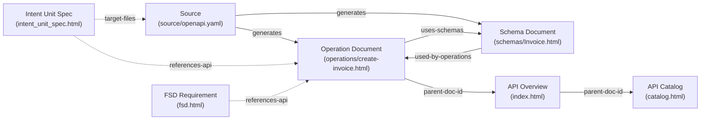

# OpenAPI Documents Architecture & Specification

> The master specification for the OpenAPI Documents domain of `tosh`. This document defines how `tosh` stores OpenAPI
> source files and generates XHTML documents from them. Developers and agents then read one operation or one schema at
> a time.

---

## Table of Contents

1. [Scope & Architectural Role](#scope--architectural-role)
2. [Source & Generation Model](#source--generation-model)
3. [API Taxonomy & Versioning](#api-taxonomy--versioning)
4. [Generation Lifecycle](#generation-lifecycle)
5. [Document Catalog](#document-catalog)
6. [Directory & File Organization Standards](#directory--file-organization-standards)
7. [API Catalog Index (`catalog.json`)](#api-catalog-index-catalogjson)
8. [Unified XHTML Header Metadata Standard](#unified-xhtml-header-metadata-standard)
9. [Document Body Structure](#document-body-structure)
10. [Document-Specification Metadata Matrix](#document-specification-metadata-matrix)
11. [Static UI Rendering](#static-ui-rendering)
12. [Command Surface](#command-surface)
13. [Token Optimization & XPath Query Patterns](#token-optimization--xpath-query-patterns)
14. [Traceability & Cross-Domain Links](#traceability--cross-domain-links)
15. [Rules & Constraints](#rules--constraints)
16. [Revisions](#revisions)

---

## Scope & Architectural Role

The OpenAPI domain holds the HTTP service contracts of a project. A service contract is the formal description of the
endpoints, the payloads, and the responses of an API. The domain covers two kinds of API:

- The APIs that the project exposes to other systems.
- The external APIs that the project calls.

A developer saves an OpenAPI 3.0 or 3.1 file in `.tosh/open-api/`. The `tosh` CLI makes sure that the file is valid and
then generates a set of strict XHTML documents from it. The generated documents render in a browser with Material Design
3 (M3) web components. Agents query the same documents with XPath and read one operation or one schema at a time.

The domain does not cover these items:

- The execution of requests against a live server. The generated documents contain no request runner.
- The generation of client or server code from a contract.
- Custom OpenAPI validation rules. `tosh` uses a standard OpenAPI 3.0 and 3.1 validator.
- Code-level API reference documents, such as package, class, and function signatures. `tosh` generates no document of
  this kind.

### Dual-Purpose Consumption Model

Every generated document has two consumers:

1. Developers open the documents in a browser. The documents show endpoint cards, method chips, parameter tables, and
   response sections with no build step and no runtime server.
2. Agents and the `tosh` CLI query the documents with an XML parser. One operation document is typically between 300 and
   1,500 tokens. A full OpenAPI file is often between 10,000 and 50,000 tokens.

---

## Source & Generation Model

The OpenAPI source file is the single source of truth. The generated XHTML documents are a read-only projection of the
source. A projection is output that a tool derives from a source and never edits by hand.



### Source Files

- The entry file of each API version is `source/openapi.yaml` or `source/openapi.json`. One version directory holds one
  entry file.
- The entry file can reference other files in the same `source/` directory with a relative `$ref`. For example,
  `$ref: "./schemas/invoice.yaml"` is valid.
- A `$ref` to a remote URL is not valid. The CLI makes no network call, so every reference must resolve to a local
  file.
- The developer edits the source file directly, or replaces it with `tosh open-api update`. A framework that exports an
  OpenAPI file at build time can write the export to the same path.

### Generated Files

- The generator writes the overview document, one operation document per operation, one schema document per entry in
  `components.schemas`, and the project catalog.
- Generation is deterministic. The same source and the same generator version produce byte-identical output, so a git
  diff of generated files shows only real contract changes.
- Generation removes generated files that no longer match an operation or a schema in the source.
- Every generated document records the SHA-256 hash of the source in its `source-hash` tag.

---

## API Taxonomy & Versioning

### API Roles

Each API has one role. The role is the first directory level under `.tosh/open-api/`.

| Role      | Directory    | Meaning                                                                  | Example                                   |
|:----------|:-------------|:-------------------------------------------------------------------------|:------------------------------------------|
| `service` | `services/`  | An API that the project implements and exposes to other systems.         | The billing API that the project serves.  |
| `client`  | `clients/`   | An external API that the project calls. Another party owns the contract. | A payment provider API that the project calls. |

The role controls how other domains use the contract:

- A work item unit that changes a `service` API must keep the contract and the implementation in step. The unit lists
  the source file in its Target Scope.
- A `client` contract is a copy of a third-party contract. A unit reads it as reference and does not change it. The
  source file of a `client` API belongs in the `protected-files` tag of every unit that does not update the vendor
  contract.

### API Identifier

Each API has an API identifier (`api-id`). The identifier is a kebab-case slug that is unique within its role, for
example `billing-api` or `stripe-payments`. The developer chooses it with `tosh open-api add`.

### Versioning

- Each major version of an API has its own directory, `v{major}`. For example, `services/billing-api/v1/` and
  `services/billing-api/v2/` exist side by side.
- The generator reads the major version from `info.version` of the source. If `info.version` is not a semantic version
  (SemVer), the developer gives the major version with the `--major` flag.
- A minor or patch change replaces the source in the same version directory. Git holds the history of minor and patch
  changes.
- The overview document of each version lists the other versions of the same API in its `sibling-versions` tag.

---

## Generation Lifecycle

`catalog.json` records a generation state for each API version.



| State     | Meaning                                                                                                     |
|:----------|:------------------------------------------------------------------------------------------------------------|
| `current` | The hash of the source file matches the `source-hash` of the generated documents.                           |
| `stale`   | The source file changed after the last generation. The generated documents show the previous contract.      |
| `invalid` | The last generation failed validation. The documents from the last valid generation stay in place.          |

- `tosh open-api check` compares each source hash with `catalog.json` and reports every `stale` or `invalid` version.
  It changes no file. If it finds a difference, it exits with code `5`.
- A CI job or a `build-gate` hook can run `tosh open-api check` to stop a commit that changes a source file without its
  generated documents.
- The universal `status` tag of a generated document is always `completed`. The generation state lives only in
  `catalog.json`, because a document cannot know that its source changed.

---

## Document Catalog

The OpenAPI domain defines five documents: two project-level documents and three per-version documents.

### Project-Level Documents

| # | Document Name    | Target Filename | Format | Purpose                                                                                             |
|:--|:-----------------|:----------------|:-------|:----------------------------------------------------------------------------------------------------|
| 1 | API Catalog      | `catalog.json`  | JSON   | Machine index of every API version: role, identifier, version, source hash, generation state, and file paths. |
| 2 | API Catalog View | `catalog.html`  | XHTML  | The landing page of the domain. It lists every API by role, with its versions and its generation state. |

### Per-Version Documents

| # | Document Name      | Target Filename                       | Format | Purpose                                                                                                   |
|:--|:-------------------|:--------------------------------------|:-------|:----------------------------------------------------------------------------------------------------------|
| 3 | API Overview       | `{role}/{api-id}/v{major}/index.html` | XHTML  | The title, description, servers, security schemes, tags, and an index of every operation and schema.     |
| 4 | Operation Document | `operations/{operation-slug}.html`    | XHTML  | One HTTP method on one path: parameters, request body, responses, security, examples, and the source fragment. |
| 5 | Schema Document    | `schemas/{schema-name}.html`          | XHTML  | One entry of `components.schemas`: properties, required fields, composition, the JSON Schema, and the operations that use it. |

The XHTML documents use the `doc-type` values `openapi-catalog`, `openapi-overview`, `openapi-operation`, and
`openapi-schema`. `catalog.json` is JSON and has no `doc-type`.

### Operation Slug

The operation slug names the file of an operation document. The generator derives it in this order:

1. If the operation has an `operationId`, the slug is the `operationId` in kebab-case. `createInvoice` becomes
   `create-invoice`.
2. If the operation has no `operationId`, the slug is the method and the path in kebab-case. A path parameter
   `{id}` becomes `by-id`. `GET /invoices/{id}` becomes `get-invoices-by-id`.

If two operations produce the same slug, generation fails and names both operations.

---

## Directory & File Organization Standards

```
<repo-root>/
└── .tosh/
    └── open-api/
        ├── catalog.json                          # Machine index of all API versions
        ├── catalog.html                          # Landing page of the domain
        │
        ├── services/                             # APIs that the project exposes
        │   └── billing-api/
        │       ├── v1/
        │       │   ├── source/
        │       │   │   ├── openapi.yaml          # Source of truth (entry file)
        │       │   │   └── schemas/
        │       │   │       └── invoice.yaml      # Optional file referenced with a relative $ref
        │       │   ├── index.html                # API Overview (generated)
        │       │   ├── operations/
        │       │   │   ├── create-invoice.html   # Operation Document (generated)
        │       │   │   └── get-invoices-by-id.html
        │       │   └── schemas/
        │       │       ├── Invoice.html          # Schema Document (generated)
        │       │       └── Error.html
        │       └── v2/
        │           └── ...
        │
        └── clients/                              # External APIs that the project calls
            └── stripe-payments/
                └── v1/
                    ├── source/
                    │   └── openapi.json
                    ├── index.html
                    ├── operations/
                    └── schemas/
```

### Naming Conventions

- Role directories are `services/` and `clients/`. No other directory is valid at this level.
- API directories use the API identifier in kebab-case.
- Version directories are `v{major}` with no zero padding, for example `v1` and `v12`.
- Operation files use the operation slug.
- Schema files use the exact key from `components.schemas`, because schema names are case-sensitive references.

---

## API Catalog Index (`catalog.json`)

`catalog.json` is the machine index of the domain. The CLI and the MCP server read it to find an API version without a
directory walk. Only `tosh open-api` commands write it.

```json
{
  "$schema": "https://json-schema.org/draft/2020-12/schema",
  "catalogVersion": 7,
  "generatorVersion": "1.0.0",
  "updatedAt": "2026-11-04T15:20:00Z",
  "apis": [
    {
      "apiId": "billing-api",
      "role": "service",
      "title": "Billing API",
      "versions": [
        {
          "major": 1,
          "apiVersion": "1.4.2",
          "openapiVersion": "3.1.0",
          "generationState": "current",
          "sourceFile": "services/billing-api/v1/source/openapi.yaml",
          "sourceHash": "sha256:4a1f0c9e5b7d2e8f3a6b1c4d7e0f2a5b8c1d4e7f0a3b6c9d2e5f8a1b4c7d0e3f",
          "generatedAt": "2026-11-04T15:20:00Z",
          "overview": "services/billing-api/v1/index.html",
          "operations": [
            {
              "slug": "create-invoice",
              "operationId": "createInvoice",
              "method": "POST",
              "path": "/invoices",
              "tags": ["invoices"],
              "deprecated": false,
              "file": "services/billing-api/v1/operations/create-invoice.html"
            }
          ],
          "schemas": [
            {
              "name": "Invoice",
              "file": "services/billing-api/v1/schemas/Invoice.html"
            }
          ],
          "lastError": null
        }
      ]
    }
  ]
}
```

- `catalogVersion` rises by one on every write. A write with a version that does not match fails with exit code `6`.
- `lastError` holds the validation errors of the last failed generation. If `generationState` is not `invalid`,
  `lastError` is `null`.
- Every path in the catalog is relative to `.tosh/open-api/`.

---

## Unified XHTML Header Metadata Standard

Every generated XHTML document carries the seven universal baseline tags and the OpenAPI tags below. This example is
the head of an operation document.

```html
<!DOCTYPE html>
<html xmlns="http://www.w3.org/1999/xhtml" lang="en">
<head>
    <meta charset="UTF-8"/>
    <meta name="viewport" content="width=device-width, initial-scale=1.0"/>
    <title>POST /invoices - Billing API v1</title>

    <!-- 1. Universal Baseline -->
    <meta name="doc-id" content="OAS:service:billing-api:v1:OP:create-invoice"/>
    <meta name="doc-type" content="openapi-operation"/>
    <meta name="schema-version" content="1.0.0"/>
    <meta name="domain" content="open-api"/>
    <meta name="status" content="completed"/>
    <meta name="created-at" content="2026-10-02T09:00:00Z"/>
    <meta name="updated-at" content="2026-11-04T15:20:00Z"/>

    <!-- 2. API Identity & Lineage -->
    <meta name="api-id" content="billing-api"/>
    <meta name="api-role" content="service"/>
    <meta name="api-major" content="1"/>
    <meta name="api-version" content="1.4.2"/>
    <meta name="openapi-version" content="3.1.0"/>
    <meta name="parent-doc-id" content="OAS:service:billing-api:v1:OVERVIEW"/>

    <!-- 3. Operation Identity -->
    <meta name="operation-id" content="createInvoice"/>
    <meta name="operation-slug" content="create-invoice"/>
    <meta name="http-method" content="POST"/>
    <meta name="http-path" content="/invoices"/>
    <meta name="tags" content="invoices"/>
    <meta name="deprecated" content="false"/>
    <meta name="security" content="bearerAuth"/>
    <meta name="uses-schemas" content="InvoiceCreate,Invoice,Error"/>

    <!-- 4. Generation Provenance -->
    <meta name="source-file" content="services/billing-api/v1/source/openapi.yaml"/>
    <meta name="source-hash" content="sha256:4a1f0c9e5b7d2e8f3a6b1c4d7e0f2a5b8c1d4e7f0a3b6c9d2e5f8a1b4c7d0e3f"/>
    <meta name="generator-version" content="1.0.0"/>

    <!-- 5. Material Design 3 Web Component Loader -->
    <link href="https://fonts.googleapis.com/css2?family=Roboto:wght@400;500;700&amp;display=swap" rel="stylesheet"/>
    <link href="https://fonts.googleapis.com/css2?family=Material+Symbols+Outlined" rel="stylesheet"/>
    <script type="importmap">
        {
          "imports": {
            "@material/web/": "https://esm.run/@material/web/"
          }
        }
    </script>
    <script type="module">
        import '@material/web/all.js';
        import {styles as typescaleStyles} from '@material/web/typography/md-typescale-styles.js';

        document.adoptedStyleSheets.push(typescaleStyles.styleSheet);
    </script>
</head>
<body>
<main class="tosh-doc-container">
    <!-- Structured Document Body -->
</main>
</body>
</html>
```

### Document Identifier Format

| Document Type       | `doc-id` Pattern                                | Example                                       |
|:--------------------|:------------------------------------------------|:----------------------------------------------|
| `openapi-catalog`   | `OAS:CATALOG`                                   | `OAS:CATALOG`                                 |
| `openapi-overview`  | `OAS:{role}:{api-id}:v{major}:OVERVIEW`         | `OAS:service:billing-api:v1:OVERVIEW`         |
| `openapi-operation` | `OAS:{role}:{api-id}:v{major}:OP:{slug}`        | `OAS:service:billing-api:v1:OP:create-invoice` |
| `openapi-schema`    | `OAS:{role}:{api-id}:v{major}:SCHEMA:{name}`    | `OAS:service:billing-api:v1:SCHEMA:Invoice`   |

### Tag Definitions

| Tag                 | Applies To                   | Content                                                                                 |
|:--------------------|:-----------------------------|:----------------------------------------------------------------------------------------|
| `api-id`            | Overview, operation, schema  | The API identifier.                                                                     |
| `api-role`          | Overview, operation, schema  | `service` or `client`.                                                                  |
| `api-major`         | Overview, operation, schema  | The major version number of the version directory.                                     |
| `api-version`       | Overview, operation, schema  | The full `info.version` value of the source.                                            |
| `openapi-version`   | Overview, operation, schema  | The `openapi` value of the source, for example `3.0.3` or `3.1.0`.                      |
| `parent-doc-id`     | Overview, operation, schema  | The catalog for an overview. The overview for an operation or a schema.                 |
| `sibling-versions`  | Overview                     | The `doc-id` values of the overviews of the other major versions, comma-separated.      |
| `operation-count`   | Overview                     | The number of operations in the version.                                                |
| `schema-count`      | Overview                     | The number of component schemas in the version.                                         |
| `operation-id`      | Operation                    | The `operationId` of the source. If the source has none, the value is empty.             |
| `operation-slug`    | Operation                    | The operation slug.                                                                     |
| `http-method`       | Operation                    | The HTTP method in upper case.                                                          |
| `http-path`         | Operation                    | The path template exactly as the source states it.                                      |
| `tags`              | Operation                    | The OpenAPI tags of the operation, comma-separated.                                     |
| `deprecated`        | Operation, schema            | `true` or `false`.                                                                      |
| `security`          | Operation                    | The names of the security schemes that apply, comma-separated. Empty means no security. |
| `uses-schemas`      | Operation                    | The component schemas that the operation references, comma-separated.                  |
| `schema-name`       | Schema                       | The key of the schema in `components.schemas`.                                          |
| `used-by-operations`| Schema                       | The slugs of the operations that reference the schema, comma-separated.                 |
| `source-file`       | Overview, operation, schema  | The path of the entry file, relative to `.tosh/open-api/`.                              |
| `source-hash`       | Overview, operation, schema  | The SHA-256 hash of the source at generation time.                                      |
| `generator-version` | All                          | The version of the `tosh` generator that wrote the document.                            |

---

## Document Body Structure

Each document type has a fixed set of sections. Each section carries a stable `id`, so an XPath query does not depend on
the layout.

### API Overview (`index.html`)

| Section `id`       | Content                                                                                      |
|:-------------------|:---------------------------------------------------------------------------------------------|
| `api-info`         | The title, the description, the contact, the license, and the terms of service from `info`.  |
| `servers`          | One row per entry in `servers`, with the URL and the description.                            |
| `security-schemes` | One card per entry in `components.securitySchemes`, with the type and the location.          |
| `operation-index`  | Operations grouped by tag. Each row has a method chip, the path, the summary, and a link. Each row carries `data-deprecated`. |
| `schema-index`     | One row per component schema, with a link to its schema document.                            |

### Operation Document (`operations/{operation-slug}.html`)

The body holds one `<article>` element with `data-endpoint`, `data-method`, and `data-operation-id` attributes.

| Section `id`      | Content                                                                                                     |
|:------------------|:------------------------------------------------------------------------------------------------------------|
| `operation-summary` | The method chip, the path, the summary, the description, and a deprecation banner for a deprecated operation. |
| `parameters`      | A table with one `<tr>` per parameter. Each row carries `data-param-name` and `data-param-in` (`path`, `query`, `header`, or `cookie`). |
| `request-body`    | One block per media type, with the schema and a link to each referenced schema document.                    |
| `responses`       | One `<details>` element per status code, with a `data-status` attribute, the description, headers, and the schema. |
| `security`        | The security requirements of the operation, with links to the schemes in the overview.                      |
| `examples`        | The request and response examples from the source, verbatim.                                                |
| `source-fragment` | The exact OpenAPI operation object as JSON in `<pre data-format="json"><code>`. References stay unresolved. |

A reference to a component schema appears as a link with a `data-schema-ref` attribute. The operation document does not
copy the referenced schema. An inline schema, a schema with no component name, appears in full inside the section that
uses it.

### Schema Document (`schemas/{schema-name}.html`)

| Section `id`     | Content                                                                                                   |
|:-----------------|:----------------------------------------------------------------------------------------------------------|
| `schema-summary` | The name, the type, the description, and a deprecation banner for a deprecated schema.                    |
| `properties`     | A table with one `<tr>` per property. Each row carries `data-property`, the type, the format, `data-required`, and the description. |
| `composition`    | The `allOf`, `oneOf`, and `anyOf` members and the discriminator, with links to each member schema.        |
| `json-schema`    | The exact JSON Schema of the component as JSON in `<pre data-format="json"><code>`.                       |
| `used-by`        | Links to every operation document that references the schema.                                              |

### Body Example (Operation Document)

```html
<main class="tosh-doc-container">
    <article data-endpoint="/invoices" data-method="POST" data-operation-id="createInvoice">
        <section id="operation-summary">
            <md-assist-chip label="POST" class="method-post"></md-assist-chip>
            <h1 class="md-typescale-headline-small"><code>/invoices</code></h1>
            <p>Create an invoice for a customer.</p>
        </section>
        <section id="parameters">
            <table>
                <tr data-param-name="Idempotency-Key" data-param-in="header">
                    <td>Idempotency-Key</td><td>header</td><td>string</td><td>required</td>
                </tr>
            </table>
        </section>
        <section id="request-body">
            <h2>application/json</h2>
            <a data-schema-ref="InvoiceCreate" href="../schemas/InvoiceCreate.html">InvoiceCreate</a>
        </section>
        <section id="responses">
            <details data-status="201">
                <summary>201 Created</summary>
                <a data-schema-ref="Invoice" href="../schemas/Invoice.html">Invoice</a>
            </details>
            <details data-status="422">
                <summary>422 Unprocessable Entity</summary>
                <a data-schema-ref="Error" href="../schemas/Error.html">Error</a>
            </details>
        </section>
        <section id="security">
            <a href="../index.html#security-schemes">bearerAuth</a>
        </section>
        <section id="examples">
            <!-- Examples from the source, verbatim -->
        </section>
        <section id="source-fragment">
            <pre data-format="json"><code>{"operationId": "createInvoice", "...": "..."}</code></pre>
        </section>
    </article>
</main>
```

---

## Document-Specification Metadata Matrix

| Document Category | Target Files                        | Key Custom Metadata Attributes                                                                                       | XPath Lookup Utility                                   |
|:------------------|:------------------------------------|:---------------------------------------------------------------------------------------------------------------------|:-------------------------------------------------------|
| Catalog           | `catalog.json`<br/>`catalog.html`   | `catalogVersion`<br/>`generationState`<br/>`sourceHash`                                                              | Direct JSON key or jq query                            |
| Overview          | `index.html`                        | `api-id`<br/>`api-role`<br/>`api-version`<br/>`sibling-versions`<br/>`operation-count`<br/>`schema-count`            | `//section[@id='operation-index']//a/@href`            |
| Operation         | `operations/*.html`                 | `operation-id`<br/>`http-method`<br/>`http-path`<br/>`tags`<br/>`deprecated`<br/>`security`<br/>`uses-schemas`       | `//article[@data-endpoint and @data-method]`           |
| Schema            | `schemas/*.html`                    | `schema-name`<br/>`deprecated`<br/>`used-by-operations`                                                              | `//section[@id='properties']//tr[@data-property]`      |

---

## Static UI Rendering

The generated documents use the OpenAPI template of the [static UI](../../static-ui/README.md). The template follows
these rules:

- Each HTTP method has a fixed chip color. The same method has the same color in every document.
- The overview groups endpoint cards by tag. An operation with no tag goes into a group named `default`.
- Each response status code is a `<details>` section. The browser opens and closes the section with no script.
- A deprecated operation or schema shows a banner at the top and a struck-through path in the overview.
- Schema links open the schema document. The schema document links back to every operation that uses it.
- The catalog view groups APIs into Services and Clients and shows the generation state of each version as a chip.
- If a version is `stale` or `invalid`, the catalog view shows a warning that the documents show the previous contract.

The documents contain no request runner and no live call to a server.

---

## Command Surface

The [CLI](../../cli/README.md) provides the `tosh open-api` command group. The [MCP server](../../mcp/README.md)
provides matching tools. Both surfaces call the same code.

### CLI Commands

| Command                                                                                     | Effect                                                                                                    |
|:--------------------------------------------------------------------------------------------|:----------------------------------------------------------------------------------------------------------|
| `tosh open-api add --role <service\|client> --api-id <id> --source <file> [--major <n>]`    | Copies the source into a new version directory, validates it, and generates the documents.                |
| `tosh open-api update --api-id <id> --major <n> --source <file>`                            | Replaces the source of an existing version, validates it, and generates the documents.                    |
| `tosh open-api generate [--api-id <id>] [--major <n>]`                                      | Validates the sources and regenerates the documents. With no flags, it regenerates every `stale` version. |
| `tosh open-api check`                                                                       | Reports every `stale` or `invalid` version. It changes nothing. It exits with code `5` on a difference.   |
| `tosh open-api list [--role <service\|client>]`                                             | Prints the APIs and versions from `catalog.json`.                                                         |
| `tosh open-api operation --api-id <id> --major <n> (--slug <slug> \| --method <m> --path <p>)` | Prints the operation document fragment that the `--section` flag selects. The default is all sections.  |
| `tosh open-api schema --api-id <id> --major <n> --name <name>`                              | Prints the schema document fragment that the `--section` flag selects. The default is all sections.       |
| `tosh open-api remove --api-id <id> --major <n>`                                            | Deletes the version directory and its catalog entry.                                                      |

If the source of `add`, `update`, or `generate` fails validation, the command exits with code `3`. It records the errors
in `lastError` and leaves the previous generated documents unchanged.

### MCP Tools

| Tool                        | Input                                                                 | Result                                                                                  |
|:----------------------------|:----------------------------------------------------------------------|:----------------------------------------------------------------------------------------|
| `tosh_openapi_list`         | Optional `role`, `api_id`                                             | The APIs, versions, and generation states from `catalog.json`.                         |
| `tosh_openapi_find`         | `api_id`, `major`, and one of `path_contains`, `tag`, `method`        | The matching operations: slug, method, path, and summary. No operation bodies.          |
| `tosh_openapi_get_operation`| `api_id`, `major`, `slug` or `method` and `path`, optional `sections` | The selected sections of one operation document.                                        |
| `tosh_openapi_get_schema`   | `api_id`, `major`, `name`, optional `sections`                        | The selected sections of one schema document.                                          |
| `tosh_openapi_check`        | None                                                                  | The list of `stale` and `invalid` versions.                                             |

The MCP tools are read-only. To change a contract, an agent edits the source file inside the Target Scope of a unit. The
unit verification then runs `tosh open-api generate`.

---

## Token Optimization & XPath Query Patterns

An agent that implements or calls one endpoint needs one operation and the schemas that it uses. It does not need the
full contract.

```
Full OpenAPI File Ingestion:
┌────────────────────────────────────────────────────────┐
│ openapi.yaml with 85 operations and 140 schemas        │
│ ~42,000 Tokens                                         │
└────────────────────────────────────────────────────────┘

tosh Operation Extraction:
┌───────────────────────────────────────┐
│ Parameters + Request + 201 Response   │
│ ~650 Tokens (98.5% reduction)         │
└───────────────────────────────────────┘
```

### High-Value Extraction Examples

- Find the operation file for a method and a path in the catalog:
  ```json
  apis[?apiId=='billing-api'].versions[?major==`1`].operations[?method=='POST' && path=='/invoices'].file
  ```

- Extract the parameters of an operation:
  ```xpath2
  //section[@id='parameters']//tr[@data-param-in='path' or @data-param-in='query']
  ```

- Extract the success response of an operation:
  ```xpath2
  //section[@id='responses']/details[starts-with(@data-status, '2')]
  ```

- Extract the exact source fragment of an operation:
  ```xpath2
  //section[@id='source-fragment']//code
  ```

- List the schemas that an operation depends on:
  ```xpath2
  /html/head/meta[@name='uses-schemas']/@content
  ```

- Extract the required properties of a schema:
  ```xpath2
  //section[@id='properties']//tr[@data-required='true']
  ```

- Find the operations that a schema change affects:
  ```xpath2
  /html/head/meta[@name='used-by-operations']/@content
  ```

- List the deprecated operations in an overview:
  ```xpath2
  //section[@id='operation-index']//*[@data-deprecated='true']
  ```

---

## Traceability & Cross-Domain Links



- Upward pointers: each operation and schema document names its overview in `parent-doc-id`. Each overview names the
  catalog.
- Lateral pointers: `uses-schemas` and `used-by-operations` link operations and schemas in both directions.
- Version pointers: `sibling-versions` links the overviews of the major versions of one API.
- Work item pointers: an intent unit lists operation `doc-id` values in its `references-api` tag. A unit that changes a
  `service` contract lists the source file in its Target Scope.
- Requirement pointers: a [project manager](../../project-mgr/README.md) requirement can list operation `doc-id` values
  in its `references-api` tag.

---

## Rules & Constraints

1. Current state design: this document represents the current state of the design. Historical deliberations are
   recorded in [`topics/`](../../../topics/README.md).
2. Single source of truth: the OpenAPI source file is the contract. No person and no agent edits a generated document.
   Only `tosh open-api` commands write generated documents and `catalog.json`.
3. Supported versions: the source must be OpenAPI 3.0.x or 3.1.x. Swagger 2.0 sources are not valid.
4. Local references only: every `$ref` must resolve to a file in the same `source/` directory. A remote reference fails
   validation.
5. Valid before generation: the generator writes no document from an invalid source. The previous documents stay in
   place.
6. Deterministic output: the same source and the same generator version produce byte-identical documents.
7. Unique slugs: every operation slug and every schema name must be unique within one API version.
8. Strict XHTML conformance: every generated `.html` file must parse as XML with the namespace
   `http://www.w3.org/1999/xhtml`. Tags are closed, attributes are quoted, and entities are escaped.
9. Mandatory universal baseline: every generated XHTML document carries the seven universal baseline tags and the
   `source-hash` tag.
10. Zero runtime bundling: the documents render in a browser through the importmap with no build step.
11. No secrets in sources: a source file and its examples must not contain credentials, tokens, or keys. The documents
    copy examples verbatim and git stores them.
12. Client contracts are reference: a unit does not change a `client` source unless the intent of the unit is a vendor
    contract update.
13. Revision tracking: document revision history is tracked only in the `## Revisions` table at the bottom of each
    document.

---

## Revisions

| Date       | Version | Description                                                                                                                                                                                                 | Source    |
|:-----------|:--------|:------------------------------------------------------------------------------------------------------------------------------------------------------------------------------------------------------------|:----------|
| 2026-11-04 | 0.2.1   | Removed the link to the SDK & Code API domain from the scope exclusions.                                                                                                                                    | TOPIC-004 |
| 2026-11-04 | 0.2.0   | Full domain specification. It adds the generation model, API roles, version directories, the lifecycle, and the document catalog. It also adds `catalog.json`, metadata, body sections, UI rules, commands, XPath patterns, and traceability. | TOPIC-003 |
| 2026-08-30 | 0.1.0   | Initial placeholder.                                                                                                                                                                                        | Initial Document |
