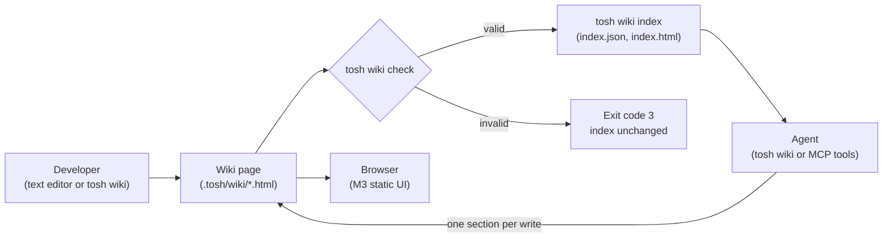
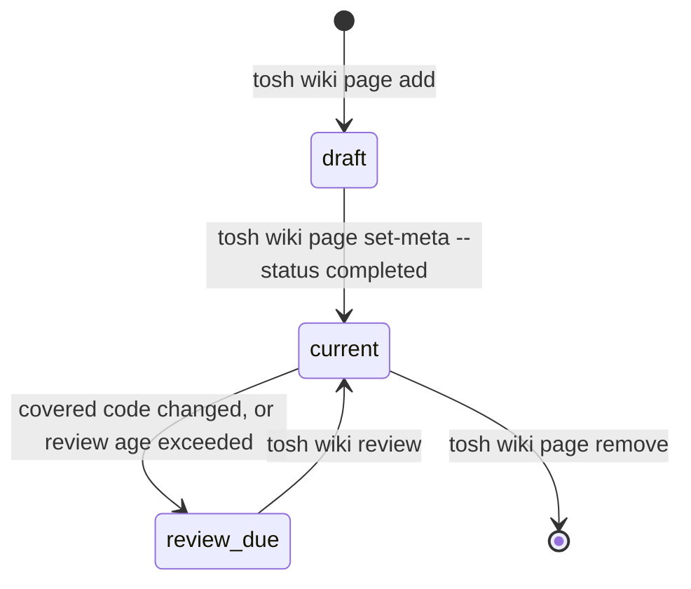
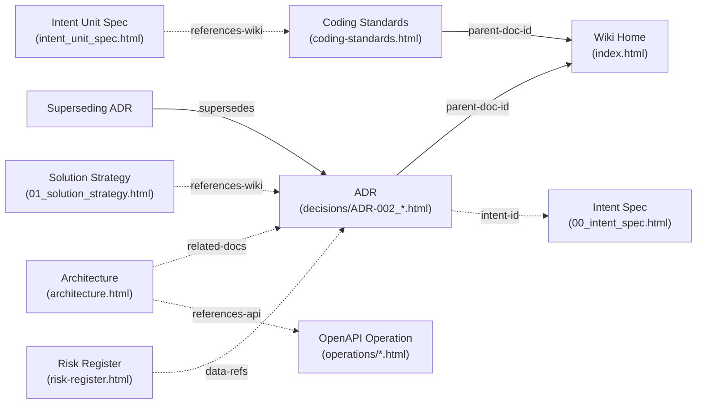

# Project Wiki Documents Architecture & Specification

> The master specification for the Project Wiki domain of `tosh`. This document defines how a project keeps its wiki
> inside the repository as strict XHTML pages. Developers read the pages in a browser. Agents read and change one
> section at a time.

---

## Table of Contents

1. [Scope & Architectural Role](#scope--architectural-role)
2. [Authoring Model](#authoring-model)
3. [Wiki Structure](#wiki-structure)
4. [Page Lifecycle](#page-lifecycle)
5. [Document Catalog](#document-catalog)
6. [Directory & File Organization Standards](#directory--file-organization-standards)
7. [Wiki Index (`index.json`)](#wiki-index-indexjson)
8. [Unified XHTML Header Metadata Standard](#unified-xhtml-header-metadata-standard)
9. [Document Body Structure](#document-body-structure)
10. [Document-Specification Metadata Matrix](#document-specification-metadata-matrix)
11. [Static UI Rendering](#static-ui-rendering)
12. [Command Surface](#command-surface)
13. [Token Optimization & XPath Query Patterns](#token-optimization--xpath-query-patterns)
14. [Traceability & Cross-Domain Links](#traceability--cross-domain-links)
15. [Rules & Constraints](#rules--constraints)
16. [Revisions](#revisions)

---

## Scope & Architectural Role

The project wiki holds the knowledge of a project that lasts longer than one work item. Examples are the project
overview, the architecture, the setup steps, the coding standards, the architecture decisions, and the risks. The wiki
lives in `.tosh/wiki/` and git stores it with the code.

The domain covers these items:

- A required core set of five pages with fixed file names and fixed section identifiers.
- Architecture decision records (ADRs). An ADR is a dated record of one decision of the project.
- Freeform pages that a team adds for its own topics, for example runbooks or onboarding notes.
- A machine index of every page and every section.

The domain does not cover these items:

- A web editor or a WYSIWYG editor. A person edits a page in a text editor or through `tosh wiki` commands.
- Full-text search across the repository. `tosh wiki find` searches only wiki pages.
- Synchronization with an external wiki product.
- The decisions about the design of `tosh` itself. The `topics/` workspace of the `tosh` repository holds them.

### Dual-Purpose Consumption Model

Every wiki page has two consumers:

1. Developers open the pages in a browser. The pages render with Material Design 3 (M3) web components, with no build
   step and no runtime server.
2. Agents and the `tosh` CLI query the pages with an XML parser. An agent first reads the index or the outline of a
   page. Then it reads only the sections that it needs. One section is typically between 150 and 800 tokens. A full
   engineering wiki is often more than 30,000 tokens.

---

## Authoring Model

The XHTML page is the single source of truth. No other file holds the content of a page, and git stores one copy of
each page.



### Section Addressing

A section is a `<section>` element with an `id` attribute. A section reference names one section in the whole
workspace. It has the form `{doc-id}#{section-id}`, for example `WIKI:coding-standards#error-handling`. A rule, an ADR,
and a risk also carry an `id`. A reference names them in the same way, for example `WIKI:coding-standards#CS-014`.

### Writes by People

- A person can edit a page in a text editor.
- After the edit, the person runs `tosh wiki index`. The command makes sure that every page is valid and rebuilds the
  index.
- A CI job or a `build-gate` hook can run `tosh wiki check` to stop a commit that holds an invalid page or a stale
  index.

### Writes by Agents

- An agent changes a page only through `tosh wiki` commands or the matching MCP tools. It does not edit a page file
  directly.
- A section write replaces the content of one section. The agent sends an XHTML fragment and the hash of the section
  that it read.
- If the hash does not match the current section, the write fails with exit code `6`. The agent then reads the section
  again. This rule stops an agent from overwriting a change that it did not see.
- Every write makes sure that the fragment is well-formed and uses only permitted elements. Then it updates the
  `updated-at` tag of the page and the section record in the index, in one atomic change.

---

## Wiki Structure

The wiki has three parts.

| Part      | Location            | Content                                                                                   |
|:----------|:--------------------|:------------------------------------------------------------------------------------------|
| Core      | `.tosh/wiki/*.html` | Five required pages with fixed file names and fixed section identifiers.                  |
| Decisions | `decisions/`        | One ADR per decision.                                                                     |
| Pages     | `pages/`            | Freeform pages that the team names and arranges in directories.                           |

### Core Pages

`tosh wiki init` creates the five core pages with their required sections. A new required section holds no content
until a person or an agent writes it. A core page cannot be removed or renamed.

The core pages describe the current state of the project. When the project changes, a person or an agent changes the
page. Git holds the history of each page. An ADR holds the reason for a decision.

### Decisions

An ADR records one decision, its context, and its consequences on the date of the decision. An ADR can describe the
alternatives that the project considered. After acceptance, only the status of an ADR changes. A new decision that
replaces an old one is a new ADR. The new ADR names the old one in `supersedes`, and the CLI sets `superseded-by` on the
old one.

### Freeform Pages

- A team adds a freeform page with `tosh wiki page add`. The page lives under `pages/`, in directories up to three levels
  deep.
- Each freeform page has a slug. A slug is a kebab-case name that is unique in the wiki. The slug does not change when
  the page moves to another directory, so references to the page stay valid.
- A freeform page has no required sections. It must hold at least one section.
- The slugs of the core pages are reserved. A freeform page cannot use them.

---

## Page Lifecycle

The universal `status` tag of a wiki page has two values.

| `status`      | Meaning                                                                       |
|:--------------|:------------------------------------------------------------------------------|
| `in-progress` | The page is a draft. If a query asks for drafts, agents read it.              |
| `completed`   | The page is published. Agents read it as current project knowledge.          |

### Review State

A page that nobody reviews becomes outdated. The index records a review state for each page. `tosh wiki index` and
`tosh wiki check` calculate it. No person or agent writes it.



| Review State | Condition                                                                                                   |
|:-------------|:------------------------------------------------------------------------------------------------------------|
| `current`    | The page passed its last review and no condition for `review_due` is true.                                  |
| `review_due` | A file that matches `covers-paths` has a git commit after `reviewed-at`, or `reviewed-at` is older than the maximum review age. |

- The `covers-paths` tag lists the paths and globs of the code that the page describes. The CLI reads the commit dates of
  those files from the local git repository.
- The maximum review age is 180 days. The flag `--max-age-days` of `tosh wiki check` changes it for one run.
- `tosh wiki review` sets `reviewed-at` and `reviewed-by` on the page. The person who reviews the page reads the page
  and the changed code first.
- ADRs have no review state. An ADR records a decision on one date.

### ADR Status

| `adr-status` | Meaning                                                              | Universal `status` |
|:-------------|:---------------------------------------------------------------------|:-------------------|
| `proposed`   | The decision is open for discussion.                                 | `in-progress`      |
| `accepted`   | The project follows the decision.                                    | `completed`        |
| `superseded` | A newer ADR replaces the decision. `superseded-by` names the new ADR. | `completed`        |
| `deprecated` | The project no longer follows the decision, and no ADR replaces it.  | `completed`        |

A named human accepts, supersedes, or deprecates an ADR. An agent can write a `proposed` ADR.

### Risk Status

Each entry in the risk register carries one of these values in `data-risk-status`: `open`, `mitigating`, `accepted`,
or `closed`. An `accepted` risk is a risk that the project chooses to carry. A named human sets `accepted` and `closed`.

---

## Document Catalog

The wiki domain defines nine documents: one JSON index and eight XHTML document types.

### Project-Level Documents

| # | Document Name | Target Filename | Format | Purpose                                                                                       |
|:--|:--------------|:----------------|:-------|:----------------------------------------------------------------------------------------------|
| 1 | Wiki Index    | `index.json`    | JSON   | Machine index of every page and section: identifier, file, title, summary, tags, hash, token estimate, and review state. |
| 2 | Wiki Home     | `index.html`    | XHTML  | The landing page of the domain. It lists the core pages, the ADRs by status, the open risks, and the freeform page tree. |

### Core Pages

| # | Document Name    | Target Filename         | Format | Purpose                                                                                       |
|:--|:-----------------|:------------------------|:-------|:----------------------------------------------------------------------------------------------|
| 3 | Project Overview | `overview.html`         | XHTML  | The purpose, the scope, the stakeholders, the glossary, and the key links of the project.     |
| 4 | Architecture     | `architecture.html`     | XHTML  | The system context, the components, the data flow, the boundaries, the deployment, and the cross-cutting concerns. |
| 5 | Setup Guide      | `setup-guide.html`      | XHTML  | The prerequisites and the commands to install, configure, build, run, and test the project.   |
| 6 | Coding Standards | `coding-standards.html` | XHTML  | The rules of the project, grouped by topic. Each rule has an identifier, a level, and the paths that it applies to. |
| 7 | Risk Register    | `risk-register.html`    | XHTML  | One entry per risk, with likelihood, impact, rating, status, owner, and mitigation.           |

### Decision and Freeform Documents

| # | Document Name | Target Filename                          | Format | Purpose                                                                            |
|:--|:--------------|:-----------------------------------------|:-------|:-----------------------------------------------------------------------------------|
| 8 | ADR           | `decisions/ADR-{NNN}_{slug}.html`        | XHTML  | One decision: status, context, decision, consequences, and alternatives.           |
| 9 | Wiki Page     | `pages/{dir}/{slug}.html`                | XHTML  | A freeform page with sections that the team defines.                               |

The XHTML documents use the `doc-type` values `wiki-home`, `wiki-overview`, `wiki-architecture`, `wiki-setup-guide`,
`wiki-coding-standards`, `wiki-risk-register`, `wiki-adr`, and `wiki-page`. `index.json` is JSON and has no `doc-type`.

---

## Directory & File Organization Standards

```
<repo-root>/
└── .tosh/
    └── wiki/
        ├── index.json                         # Machine index of all pages and sections
        ├── index.html                         # Wiki Home (written by tosh wiki index)
        │
        ├── overview.html                      # Project Overview (core)
        ├── architecture.html                  # Architecture (core)
        ├── setup-guide.html                   # Setup Guide (core)
        ├── coding-standards.html              # Coding Standards (core)
        ├── risk-register.html                 # Risk Register (core)
        │
        ├── decisions/
        │   ├── ADR-001_use-postgres.html
        │   └── ADR-002_event-sourced-billing.html
        │
        ├── pages/
        │   ├── onboarding.html
        │   └── runbooks/
        │       ├── deploy.html
        │       └── database-restore.html
        │
        └── assets/
            └── context-diagram.svg            # Images that pages reference
```

### Naming Conventions

- Core page file names are fixed. No other file is valid at the root of `.tosh/wiki/`, except `index.json` and
  `index.html`.
- ADR files are `ADR-{NNN}_{kebab-case-slug}.html` with three-digit zero padding. The CLI allocates the next free
  number.
- Freeform page files are `{slug}.html`. Directory names under `pages/` are kebab-case.
- Section identifiers are kebab-case and unique within one page. A rule identifier is `CS-{NNN}`. A risk identifier is
  `RISK-{NNN}`.
- Assets live in `assets/`. An asset is SVG or a raster image (PNG, JPEG, WebP). An asset is never larger than 1 MiB.

---

## Wiki Index (`index.json`)

`index.json` is the machine index of the domain. The CLI and the MCP server read it to find a page or a section without
a directory walk and without opening a page. Only `tosh wiki` commands write it.

```json
{
  "$schema": "https://json-schema.org/draft/2020-12/schema",
  "indexVersion": 42,
  "updatedAt": "2026-11-04T15:20:00Z",
  "maxReviewAgeDays": 180,
  "pages": [
    {
      "docId": "WIKI:coding-standards",
      "docType": "wiki-coding-standards",
      "file": "coding-standards.html",
      "title": "Coding Standards",
      "summary": "Rules for naming, errors, logging, tests, security, and dependencies.",
      "status": "completed",
      "owner": "@platform-team",
      "tags": ["standards"],
      "coversPaths": ["src/**"],
      "reviewedAt": "2026-10-20T10:00:00Z",
      "reviewedBy": "human:tech-lead",
      "reviewState": "current",
      "sections": [
        {
          "id": "error-handling",
          "title": "Error Handling",
          "hash": "sha256:7d1a54127b222502f5b79b5fb0803061152a44f92b37e23c6527baf665d4da9a",
          "tokens": 410,
          "appliesTo": ["src/**/*.ts"],
          "rules": ["CS-012", "CS-013", "CS-014"]
        }
      ]
    },
    {
      "docId": "WIKI:ADR-002",
      "docType": "wiki-adr",
      "file": "decisions/ADR-002_event-sourced-billing.html",
      "title": "Event-sourced billing ledger",
      "summary": "The billing service stores invoice changes as an append-only event log.",
      "status": "completed",
      "adrStatus": "accepted",
      "decidedAt": "2026-09-12",
      "supersedes": [],
      "supersededBy": null,
      "tags": ["billing", "data"],
      "sections": [
        {"id": "decision", "title": "Decision", "hash": "sha256:...", "tokens": 180}
      ]
    },
    {
      "docId": "WIKI:PAGE:deploy",
      "docType": "wiki-page",
      "file": "pages/runbooks/deploy.html",
      "title": "Deploy Runbook",
      "summary": "Steps to release the API to staging and production.",
      "status": "completed",
      "tags": ["runbook", "release"],
      "coversPaths": ["deploy/**", ".github/workflows/release.yml"],
      "reviewedAt": "2026-06-01T09:00:00Z",
      "reviewedBy": "human:release-owner",
      "reviewState": "review_due",
      "sections": [
        {"id": "staging", "title": "Release to Staging", "hash": "sha256:...", "tokens": 520}
      ]
    }
  ]
}
```

- `indexVersion` rises by one on every write. A write with a version that does not match fails with exit code `6`.
- `tokens` is an estimate of the section text at four characters per token. An agent uses it to plan its context
  budget.
- `hash` is the SHA-256 hash of the canonical XML of the section. A section write must send this value.
- `rules` lists the rule identifiers of a section on the Coding Standards page. Other pages have no `rules` field.
- Every path in the index is relative to `.tosh/wiki/`.

---

## Unified XHTML Header Metadata Standard

Every wiki page carries the seven universal baseline tags and the wiki tags below. This example is the head of the
Coding Standards page.

```html
<!DOCTYPE html>
<html xmlns="http://www.w3.org/1999/xhtml" lang="en">
<head>
    <meta charset="UTF-8"/>
    <meta name="viewport" content="width=device-width, initial-scale=1.0"/>
    <title>Coding Standards</title>

    <!-- 1. Universal Baseline -->
    <meta name="doc-id" content="WIKI:coding-standards"/>
    <meta name="doc-type" content="wiki-coding-standards"/>
    <meta name="schema-version" content="1.0.0"/>
    <meta name="domain" content="wiki"/>
    <meta name="status" content="completed"/>
    <meta name="created-at" content="2026-09-01T09:00:00Z"/>
    <meta name="updated-at" content="2026-11-04T15:20:00Z"/>

    <!-- 2. Page Identity & Navigation -->
    <meta name="parent-doc-id" content="WIKI:HOME"/>
    <meta name="page-summary" content="Rules for naming, errors, logging, tests, security, and dependencies."/>
    <meta name="tags" content="standards"/>
    <meta name="nav-order" content="40"/>

    <!-- 3. Ownership & Review -->
    <meta name="owner" content="@platform-team"/>
    <meta name="covers-paths" content="src/**"/>
    <meta name="reviewed-at" content="2026-10-20T10:00:00Z"/>
    <meta name="reviewed-by" content="human:tech-lead"/>

    <!-- 4. Cross-Domain Links -->
    <meta name="references-api" content=""/>
    <meta name="related-docs" content="WIKI:ADR-002"/>

    <!-- 5. Material Design 3 Web Component Loader and Wiki Template -->
    <link href="https://fonts.googleapis.com/css2?family=Roboto:wght@400;500;700&amp;display=swap" rel="stylesheet"/>
    <link href="https://fonts.googleapis.com/css2?family=Material+Symbols+Outlined" rel="stylesheet"/>
    <script type="importmap">
        {
          "imports": {
            "@material/web/": "https://esm.run/@material/web/"
          }
        }
    </script>
    <script type="module">
        import '@material/web/all.js';
        import {styles as typescaleStyles} from '@material/web/typography/md-typescale-styles.js';

        document.adoptedStyleSheets.push(typescaleStyles.styleSheet);
    </script>
</head>
<body>
<main class="tosh-doc-container">
    <!-- Structured Document Body -->
</main>
</body>
</html>
```

### Document Identifier Format

| Document Type           | `doc-id` Pattern       | Example                  |
|:------------------------|:-----------------------|:-------------------------|
| `wiki-home`             | `WIKI:HOME`            | `WIKI:HOME`              |
| Core pages              | `WIKI:{core-slug}`     | `WIKI:setup-guide`       |
| `wiki-adr`              | `WIKI:ADR-{NNN}`       | `WIKI:ADR-002`           |
| `wiki-page`             | `WIKI:PAGE:{slug}`     | `WIKI:PAGE:deploy`       |

The core slugs are `overview`, `architecture`, `setup-guide`, `coding-standards`, and `risk-register`.

### Tag Definitions

| Tag             | Applies To              | Content                                                                                      |
|:----------------|:------------------------|:---------------------------------------------------------------------------------------------|
| `parent-doc-id` | All pages               | `WIKI:HOME` for a core page or an ADR. For a freeform page, `WIKI:HOME` or the `doc-id` of a parent freeform page. |
| `page-summary`  | All pages               | One sentence of at most 200 characters. The index and the search results show it.           |
| `tags`          | All pages               | Kebab-case labels, comma-separated.                                                          |
| `nav-order`     | All pages               | An integer that orders pages in the navigation drawer. Lower values come first.             |
| `owner`         | All pages except ADRs   | The person or the team that keeps the page correct.                                          |
| `covers-paths`  | All pages except ADRs   | The paths and globs of the code that the page describes, comma-separated. Empty means none.  |
| `reviewed-at`   | All pages except ADRs   | The ISO-8601 time of the last review.                                                        |
| `reviewed-by`   | All pages except ADRs   | The identity of the last reviewer, for example `human:tech-lead`.                           |
| `references-api`| All pages               | The `doc-id` values of related OpenAPI operation documents, comma-separated.                 |
| `related-docs`  | All pages               | The `doc-id` values or section references of related wiki pages, comma-separated.            |
| `adr-id`        | ADR                     | `ADR-{NNN}`.                                                                                 |
| `adr-status`    | ADR                     | `proposed`, `accepted`, `superseded`, or `deprecated`.                                       |
| `decided-at`    | ADR                     | The ISO-8601 date of acceptance. Empty while `proposed`.                                     |
| `deciders`      | ADR                     | The identities that accepted the decision, comma-separated.                                  |
| `supersedes`    | ADR                     | The `doc-id` values of the ADRs that this ADR replaces, comma-separated.                     |
| `superseded-by` | ADR                     | The `doc-id` of the ADR that replaces this ADR. If no ADR replaces it, the value is empty.  |
| `intent-id`     | ADR                     | The work item intent that produced the decision. If no intent produced it, the value is empty. |
| `rule-count`    | Coding Standards        | The number of rules on the page.                                                             |
| `open-risk-count` | Risk Register         | The number of risks with the status `open` or `mitigating`.                                  |

---

## Document Body Structure

Every page holds one `<article>` element inside `<main>`. Each top-level section is a direct child of the article. A
section can hold sub-sections, and every section at every level carries an `id`.

### Permitted Elements

A section can hold the elements in this list:

- Headings and text: `h2`, `h3`, `h4`, `p`, `em`, `strong`, `blockquote`, `a`.
- Lists and tables: `ul`, `ol`, `li`, `dl`, `dt`, `dd`, and `table` with its row and cell elements.
- Code: `pre` and `code`.
- Media and disclosure: `figure`, `figcaption`, `img`, `aside`, `details`, `summary`.
- M3 elements: `md-list`, `md-list-item`, `md-outlined-card`, `md-assist-chip`.

- A callout is `<aside class="callout" data-kind="note|tip|warning">`.
- A diagram is `<pre class="mermaid">` with Mermaid text. The wiki template renders it in the browser, and an agent
  reads the text.
- An image is `` with a `src` in `assets/` and a required `alt` text.
- A link to another wiki page carries `data-wiki-ref` with a section reference. `tosh wiki check` makes sure that every
  `data-wiki-ref` resolves.
- A page holds no `<script>` element in its body. The page holds no inline event attribute.

### Project Overview (`overview.html`)

| Section `id`   | Content                                                                         |
|:---------------|:--------------------------------------------------------------------------------|
| `purpose`      | What the project does and for whom.                                             |
| `scope`        | What the project includes and what it does not include.                         |
| `stakeholders` | The teams and roles that own, use, or depend on the project.                    |
| `glossary`     | A `dl` list. Each `dt` carries `id="term-{kebab-term}"`.                        |
| `key-links`    | Links to repositories, dashboards, and other systems.                           |

### Architecture (`architecture.html`)

| Section `id`     | Content                                                                        |
|:-----------------|:-------------------------------------------------------------------------------|
| `system-context` | The system, its users, and the external systems that it talks to.              |
| `components`     | One sub-section per component. Each sub-section carries `data-component` and `data-paths` with the code globs of the component. |
| `data-flow`      | How data moves between the components.                                         |
| `boundaries`     | The trust boundaries, the ownership boundaries, and the interfaces between components. |
| `deployment`     | Where and how the system runs.                                                 |
| `cross-cutting`  | Security, performance, observability, and other concerns that apply to every component. |

### Setup Guide (`setup-guide.html`)

| Section `id`      | Content                                                                       |
|:------------------|:------------------------------------------------------------------------------|
| `prerequisites`   | The tools and versions that a developer needs.                                |
| `install`         | The commands that install the dependencies.                                   |
| `configuration`   | The environment variables and configuration files, with no secret values.     |
| `build`           | The build commands.                                                           |
| `run`             | The commands that start the project on a local machine.                       |
| `test`            | The commands that run the tests and the linters.                              |
| `troubleshooting` | Known problems and their fixes.                                               |

Each command is a `<pre data-command="{kind}"><code>` element. The `kind` value is `install`, `build`, `run`, `test`,
`lint`, or `format`. An agent reads the test command with one query and no prose.

### Coding Standards (`coding-standards.html`)

| Section `id`     | Content                                                     |
|:-----------------|:------------------------------------------------------------|
| `general`        | Rules that apply to all code.                               |
| `naming`         | Naming rules for files, types, functions, and variables.    |
| `error-handling` | How code raises, wraps, and reports errors.                 |
| `logging`        | What code logs, at which level, and what it never logs.     |
| `testing`        | Test layout, test naming, and coverage expectations.        |
| `security`       | Input handling, secrets, and access rules.                  |
| `dependencies`   | How the project adds, pins, and updates dependencies.       |

A team can add more top-level sections. Each section can carry `data-applies-to` with code globs, comma-separated. A
section with no `data-applies-to` applies to all code.

Each rule is an `<li>` element with these attributes:

| Attribute      | Content                                                                                      |
|:---------------|:---------------------------------------------------------------------------------------------|
| `id`           | The rule identifier, `CS-{NNN}`. The identifier never changes and is never used again.       |
| `data-level`   | `required` or `recommended`.                                                                 |
| `data-command` | Optional. A shell command, for example a linter rule. If the code follows the rule, the command exits with code `0`. |

A rule with `data-command` can become an invariant in a work item unit. The unit copies the command and chooses the
enforcement level.

### Risk Register (`risk-register.html`)

| Section `id`  | Content                                                                         |
|:--------------|:--------------------------------------------------------------------------------|
| `risk-scale`  | The meaning of `low`, `medium`, and `high` for likelihood and impact.           |
| `risks`       | One `<article>` element per risk.                                               |

Each risk article carries these attributes and child elements:

| Item                   | Content                                                                              |
|:-----------------------|:-------------------------------------------------------------------------------------|
| `id`                   | The risk identifier, `RISK-{NNN}`.                                                   |
| `data-likelihood`      | `low`, `medium`, or `high`.                                                          |
| `data-impact`          | `low`, `medium`, or `high`.                                                          |
| `data-rating`          | The product of likelihood and impact, where `low` is 1, `medium` is 2, and `high` is 3. The CLI calculates it. |
| `data-risk-status`     | `open`, `mitigating`, `accepted`, or `closed`.                                       |
| `data-owner`           | The person or the team that owns the risk.                                           |
| `data-refs`            | Optional. Related ADRs, intents, or wiki sections, comma-separated.                  |
| `p[data-field='description']` | What can happen and why.                                                      |
| `p[data-field='trigger']`     | The signal that shows that the risk is happening.                             |
| `p[data-field='mitigation']`  | What the project does to lower the likelihood or the impact.                  |

### ADR (`decisions/ADR-{NNN}_{slug}.html`)

| Section `id`   | Content                                                                         |
|:---------------|:--------------------------------------------------------------------------------|
| `status`       | The status chip, the decision date, the deciders, and the supersede links.     |
| `context`      | The problem and the forces that led to the decision.                            |
| `decision`     | The decision in one or two paragraphs.                                          |
| `consequences` | What becomes easier, what becomes harder, and what the project must now do.     |
| `alternatives` | The options that the project did not choose, with the reason for each.          |

### Wiki Page (`pages/{dir}/{slug}.html`)

A freeform page has no required sections. It holds at least one section. Its section identifiers follow the naming
conventions.

### Body Example (Coding Standards)

```html
<main class="tosh-doc-container">
    <article data-wiki-page="WIKI:coding-standards">
        <header id="page-header">
            <h1 class="md-typescale-headline-small">Coding Standards</h1>
            <p>Rules for naming, errors, logging, tests, security, and dependencies.</p>
        </header>
        <section id="error-handling" data-applies-to="src/**/*.ts">
            <h2>Error Handling</h2>
            <ul class="rules">
                <li id="CS-012" data-level="required">
                    Wrap every error from an external call in a <code>DomainError</code> with a cause.
                </li>
                <li id="CS-013" data-level="required" data-command="npx eslint --rule 'no-throw-literal: error' src">
                    Throw only <code>Error</code> objects.
                </li>
                <li id="CS-014" data-level="recommended">
                    Return a typed result from a function that fails often during normal use.
                </li>
            </ul>
            <aside class="callout" data-kind="warning">
                <p>Do not log the message of an authentication error. It can hold a token.</p>
            </aside>
        </section>
    </article>
</main>
```

---

## Document-Specification Metadata Matrix

| Document Category | Target Files                              | Key Custom Metadata Attributes                                                                        | XPath Lookup Utility                                         |
|:------------------|:------------------------------------------|:------------------------------------------------------------------------------------------------------|:-------------------------------------------------------------|
| Index             | `index.json`<br/>`index.html`             | `indexVersion`<br/>`reviewState`<br/>`hash`<br/>`tokens`                                              | Direct JSON key or jq query                                  |
| Core page         | `overview.html`<br/>`architecture.html`<br/>`setup-guide.html` | `page-summary`<br/>`owner`<br/>`covers-paths`<br/>`reviewed-at`                     | `//section[@id='components']/section[@data-component]`      |
| Coding Standards  | `coding-standards.html`                   | `rule-count`<br/>`data-applies-to`<br/>`data-level`<br/>`data-command`                                | `//li[@data-level='required']`                               |
| Risk Register     | `risk-register.html`                      | `open-risk-count`<br/>`data-rating`<br/>`data-risk-status`                                            | `//section[@id='risks']/article[@data-risk-status='open']`   |
| ADR               | `decisions/*.html`                        | `adr-id`<br/>`adr-status`<br/>`decided-at`<br/>`supersedes`<br/>`superseded-by`<br/>`intent-id`       | `/html/head/meta[@name='adr-status']/@content`               |
| Wiki Page         | `pages/**/*.html`                         | `page-summary`<br/>`tags`<br/>`covers-paths`<br/>`parent-doc-id`                                      | `//section[@id]/h2`                                          |

---

## Static UI Rendering

Wiki pages use the Wiki template of the [static UI](../../static-ui/README.md). The template follows these rules:

- The page has a two-column layout. The left column is a navigation drawer. The right column is the article.
- The navigation drawer is a tree with four groups: Core, Decisions, Risks, and Pages. The Pages group follows the
  directory tree under `pages/` and orders pages by `nav-order`, then by title.
- The template builds the drawer and the table of contents in the browser from `index.json` and from the section
  headings. The page markup holds no navigation, so a section write never has to update navigation.
- Each section heading has a link icon that copies the section reference.
- A page in the `review_due` state shows a banner with the date of the last review.
- A draft page shows a Draft chip next to its title.
- An ADR shows its status as a chip. A superseded ADR shows a banner with a link to the new ADR.
- The risk register shows each risk as a card with a rating chip. A filter shows only `open` and `mitigating` risks.
- A Mermaid diagram renders as a diagram. The text stays in the markup.

---

## Command Surface

The [CLI](../../cli/README.md) provides the `tosh wiki` command group. The [MCP server](../../mcp/README.md) provides
matching tools. Both surfaces call the same code.

### CLI Commands

| Command                                                                                          | Effect                                                                                                         |
|:-------------------------------------------------------------------------------------------------|:---------------------------------------------------------------------------------------------------------------|
| `tosh wiki init`                                                                                 | Creates `.tosh/wiki/`, the five core pages with their required sections, and the index.                        |
| `tosh wiki list [--type <doc-type>] [--tag <tag>] [--review-due] [--drafts]`                     | Prints page records from the index: identifier, title, summary, and review state. No page bodies.              |
| `tosh wiki outline --page <doc-id>`                                                              | Prints the sections of one page: identifier, title, token estimate, and hash.                                  |
| `tosh wiki get --page <doc-id> [--section <id>[,<id>...]]`                                       | Prints the selected sections of one page. The default is all sections.                                         |
| `tosh wiki find --text <words> [--type <doc-type>] [--tag <tag>] [--limit <n>]`                  | Searches the section text of all published pages. Prints section references, titles, and page summaries.       |
| `tosh wiki rules --paths <path>[,<path>...] [--level <required\|recommended>]`                   | Prints the coding standard rules whose section `data-applies-to` matches any of the paths.                     |
| `tosh wiki page add --slug <slug> --title <title> --summary <text> [--dir <dir>] [--tags <tags>]` | Creates a freeform page with one empty section and the status `in-progress`.                                  |
| `tosh wiki page set-meta --page <doc-id> [--title] [--summary] [--tags] [--owner] [--covers-paths] [--status] [--nav-order]` | Changes the head tags of a page.                                                       |
| `tosh wiki page move --page <doc-id> --dir <dir>`                                                | Moves a freeform page to another directory under `pages/`. The `doc-id` stays the same.                        |
| `tosh wiki page remove --page <doc-id> [--force]`                                                | Deletes a freeform page. If a document in `.tosh/` references the page, the command fails with exit code `4` unless `--force` is present. |
| `tosh wiki section set --page <doc-id> --section <id> --file <fragment> --expect-hash <hash>`     | Replaces the content of one section with the fragment in the file.                                            |
| `tosh wiki section add --page <doc-id> --section <id> --title <title> --file <fragment> [--after <id>] [--parent <id>]` | Adds a new section.                                                                     |
| `tosh wiki section remove --page <doc-id> --section <id> --expect-hash <hash>`                    | Removes a section. A required section of a core page cannot be removed.                                       |
| `tosh wiki adr add --title <title> --slug <slug> [--intent-id <id>] [--supersedes <doc-id>]`      | Creates an ADR with the status `proposed` and the next free number.                                           |
| `tosh wiki adr accept --adr <doc-id> --by <identity>`                                             | Sets `accepted`, `decided-at`, and `deciders`. If the ADR supersedes another, it also sets `superseded` and `superseded-by` on the old ADR. |
| `tosh wiki adr deprecate --adr <doc-id> --by <identity>`                                          | Sets `deprecated`.                                                                                            |
| `tosh wiki risk add --title <title> --likelihood <level> --impact <level> --owner <owner> --file <fragment>` | Adds a risk with the next free number, the status `open`, and a calculated rating.                 |
| `tosh wiki risk set --risk <RISK-NNN> [--likelihood] [--impact] [--status] [--owner]`             | Changes the attributes of a risk and calculates the rating again.                                             |
| `tosh wiki review --page <doc-id> --by <identity>`                                                | Sets `reviewed-at` and `reviewed-by`. The review state of the page becomes `current`.                         |
| `tosh wiki index`                                                                                 | Makes sure that every page is valid, then rebuilds `index.json` and `index.html`.                             |
| `tosh wiki check [--max-age-days <n>]`                                                            | Reports invalid pages, missing required sections, broken `data-wiki-ref` links, index drift, and `review_due` pages. It changes nothing. It exits with code `5` on a finding. |

- A fragment file holds the content of one section as well-formed XHTML, with no `<section>` wrapper. The command adds
  the wrapper and the `id`.
- If a fragment is not valid, the command exits with code `3` and changes no file.
- If `--expect-hash` does not match the current section, the command exits with code `6` and changes no file.

### MCP Tools

| Tool                     | Input                                                                           | Result                                                                          |
|:-------------------------|:--------------------------------------------------------------------------------|:--------------------------------------------------------------------------------|
| `tosh_wiki_list`         | Optional `doc_type`, `tag`, `review_due`, `drafts`                              | Page records from the index, with no page bodies.                               |
| `tosh_wiki_outline`      | `page`                                                                          | The sections of one page, with token estimates and hashes.                      |
| `tosh_wiki_get`          | `page`, optional `sections`                                                     | The selected sections of one page.                                              |
| `tosh_wiki_find`         | `text`, optional `doc_type`, `tag`, `limit`                                     | Matching section references, titles, and page summaries.                        |
| `tosh_wiki_rules`        | `paths`, optional `level`                                                       | The rules that apply to the paths, with their identifiers, levels, and commands. |
| `tosh_wiki_set_section`  | `page`, `section`, `content`, `expect_hash`, and for a new section `title` and optional `after` or `parent` | The new hash of the section.                         |
| `tosh_wiki_add_page`     | `slug`, `title`, `summary`, optional `dir`, `tags`                              | The `doc-id` and the file path of the new draft page.                           |
| `tosh_wiki_add_adr`      | `title`, `slug`, optional `intent_id`, `supersedes`                             | The `doc-id` and the file path of the new `proposed` ADR.                       |
| `tosh_wiki_add_risk`     | `title`, `likelihood`, `impact`, `owner`, `content`                             | The risk identifier and the rating.                                             |
| `tosh_wiki_check`        | Optional `max_age_days`                                                         | The list of findings.                                                           |

These actions need a named human, so the MCP server provides no tool for them:

- Accept or deprecate an ADR.
- Set a risk to `accepted` or `closed`.
- Mark a page as reviewed.

A call that tries one of them returns `forbidden`.

---

## Token Optimization & XPath Query Patterns

An agent that works on a unit needs the rules for the files in its Target Scope and perhaps one architecture section.
It does not need the full wiki.

```
Full Wiki Ingestion:
┌────────────────────────────────────────────────────────┐
│ All core pages, 14 ADRs, and 20 freeform pages         │
│ ~34,000 Tokens                                         │
└────────────────────────────────────────────────────────┘

tosh Section Extraction:
┌───────────────────────────────────────┐
│ Required rules for src/api/** only    │
│ ~450 Tokens (98.7% reduction)         │
└───────────────────────────────────────┘
```

### Agent Read Pattern

1. Call `tosh_wiki_list` or `tosh_wiki_find` to get page summaries and section references.
2. If the summary is not enough, call `tosh_wiki_outline` for the page. The outline shows the token cost of each section.
3. Call `tosh_wiki_get` with only the sections that the task needs.

### High-Value Extraction Examples

- Find the file and the sections of a page in the index:
  ```json
  pages[?docId=='WIKI:setup-guide'].sections[].{id: id, tokens: tokens}
  ```

- List the pages that need a review:
  ```json
  pages[?reviewState=='review_due'].{page: docId, reviewedAt: reviewedAt}
  ```

- Extract the test commands of the project:
  ```xpath2
  //section[@id='test']//pre[@data-command='test']/code
  ```

- Extract the required rules of one standards section:
  ```xpath2
  //section[@id='error-handling']//li[@data-level='required']
  ```

- Extract the rules that a tool can enforce:
  ```xpath2
  //li[@data-command]/@data-command
  ```

- Extract the components and their code paths:
  ```xpath2
  //section[@id='components']/section/@data-paths
  ```

- Extract the decision of an ADR:
  ```xpath2
  //section[@id='decision']
  ```

- List the open high-rated risks:
  ```xpath2
  //section[@id='risks']/article[@data-risk-status='open' and @data-rating >= 6]
  ```

- Find the definition of a glossary term:
  ```xpath2
  //dt[@id='term-invoice']/following-sibling::dd[1]
  ```

---

## Traceability & Cross-Domain Links



- Upward pointers: every page names its parent in `parent-doc-id`. The Wiki Home is the root.
- Decision pointers: `supersedes` and `superseded-by` link ADRs in both directions. `intent-id` links an ADR to the
  work item that produced it.
- Work item pointers: an intent unit and a solution strategy list section references in their `references-wiki` tag,
  for example `WIKI:coding-standards#error-handling,WIKI:ADR-002`. A unit can list rule references, for example
  `WIKI:coding-standards#CS-013`.
- Rule discovery: before a unit enters `converging`, the agent can call `tosh_wiki_rules` with the Target Scope of the
  unit and add the result to `references-wiki`.
- API pointers: a wiki page lists OpenAPI operation `doc-id` values in its `references-api` tag.
- Code pointers: `covers-paths` on a page and `data-paths` on an architecture component link the wiki to the code.
  They drive the review state.

---

## Rules & Constraints

1. Current state design: this document represents the current state of the design. Historical deliberations are
   recorded in [`topics/`](../../../topics/README.md).
2. Single source of truth: the XHTML page is the content. No other file holds a copy of the content of a page.
3. Index ownership: only `tosh wiki` commands write `index.json` and `index.html`. No person and no agent edits them by
   hand.
4. Agent writes: an agent changes a wiki page only through `tosh wiki` commands or MCP tools, one section per write,
   with the expected section hash.
5. Required core: the five core pages and their required sections always exist. A core page cannot be removed or
   renamed.
6. Stable identifiers: a `doc-id`, a section `id`, a rule identifier, an ADR identifier, and a risk identifier never
   change. A removed rule, ADR, or risk identifier is never used again.
7. Immutable decisions: after an ADR is accepted, only its status tags change. A changed decision is a new ADR.
8. Human authority: a named human accepts or deprecates an ADR, accepts or closes a risk, and marks a page as reviewed.
9. Strict XHTML conformance: every `.html` file must parse as XML with the namespace `http://www.w3.org/1999/xhtml`.
   Tags are closed, attributes are quoted, and entities are escaped.
10. Mandatory universal baseline: every wiki page carries the seven universal baseline tags and `page-summary`.
11. Permitted content: a section holds only the permitted elements. A page body holds no `<script>` element and no
    inline event attribute.
12. Zero runtime bundling: the pages render in a browser through the importmap with no build step.
13. No secrets: a page must not contain credentials, tokens, keys, or personal data. The Setup Guide names environment
    variables and does not hold their secret values.
14. Assets: an asset lives in `assets/` and is never larger than 1 MiB.
15. Revision tracking: document revision history is tracked only in the `## Revisions` table at the bottom of each
    document.

---

## Revisions

| Date       | Version | Description                                                                                                                                                                                                                                   | Source           |
|:-----------|:--------|:----------------------------------------------------------------------------------------------------------------------------------------------------------------------------------------------------------------------------------------------|:-----------------|
| 2026-11-04 | 0.2.0   | Full domain specification. It adds the authoring model, the wiki structure, the lifecycle, and the review state. It also adds the document catalog, `index.json`, metadata, body sections, UI rules, commands, XPath patterns, and traceability. | TOPIC-002        |
| 2026-08-30 | 0.1.0   | Initial placeholder.                                                                                                                                                                                                                          | Initial Document |
