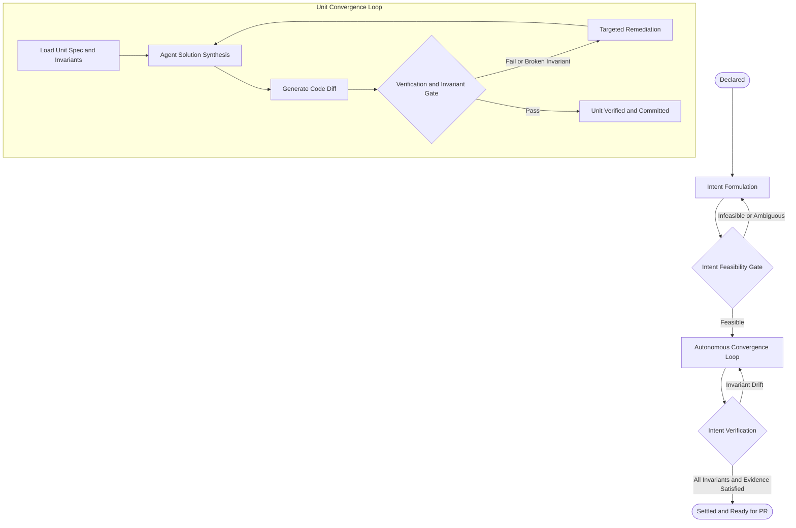
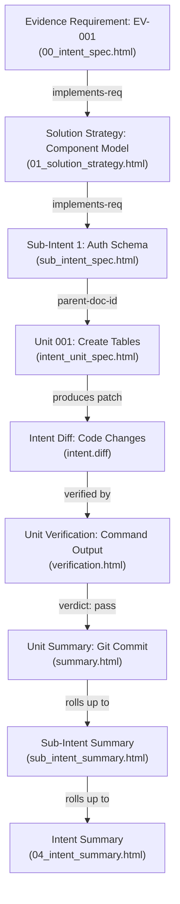

# Work Item Documents Architecture & Specification

> The authoritative master specification for the **Work Item Documents** domain within the **Token Optimized Software
> Harness (`tosh`)**. This document defines the intent-driven hierarchy, the convergence state machine, invariant
> enforcement, autonomy tiers, universal XHTML metadata standards, directory conventions, and targeted query patterns
> that govern feature development from declaration through pull request merge.

---

## Table of Contents

1. [Scope & Architectural Role](#scope--architectural-role)
2. [Intent-Driven Hierarchy](#intent-driven-hierarchy)
3. [Intent Convergence State Machine](#intent-convergence-state-machine)
4. [Invariants & Enforcement Levels](#invariants--enforcement-levels)
5. [Autonomy Tiers, Gates & Separation of Duties](#autonomy-tiers-gates--separation-of-duties)
6. [Document Catalog & Tier Breakdown](#document-catalog--tier-breakdown)
    1. [Tier 1: Intent Package Documents](#tier-1-intent-package-documents)
    2. [Tier 2: Sub-Intent Documents](#tier-2-sub-intent-documents)
    3. [Tier 3: Intent Unit Documents](#tier-3-intent-unit-documents)
    4. [Project-Level Documents](#project-level-documents)
7. [Directory & File Organization Standards](#directory--file-organization-standards)
8. [Intent Ledger (`03_intent_ledger.json`)](#intent-ledger-03_intent_ledgerjson)
9. [Unified XHTML Header Metadata Standard](#unified-xhtml-header-metadata-standard)
10. [Document-Specification Metadata Matrix](#document-specification-metadata-matrix)
11. [Token Optimization & XPath Query Patterns](#token-optimization--xpath-query-patterns)
12. [Stage Handoffs, Origin & Lessons Loop](#stage-handoffs-origin--lessons-loop)
13. [Traceability & Bi-Directional Lineage](#traceability--bi-directional-lineage)
14. [Rules & Constraints](#rules--constraints)
15. [Revisions](#revisions)

---

## Scope & Architectural Role

Work item documents represent the technical execution core of `tosh`. While project wikis and API references provide
global context, work item documents drive the direct, tactical delivery of every software feature, bug fix, and
architectural refactor.

A work item declares an **intent**. An intent states what the system must achieve, which boundaries the system must
keep (invariants), and which evidence proves that the intent is satisfied. The work item does not prescribe
step-by-step edits. The agent chooses how to reach the desired state, and `tosh` checks the result against the
declared invariants and evidence.

Each work item is self-contained within an isolated directory under `.tosh/work_items/`. The directory holds the intent
declaration, solution strategy, decomposition, sub-intent specifications, unit specifications, verification runs,
review findings, conversation transcripts, and token metrics.

### Dual-Purpose Consumption Model

Every work item document fulfills two simultaneous functions:

1. **Human Interface (Static UI):** Standalone XHTML documents render natively in standard web browsers using Material
   Design 3 Web Components (`@material/web` / **M3**). Developers read intents, monitor convergence, inspect diffs, and
   review verification results in a single-pane visualizer without client-side bundlers or runtime servers.
2. **Agent / Harness Interface (Machine Parseable):** Strict XHTML 1.0/5 compliance allows XML parsers (DOM, XPath,
   SAX) to extract granular sub-trees (for example invariants, target files, and verification commands) in
   microseconds. The harness delivers only these fragments to agentic LLMs.

---

## Intent-Driven Hierarchy

Work items decompose execution into a three-tier hierarchy:

```
┌──────────────────────────────────────────────────────────────────────────┐
│ TIER 1: INTENT PACKAGE                                                   │
│ Intent Spec (00) ──> Solution Strategy (01) ──> Intent Decomposition (02)│
│ Intent Ledger (03) <──> Intent Verification (03) ──> Intent Summary (04) │
│ Review Findings (07)                                                     │
└────────────────────────────────────┬─────────────────────────────────────┘
                                     │
                                     ▼
┌──────────────────────────────────────────────────────────────────────────┐
│ TIER 2: SUB-INTENTS                                                      │
│ Sub-Intent Spec (sub_intent_spec.html)                                   │
│ Sub-Intent Verification (sub_intent_verification.html)                   │
│ Sub-Intent Summary (sub_intent_summary.html)                             │
└────────────────────────────────────┬─────────────────────────────────────┘
                                     │
                                     ▼
┌──────────────────────────────────────────────────────────────────────────┐
│ TIER 3: INTENT UNITS                                                     │
│ Intent Unit Spec (intent_unit_spec.html) ──> Verification (verification) │
│ Intent Diff (intent.diff)                ──> Summary (summary.html)      │
│ Conversation and Metrics (telemetry)                                     │
└──────────────────────────────────────────────────────────────────────────┘
```

- **Tier 1 (Intent Package):** Declares the macro intent, the system invariants, and the evidence requirements. It also
  holds the solution strategy, the sub-intent DAG, the central ledger, the master verification harness, the final
  summary, the review findings, and the planning conversation telemetry.
- **Tier 2 (Sub-Intents):** Partitions the intent into verifiable milestones (for example an authentication schema or a
  token service). Each sub-intent defines prerequisites, invariant constraints, a manifest of intent units, and a
  verification gate.
- **Tier 3 (Intent Units):** The atomic unit of agent execution. Each unit declares a goal, a required target scope,
  invariants, reference anchors, and a verification contract. The agent produces a git diff that satisfies the unit.

---

## Intent Convergence State Machine

Every intent, sub-intent, and unit progresses through a deterministic lifecycle. `03_intent_ledger.json` and the
`convergence-status` metadata tag record the state.



### State Definitions

| State            | Applies To             | Meaning                                                                                                   |
|:-----------------|:-----------------------|:----------------------------------------------------------------------------------------------------------|
| `declared`       | Intent, sub-intent, unit | The intent is registered with raw objectives and desired outcomes.                                      |
| `formulating`    | Intent                 | The agent and the originator author the strategy, the invariants, and the sub-intent DAG.                 |
| `converging`     | Intent, sub-intent, unit | The agent synthesizes solutions, generates diffs, and tests them against invariants.                    |
| `verified`       | Intent, sub-intent, unit | The item passed all deterministic verification and invariant checks.                                    |
| `drift_detected` | Sub-intent, unit       | The output satisfies the tests but violates a declared invariant or boundary, or the diff leaves the target scope. The item returns to `converging` after targeted remediation. |
| `settled`        | Intent                 | The intent is fully realized, verified, and locked, ready for pull request merge.                         |

### Execution Gates & State Rules

1. **Feasibility Gate:** No sub-intent or unit may enter `converging` until `03_intent_verification.html` records a
   `validation-verdict` of `pass` for the feasibility check.
2. **Sub-Intent Dependency Guard:** Sub-intent N+1 is blocked until sub-intent N is `verified` and its
   `sub_intent_verification.html` records `pass`.
3. **Unit Dependency Guard:** An agent cannot begin a unit until every unit in its `dependsOn` array is `verified`.
4. **Failure Isolation:** If a unit fails verification, execution halts for that unit branch. The agent enters
   targeted remediation without discarding the artifacts of other verified units.
5. **Scope Drift Guard:** If `intent.diff` changes a file outside the unit Target Scope, the unit enters
   `drift_detected` until the unit spec or the diff changes.
6. **Parallel Safety:** Two units can converge in parallel only if their Target Scopes do not overlap and neither unit
   depends on the other. Units whose Target Scopes overlap run one after another.

---

## Invariants & Enforcement Levels

An invariant is a condition that must hold before, during, and after convergence. Each invariant is a record with an
identifier, a description, a shell command, and an enforcement level. The command exits with code `0` when the
invariant holds and with a non-zero code when the invariant is broken.

| Level        | Mechanism                                                                                        | Example                                              |
|:-------------|:-------------------------------------------------------------------------------------------------|:-----------------------------------------------------|
| `advisory`   | Text in the unit spec that the agent reads. No tool blocks a violation.                          | Follow the existing error-handling pattern.          |
| `build-gate` | A hook that runs fast, file-scoped checks during the build and can block an edit.                | Block edits to protected paths. Run the linter after each edit. |
| `ci-gate`    | A command in the Verification Contract that must exit with code `0` before the item is `verified`. | Run the invariant test suite.                      |
| `human-gate` | The ledger holds the state until a named approver signs.                                         | Changes to regulated or critical code.               |

- `build-gate` commands must stay fast and file-scoped. Heavy checks belong at the `ci-gate` level.
- A non-negotiable `build-gate` hook belongs in the managed settings of the platform owner, where an individual
  engineer cannot switch it off. A team hook belongs in the project settings file under version control.
- A hook that blocks an action must state the reason and the route to approval. The CLI and the MCP server pass this
  text to the agent.
- An `ask` hook pauses the action until a named person approves. It implements the `human-gate` level and does not run
  during the build stage.
- `tosh` ships Claude Code hook templates for `build-gate` invariants (protected paths, read-only test files during a
  fix, and a block message with the approval route). The MCP server exposes the gate state of each unit.
- Changes to the invariant set, hook templates, and verification commands are changes to the agent configuration. The
  eval suite described in [Lessons Loop](#lessons-loop) can gate these changes.

---

## Autonomy Tiers, Gates & Separation of Duties

### Autonomy Tiers

Each intent declares an `autonomy-tier` in `00_intent_spec.html` and in the ledger. The default tier is `propose`.

| Tier                 | What the agent does                                                                          |
|:---------------------|:---------------------------------------------------------------------------------------------|
| `observe`            | Reads code and logs. Writes only documents.                                                  |
| `propose`            | Writes a diff or a document. A human applies or merges the result.                           |
| `change-with-review` | Changes files on a branch. A human reviews the result before merge.                          |
| `scoped-automation`  | Runs a pre-approved runbook or action inside a declared scope. Hooks and CI enforce the scope. |

The agent can act up to the production gate and cannot pass it. A named human authorizes each production release. The
agent has no direct path to the main branch.

### Separation of Duties

- The agent identity that writes a unit must differ from the identity that approves it. The ledger records both
  identities.
- Each agent identity holds the least permissions that it needs. An incident agent, for example, can write documents
  and read logs but cannot deploy.
- A new automated reviewer starts in shadow mode. It posts findings for a human to approve. The ledger records a
  sampled audit of automated approvals.

### Confidence Gates

A gate sits between stages. A gate is one of two types:

- **Deterministic gate:** A command with an exit code.
- **Adversarial gate:** A reviewing agent with a fresh context that tries to find defects in the output.

If a gate fails, the ledger records the gate verdict and names a human approver. The output does not continue to the
next stage until the approver accepts it or the agent corrects it.

---

## Document Catalog & Tier Breakdown

The work item domain defines 20 document types: 17 per-intent documents across three tiers, one per-intent review
document, and two project-level documents.

### Tier 1: Intent Package Documents

| # | Document Name                | Target Filename                       | Format | Purpose & Canonical Specification                                                                                                                                                                                  |
|:--|:-----------------------------|:--------------------------------------|:-------|:-------------------------------------------------------------------------------------------------------------------------------------------------------------------------------------------------------------------|
| 1 | **Intent Specification**     | `00_intent_spec.html`                 | XHTML  | Declares the intent in the originator's words, the system invariants, the boundary envelope, the evidence requirements, the autonomy tier, and open questions. <br/>- Detailed Spec: [`intent-specification.md`](intent-specification.md) |
| 2 | **Solution Strategy**        | `01_solution_strategy.html`           | XHTML  | Defines the solution hypothesis, the invariant preservation strategy, contract and schema changes, agent tooling, flagged concerns, and micro-ADRs. <br/>- Detailed Spec: [`solution-strategy.md`](solution-strategy.md) |
| 3 | **Intent Decomposition**     | `02_intent_decomposition.html`        | XHTML  | Details the sub-intent DAG, dependency graph, parallelizable branches, and protected resource registry. <br/>- Detailed Spec: [`intent-decomposition.md`](intent-decomposition.md)                                  |
| 4 | **Intent Ledger**            | `03_intent_ledger.json`               | JSON   | Central convergence state machine, DAG scheduling data, gate verdicts, approver identities, and relational graph of files and artifacts. <br/>- Detailed Spec: [`intent-ledger.md`](intent-ledger.md)                |
| 5 | **Intent Verification**      | `03_intent_verification.html`         | XHTML  | Master verification harness: feasibility check, end-to-end tests, property tests, performance audits, and invariant monitors that certify the whole intent. <br/>- Detailed Spec: [`intent-verification.md`](intent-verification.md) |
| 6 | **Intent Summary**           | `04_intent_summary.html`              | XHTML  | Post-convergence synthesis of intent satisfaction, invariant compliance, diff statistics, and convergence duration. <br/>- Detailed Spec: [`intent-summary.md`](intent-summary.md)                                   |
| 7 | **Intent Conversation Summary** | `05_intent_conversation_summary.html` | XHTML | Distills the agent dialogue during formulation: ambiguities, invariant trade-offs, and strategy choices. <br/>- Detailed Spec: [`intent-conversation-summary.md`](intent-conversation-summary.md)                    |
| 8 | **Intent Conversation Metrics** | `06_intent_conversation_metrics.json` | JSON | Aggregated token consumption, latencies, tool invocations, and cost during formulation. <br/>- Detailed Spec: [`intent-conversation-metrics.md`](intent-conversation-metrics.md)                                    |
| 9 | **Review Findings**          | `07_review_findings.html`             | XHTML  | Findings from each review pass, with a pass name and a severity per finding, and a machine-readable severity count. <br/>- Detailed Spec: [`review-findings.md`](review-findings.md)                                 |

---

### Tier 2: Sub-Intent Documents

| #  | Document Name                | Target Filename                                          | Format | Purpose & Canonical Specification                                                                                                                                                      |
|:---|:-----------------------------|:---------------------------------------------------------|:-------|:---------------------------------------------------------------------------------------------------------------------------------------------------------------------------------------|
| 10 | **Sub-Intent Specification** | `sub_intents/{sub_intent_id}/sub_intent_spec.html`       | XHTML  | Scopes the milestone, prerequisites, invariant constraints, and unit manifest. <br/>- Detailed Spec: [`sub-intent-specification.md`](sub-intent-specification.md)                       |
| 11 | **Sub-Intent Verification**  | `sub_intents/{sub_intent_id}/sub_intent_verification.html` | XHTML | Multi-unit integration verification, cross-component invariant checks, and the milestone gate verdict. <br/>- Detailed Spec: [`sub-intent-verification.md`](sub-intent-verification.md) |
| 12 | **Sub-Intent Summary**       | `sub_intents/{sub_intent_id}/sub_intent_summary.html`    | XHTML  | Milestone convergence metrics, commit links, and diff roll-up. <br/>- Detailed Spec: [`sub-intent-summary.md`](sub-intent-summary.md)                                                  |

---

### Tier 3: Intent Unit Documents

| #  | Document Name                 | Target Filename                          | Format | Purpose & Canonical Specification                                                                                                                                                        |
|:---|:------------------------------|:-----------------------------------------|:-------|:-----------------------------------------------------------------------------------------------------------------------------------------------------------------------------------------|
| 13 | **Intent Unit Specification** | `units/{unit_id}/intent_unit_spec.html`  | XHTML  | Declares the unit goal, the required target scope, invariants, do-not-touch constraints, reference anchors, and the verification contract. <br/>- Detailed Spec: [`intent-unit-specification.md`](intent-unit-specification.md) |
| 14 | **Unit Verification**         | `units/{unit_id}/verification.html`      | XHTML  | Records the literal command output, exit codes, invariant audit results, the fresh-context verifier result, and the drift report. <br/>- Detailed Spec: [`unit-verification.md`](unit-verification.md) |
| 15 | **Intent Diff**               | `units/{unit_id}/intent.diff`            | Diff   | The authoritative unified git diff that realizes the unit. <br/>- Detailed Spec: [`intent-diff.md`](intent-diff.md)                                                                      |
| 16 | **Unit Summary**              | `units/{unit_id}/summary.html`           | XHTML  | Modified file manifest, diff statistics, commit reference, and technical notes. <br/>- Detailed Spec: [`unit-summary.md`](unit-summary.md)                                                |
| 17 | **Unit Conversation**         | `units/{unit_id}/conversation.jsonl`     | JSONL  | Verbatim or structured agent interaction, reasoning, and tool executions. <br/>- Detailed Spec: [`unit-conversation.md`](unit-conversation.md)                                           |
| 18 | **Unit Conversation Metrics** | `units/{unit_id}/metrics.json`           | JSON   | Exact token counts (prompt, completion, cached), duration, cost (USD), and tool calls. <br/>- Detailed Spec: [`unit-conversation-metrics.md`](unit-conversation-metrics.md)              |

---

### Project-Level Documents

These documents apply to every work item in the project. They sit at the root of `.tosh/work_items/`.

| #  | Document Name     | Target Filename      | Format | Purpose & Canonical Specification                                                                                                                                                                                  |
|:---|:------------------|:---------------------|:-------|:-------------------------------------------------------------------------------------------------------------------------------------------------------------------------------------------------------------------|
| 19 | **Review Policy** | `review_policy.html` | XHTML  | Defines the review passes (bugs, security, compliance with spec and decomposition), the meaning of Important and Nit, the nit cap, and the paths to skip. <br/>- Detailed Spec: [`review-policy.md`](review-policy.md) |
| 20 | **Lessons Log**   | `lessons.html`       | XHTML  | Records what happened, the root cause, the fix, and the gotcha for each failure. Agents read it at the start of an investigation. <br/>- Detailed Spec: [`lessons-log.md`](lessons-log.md)                          |

The metadata contract for all documents is in [`intent-document-metadata-definition.md`](intent-document-metadata-definition.md).

---

## Directory & File Organization Standards

Work items follow strict naming conventions under `.tosh/work_items/`:

```
<repo-root>/
└── .tosh/
    └── work_items/
        ├── review_policy.html                      # Project-Level Review Policy
        ├── lessons.html                            # Project-Level Lessons Log
        │
        └── {YYYYMMDDTHHMMSSZ}_{work_item_slug}/
            ├── 00_intent_spec.html                 # Declared Intent, Invariants & Evidence Requirements
            ├── 01_solution_strategy.html           # Solution Hypothesis & Invariant Preservation Strategy
            ├── 02_intent_decomposition.html        # Sub-Intent DAG & Protected Resource Registry
            ├── 03_intent_ledger.json               # Central State Machine, DAG & Unit Index
            ├── 03_intent_verification.html         # Feasibility Check & Master Verification Harness
            ├── 04_intent_summary.html              # Overall Work Item Convergence Summary
            ├── 05_intent_conversation_summary.html # Distilled LLM Formulation Dialogue
            ├── 06_intent_conversation_metrics.json # Formulation Telemetry & Token Metrics
            ├── 07_review_findings.html             # Review Findings by Pass and Severity
            │
            └── sub_intents/
                ├── sub_intent_01_{slug}/
                │   ├── sub_intent_spec.html        # Sub-Intent Scope & Unit Manifest
                │   ├── sub_intent_verification.html # Sub-Intent Verification & Gate Verdict
                │   ├── sub_intent_summary.html     # Sub-Intent Convergence Summary
                │   │
                │   └── units/
                │       ├── unit_001_{slug}/
                │       │   ├── intent_unit_spec.html   # Unit Goal, Target Scope & Verification Contract
                │       │   ├── verification.html       # Literal Command Output & Verdict
                │       │   ├── intent.diff             # Unit Diff File
                │       │   ├── summary.html            # Unit Changes & Commit Summary
                │       │   ├── conversation.jsonl      # Raw Agent Interaction & Tool Logs
                │       │   └── metrics.json            # Token Consumption & Cost Telemetry
                │       │
                │       └── unit_002_{slug}/
                │           ├── intent_unit_spec.html
                │           ├── verification.html
                │           ├── intent.diff
                │           ├── summary.html
                │           ├── conversation.jsonl
                │           └── metrics.json
                │
                └── sub_intent_02_{slug}/
                    ├── sub_intent_spec.html
                    ├── sub_intent_verification.html
                    ├── sub_intent_summary.html
                    └── units/
                        └── ...
```

### Naming Conventions

- **Work Item Directory:** `{UTC_TIMESTAMP}_{kebab-case-slug}` (for example `20260830T170936Z_user_auth_service`).
- **Sequential Root Prefixes:** `00_` through `07_` enforce ordered discovery in file explorers and CLI sorting.
- **Sub-Intent Directories:** `sub_intent_{NN}_{kebab-case-slug}` with two-digit zero padding (for example
  `sub_intent_01_auth_schema`).
- **Unit Directories:** `unit_{NNN}_{kebab-case-slug}` with three-digit zero padding (for example
  `unit_001_password_hashing`).

---

## Intent Ledger (`03_intent_ledger.json`)

The intent ledger is the operational heartbeat of the work item. It is the single source of truth for convergence
state, dependency graphs, file pointers, gate verdicts, approver identities, and rolled-up telemetry. Agents read the
ledger and do not traverse the filesystem.

```json
{
  "$schema": "https://json-schema.org/draft/2020-12/schema",
  "intentId": "20260830T170936Z_user_auth_service",
  "state": "converging",
  "autonomyTier": "propose",
  "originRef": null,
  "externalRef": null,
  "timestamps": {
    "declaredAt": "2026-08-30T17:09:36Z",
    "updatedAt": "2026-08-30T17:15:00Z",
    "settledAt": null
  },
  "metricsRollup": {
    "totalSubIntents": 2,
    "verifiedSubIntents": 0,
    "totalUnits": 4,
    "verifiedUnits": 1,
    "totalTokensUsed": 48210,
    "totalCostUsd": 0.1446
  },
  "subIntents": [
    {
      "subIntentId": "sub_intent_01_auth_schema",
      "index": 1,
      "title": "Authentication Schema",
      "state": "converging",
      "paths": {
        "spec": "sub_intents/sub_intent_01_auth_schema/sub_intent_spec.html",
        "verification": "sub_intents/sub_intent_01_auth_schema/sub_intent_verification.html",
        "summary": "sub_intents/sub_intent_01_auth_schema/sub_intent_summary.html"
      },
      "units": [
        {
          "unitId": "unit_001_create_tables",
          "index": 1,
          "title": "Create User & Token Tables",
          "category": "database",
          "state": "verified",
          "dependsOn": [],
          "targetScope": ["db/migrations/**", "src/model/user.*"],
          "validationVerdict": "pass",
          "identities": {
            "writer": "agent:unit-builder@v1.4",
            "approver": "human:release-owner"
          },
          "gate": {
            "type": "deterministic",
            "verdict": "pass",
            "approver": null
          },
          "paths": {
            "spec": "sub_intents/sub_intent_01_auth_schema/units/unit_001_create_tables/intent_unit_spec.html",
            "verification": "sub_intents/sub_intent_01_auth_schema/units/unit_001_create_tables/verification.html",
            "diff": "sub_intents/sub_intent_01_auth_schema/units/unit_001_create_tables/intent.diff",
            "summary": "sub_intents/sub_intent_01_auth_schema/units/unit_001_create_tables/summary.html",
            "conversation": "sub_intents/sub_intent_01_auth_schema/units/unit_001_create_tables/conversation.jsonl",
            "metrics": "sub_intents/sub_intent_01_auth_schema/units/unit_001_create_tables/metrics.json"
          },
          "metrics": {
            "durationMs": 26200,
            "tokens": 12400,
            "costUsd": 0.0372
          }
        },
        {
          "unitId": "unit_002_seed_data",
          "index": 2,
          "title": "Seed Initial RBAC Roles",
          "category": "database",
          "state": "converging",
          "dependsOn": ["unit_001_create_tables"],
          "targetScope": ["db/seeds/**"],
          "validationVerdict": "pending",
          "identities": {
            "writer": "agent:unit-builder@v1.4",
            "approver": null
          },
          "gate": {
            "type": "deterministic",
            "verdict": "pending",
            "approver": null
          },
          "paths": {
            "spec": "sub_intents/sub_intent_01_auth_schema/units/unit_002_seed_data/intent_unit_spec.html",
            "verification": "sub_intents/sub_intent_01_auth_schema/units/unit_002_seed_data/verification.html",
            "diff": "sub_intents/sub_intent_01_auth_schema/units/unit_002_seed_data/intent.diff",
            "summary": "sub_intents/sub_intent_01_auth_schema/units/unit_002_seed_data/summary.html",
            "conversation": "sub_intents/sub_intent_01_auth_schema/units/unit_002_seed_data/conversation.jsonl",
            "metrics": "sub_intents/sub_intent_01_auth_schema/units/unit_002_seed_data/metrics.json"
          },
          "metrics": {
            "durationMs": 0,
            "tokens": 0,
            "costUsd": 0.0
          }
        }
      ]
    }
  ]
}
```

- `writer` and `approver` must name different identities.
- `targetScope` is required for every unit. It lists file paths or globs.
- `originRef` links an intent that began from a finding or an alert. `externalRef` holds the ID of a record in a legacy
  tracking system.
- See the complete schema and operational rules in [`intent-ledger.md`](intent-ledger.md).

---

## Unified XHTML Header Metadata Standard

Standardizing `<head>` `<meta>` tags across all `.html` documents establishes direct entity relationships, parent-child
lineage, and instant indexing for crawlers, CLI commands, and XPath extractors.

```html
<!DOCTYPE html>
<html xmlns="http://www.w3.org/1999/xhtml" lang="en">
<head>
    <meta charset="UTF-8"/>
    <meta name="viewport" content="width=device-width, initial-scale=1.0"/>
    <title>Unit 001: Create Tables</title>

    <!-- 1. Universal Identity & Graph Lineage -->
    <meta name="doc-id" content="WI-20260830T170936Z:S01:U001:SPEC"/>
    <meta name="doc-type" content="intent-unit-spec"/>
    <meta name="schema-version" content="1.0.0"/>
    <meta name="domain" content="work-items"/>
    <meta name="intent-id" content="20260830T170936Z_user_auth_service"/>
    <meta name="sub-intent-id" content="sub_intent_01_auth_schema"/>
    <meta name="unit-id" content="unit_001_create_tables"/>
    <meta name="parent-doc-id" content="WI-20260830T170936Z:S01:SPEC"/>

    <!-- 2. Execution State & Timing -->
    <meta name="status" content="completed"/> <!-- pending | in-progress | completed | failed | blocked -->
    <meta name="convergence-status" content="verified"/> <!-- declared | formulating | converging | verified | drift_detected | settled -->
    <meta name="created-at" content="2026-08-30T17:10:00Z"/>
    <meta name="updated-at" content="2026-08-30T17:14:22Z"/>
    <meta name="execution-duration-ms" content="26200"/>

    <!-- 3. Intent, Invariants & Evidence -->
    <meta name="invariants-hash" content="sha256:9f86d081884c7d659a2feaa0c55ad015a3bf4f1b2b0b822cd15d6c15b0f00a08"/>
    <meta name="evidence-verdict" content="pass"/>
    <meta name="autonomy-tier" content="propose"/>
    <meta name="target-files" content="db/migrations/**,src/model/user.*"/>
    <meta name="protected-files" content="src/generated/**"/>

    <!-- 4. Traceability & Dependencies -->
    <meta name="depends-on" content=""/>
    <meta name="implements-req" content="EV-001,EV-002"/>
    <meta name="validates-artifact" content=""/>
    <meta name="origin-ref" content=""/>
    <meta name="external-ref" content=""/>

    <!-- 5. Agent Attribution, Approval & Model State -->
    <meta name="generated-by" content="agent:unit-builder@v1.4"/>
    <meta name="approved-by" content="human:release-owner"/>
    <meta name="model-version" content="claude-3-7-sonnet"/>
    <meta name="prompt-ref" content="sha256:2c26b46b68ffc68ff99b453c1d30413413422d706483bfa0f98a5e886266e7ae"/>
    <meta name="policy-versions" content="secure-api-review@1.2.0"/>
    <meta name="fingerprint-hash" content="sha256:e3b0c44298fc1c149afbf4c8996fb92427ae41e4649b934ca495991b7852b855"/>

    <!-- 6. Material Design 3 Web Component Loader -->
    <link href="https://fonts.googleapis.com/css2?family=Roboto:wght@400;500;700&amp;display=swap" rel="stylesheet"/>
    <link href="https://fonts.googleapis.com/css2?family=Material+Symbols+Outlined" rel="stylesheet"/>
    <script type="importmap">
        {
          "imports": {
            "@material/web/": "https://esm.run/@material/web/"
          }
        }
    </script>
    <script type="module">
        import '@material/web/all.js';
        import {styles as typescaleStyles} from '@material/web/typography/md-typescale-styles.js';

        document.adoptedStyleSheets.push(typescaleStyles.styleSheet);
    </script>
</head>
<body>
<main class="tosh-doc-container">
    <!-- Structured Document Body -->
</main>
</body>
</html>
```

- See the exhaustive tag definitions and attribute contracts in
  [`intent-document-metadata-definition.md`](intent-document-metadata-definition.md).

---

## Document-Specification Metadata Matrix

| Document Category           | Target Files                                                                              | Key Custom Metadata Attributes                                                                                                                   | XPath Lookup Utility                                      |
|:----------------------------|:------------------------------------------------------------------------------------------|:-------------------------------------------------------------------------------------------------------------------------------------------------|:----------------------------------------------------------|
| **Intent Core**             | `00_intent_spec.html`<br/>`01_solution_strategy.html`<br/>`02_intent_decomposition.html` | `intent-id`<br/>`invariants-hash`<br/>`autonomy-tier`<br/>`origin-ref`<br/>`external-ref`<br/>`estimated-sub-intents`                            | `/html/head/meta[@name='invariants-hash']/@content`       |
| **Sub-Intent Level**        | `sub_intent_spec.html`<br/>`sub_intent_verification.html`<br/>`sub_intent_summary.html`   | `sub-intent-sequence`<br/>`blocking`<br/>`validation-verdict (pass/fail)`<br/>`total-units`<br/>`verified-units`                                 | `/html/head/meta[@name='validation-verdict']/@content`    |
| **Unit Level**              | `intent_unit_spec.html`<br/>`verification.html`<br/>`summary.html`                        | `unit-sequence`<br/>`unit-category (db, api, ui, test)`<br/>`target-files`<br/>`protected-files`<br/>`test-exit-code`<br/>`evidence-verdict`<br/>`pr-link`<br/>`diff-ref` | `/html/head/meta[@name='convergence-status']/@content` |
| **Review**                  | `07_review_findings.html`<br/>`review_policy.html`                                        | `review-pass`<br/>`severity-important-count`<br/>`severity-nit-count`<br/>`approved-by`                                                          | `//meta[@name='severity-important-count']/@content`       |
| **Lessons**                 | `lessons.html`                                                                            | `lesson-outcome (invariant, check, note)`<br/>`source-intent-id`                                                                                 | `//section[@id='lessons']//md-list-item`                  |
| **Unit Code Patches**       | `intent.diff`                                                                             | Unified diff hunks, file headers, line deltas                                                                                                    | Direct patch analysis / `git apply --check`               |
| **LLM Metrics & Telemetry** | `metrics.json`<br/>`conversation.jsonl`                                                   | `total-tokens`<br/>`prompt-tokens`<br/>`completion-tokens`<br/>`total-cost-usd`<br/>`tool-call-count`<br/>`retry-attempts`                      | Direct JSON key / jq queries                              |

---

## Token Optimization & XPath Query Patterns

Instead of loading whole work item documents, agents use targeted XPath queries to extract exact sub-trees. A unit spec
declares goals, scope, invariants, and verification commands, so an agent reads a few hundred tokens and not a
procedural walkthrough.

### High-Value Extraction Examples

- **Extracting the Unit Goal:**
  ```xpath2
  //section[@id='unit-goal']//p
  ```

- **Extracting the Invariants of a Unit:**
  ```xpath2
  //section[@id='invariants']//md-list-item
  ```

- **Extracting the Verification Commands of a Unit:**
  ```xpath2
  //section[@id='verification-contract']//code
  ```

- **Retrieving Protected Files and Target Scope:**
  ```xpath2
  //meta[@name='protected-files']/@content
  //meta[@name='target-files']/@content
  ```

- **Discovering All Failing Units across the Work Item:**
  ```xpath2
  //meta[@name='doc-type' and @content='unit-verification']/ancestor::head/meta[@name='evidence-verdict' and @content='fail']/ancestor::html//section[@id='failure-analysis']
  ```

- **Querying Units Ready for Convergence from the Ledger:**
  ```json
  subIntents[*].units[?state=='declared' && length(dependsOn[?state!='verified']) == `0`]
  ```

- **Extracting Architecture Decisions (Micro-ADRs) from the Solution Strategy:**
  ```xpath2
  //section[@id='technical-decisions']//md-outlined-card
  ```

- **Extracting Flagged Concerns from the Solution Strategy:**
  ```xpath2
  //section[@id='flagged-concerns']//md-list-item
  ```

---

## Stage Handoffs, Origin & Lessons Loop

### Stage Handoffs

Each stage ends when a document is committed and accepted. The accepted document starts the next stage.

| Stage     | Artifact                                                              | Trigger for the next stage                                                       |
|:----------|:----------------------------------------------------------------------|:---------------------------------------------------------------------------------|
| Plan      | `00_intent_spec.html` in state `declared`                             | Acceptance moves the intent to `formulating` and starts the strategy pass.       |
| Design    | `01_solution_strategy.html`                                           | Acceptance starts the decomposition pass.                                        |
| Build     | `02_intent_decomposition.html`, `intent_unit_spec.html`, `intent.diff` | Acceptance of the decomposition moves the intent to `converging`.                |
| Test      | `verification.html`, `03_intent_verification.html`                    | A `pass` verdict moves the item to `verified`.                                   |
| Deploy    | `07_review_findings.html`, release authorization                      | A named human approves the release and moves the intent to `settled`.            |
| Maintain  | A finding or an alert                                                 | The finding becomes a new intent in state `declared` with an `origin-ref` value. |

- A ledger state change is the trigger. A non-interactive job can run the next stage when the trigger fires.
- A human accepts or rejects each artifact at a gate. The ledger records the approver and a timestamp.
- The solution strategy lists flagged concerns, one owner per concern. The originator resolves each concern with its
  owner before the intent moves to `converging`.
- `tosh` and the originating system can be separate. `tosh` accepts a finding as a new `declared` intent and does not
  run detection of production metrics.

### Intent Origin

An intent can start from a person, a ticket, or an alert. The originator states the intent in their own words first.
`00_intent_spec.html` holds these parts:

- Author and status.
- Problem.
- Proposed outcome.
- Affected users and systems.
- Constraints.
- Open questions.

The agent adds the system invariants, the boundary envelope, and the evidence requirements during `formulating`. The
solution strategy answers each open question or carries it forward. The MCP server lets a person without git
experience declare an intent.

### Source of Truth

The repository owns every `tosh` document. A document can carry an `external-ref` tag that holds the ID of a record in
a legacy tracking system. The legacy record holds the commit SHA of the `tosh` document.

### Review

- `review_policy.html` defines the passes and the meaning of Important and Nit.
- `07_review_findings.html` records each finding with a `review-pass` value and a severity. It also publishes the
  severity counts in `<head>` metadata, so a gate can read them.
- Findings do not approve or block a change alone. A named human approves the change.

### Lessons Loop

When a unit enters `drift_detected` or fails verification for a reason that no invariant or check covers, the agent
proposes one of three outputs:

1. A new invariant.
2. A new verification check.
3. A note for the project instructions.

A human accepts or rejects the proposal. An accepted proposal adds an entry to `lessons.html` and adds one case to the
eval suite. The eval suite runs on a schedule and on any change to the invariant set, hook templates, or verification
commands. A change that lowers the pass rate needs review before it merges.

---

## Traceability & Bi-Directional Lineage

Work item documents establish an unbroken line of custody from declared intent to git commits:



- **Downward Pointers:** The intent ledger (`03_intent_ledger.json`) stores relative file paths to every sub-intent and
  unit document.
- **Upward Pointers:** Every child document specifies `parent-doc-id` and `intent-id` in its `<head>` metadata,
  enabling immediate navigation back up the tree.
- **Lateral Pointers:** Units specify `implements-req` to bind directly to evidence requirement IDs, and `depends-on`
  to enforce sequencing.
- **Origin Pointers:** `origin-ref` binds an intent to the finding or alert that created it. `external-ref` binds a
  document to a record in a legacy tracking system.

---

## Rules & Constraints

1. **Current State Design:** All documents represent the active, current-state specification. They must not contain
   references to past iterations, rejected alternatives, or deprecated decisions. Historical deliberations are recorded
   in [`topics/`](../../../topics/README.md).
2. **Strict XHTML Conformance:** All `.html` files must parse as valid XML (`xmlns="http://www.w3.org/1999/xhtml"`).
   Self-closing tags (`<meta .../>`, `<input .../>`), escaped entities (`&amp;`), and quoted attributes are mandatory.
3. **Mandatory Universal Baseline:** Every XHTML document must contain the universal baseline metadata tags (`doc-id`,
   `doc-type`, `schema-version`, `domain`, `status`, `created-at`, `updated-at`).
4. **Zero Runtime Bundling:** Pages must render directly in modern browsers via standard ES module importmaps without
   requiring Webpack, Vite, or client-side build tools.
5. **Atomic Commit Synchronization:** State changes in `03_intent_ledger.json` must be committed atomically with code
   modifications to prevent drift.
6. **Declarative Specifications:** Intent unit specifications declare goals, scope, invariants, and verification
   commands. They must not contain step-by-step edit instructions.
7. **Required Target Scope:** Every intent unit specification must list a Target Scope. A unit without a Target Scope
   cannot enter `converging`.
8. **Executable Invariants:** Every invariant must have a shell command and an enforcement level.
9. **Measurable Evidence:** Every verification assertion must be a command with a pass or fail result. The
   `verification.html` document must store the literal command output as evidence. An agent summary is not evidence.
10. **Separation of Duties:** The identity that writes a unit and the identity that approves it must differ.
11. **Protected Verification:** An agent that fixes code must not edit the tests that verify that code during the same
    fix. A `build-gate` hook enforces this rule when the unit declares the constraint.
12. **Production Gate:** An agent must not release to production. A named human authorizes each production release.
13. **Revision Tracking:** Document revision history is tracked exclusively in the `## Revisions` table at the bottom
    of each document.

---

## Revisions

| Date       | Version | Description                                                                                                                                                                                                                                                                     | Source                           |
|:-----------|:--------|:--------------------------------------------------------------------------------------------------------------------------------------------------------------------------------------------------------------------------------------------------------------------------------|:---------------------------------|
| 2026-10-31 | 0.4.0   | Rebuilt the domain around declarative intent: intent-driven hierarchy, convergence state machine, invariant enforcement levels, autonomy tiers, confidence gates, review and lessons documents, intent ledger schema, metadata tags, and renamed document catalog (20 types). | TOPIC-005                        |
| 2026-09-06 | 0.3.0   | Integrated Task Diff (`task.diff` / `task-diff.md`) into Tier 3 catalog, ledger paths, metadata matrix, and traceability graph.                                                                                                                                                 | Work Item Architecture Alignment |
| 2026-09-05 | 0.2.0   | Established comprehensive architectural specification: 3-tier hierarchy, lifecycle state machine, full 16-document catalog, state ledger schema, XPath query patterns, and bi-directional traceability.                                                                          | Work Item Architecture Alignment |
| 2026-08-30 | 0.1.0   | Initial baseline outline of work item document types and metadata headers.                                                                                                                                                                                                      | Initial Specification            |
