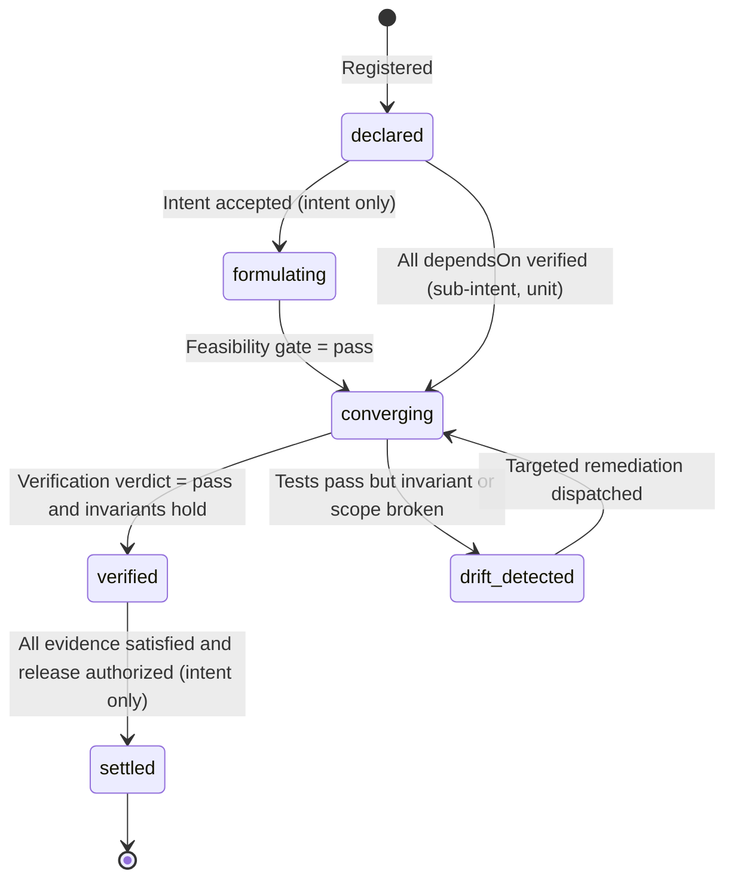
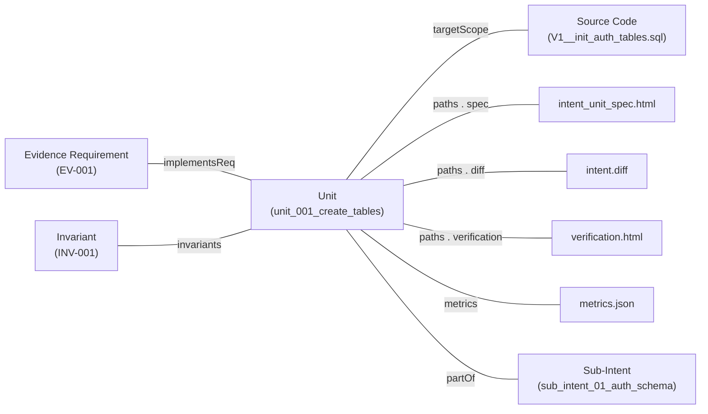
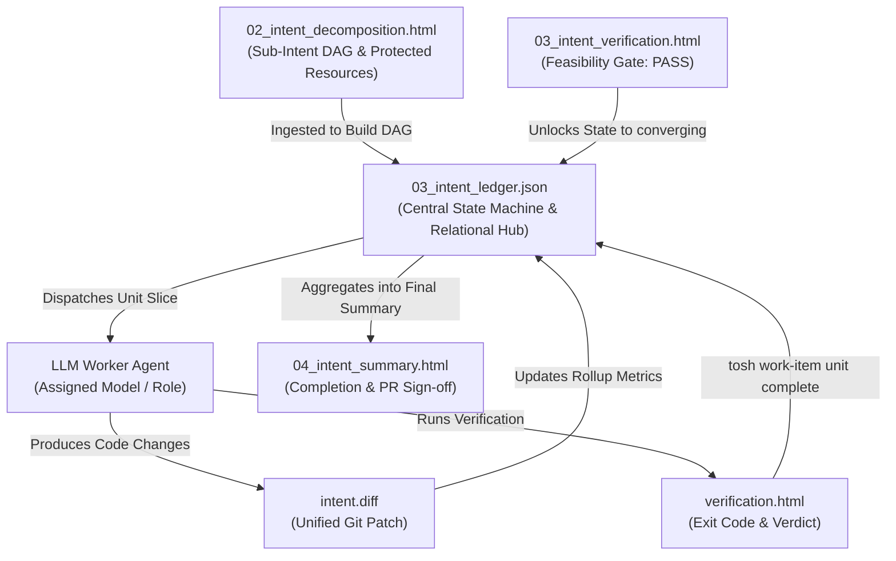

# Intent Ledger Document Definition

The **Intent Ledger** (`03_intent_ledger.json`) is the authoritative Tier 1 state machine, dependency Directed Acyclic
Graph (DAG), and relational backbone of the **Token Optimized Software Harness (`tosh`)** work item lifecycle. It unifies
all sub-intents, intent units, evidence bindings, target scopes, gate verdicts, approver identities, artifact pointers,
and token metrics into a single, queryable source of truth.

The ledger removes the need to crawl the filesystem, guess execution order, or parse unstructured markdown to find the
progress of an intent. Orchestrators, human engineers, CI/CD pipelines, and LLM worker agents all use it.

```
┌────────────────────────────────────────────────────────────────────────────────────────┐
│                                03_intent_ledger.json                                   │
│                                                                                        │
│   ┌─────────────────────┐    ┌─────────────────────┐    ┌──────────────────────────┐   │
│   │ Convergence State   │    │ Dependency DAG &    │    │ Full Relational Graph    │   │
│   │ Machine & Gates     │    │ Parallel Scheduling │    │ (Evidence, Scope, Files) │   │
│   └─────────────────────┘    └─────────────────────┘    └──────────────────────────┘   │
└───────────────────────────────────────────┬────────────────────────────────────────────┘
                                            │
               ┌────────────────────────────┴────────────────────────────┐
               ▼                                                         ▼
┌──────────────────────────────┐                         ┌───────────────────────────────┐
│  Harness / Orchestrator      │                         │  LLM Worker Agent Context     │
│  - Evaluates dependencies    │                         │  - Ingests focused unit slice │
│  - Enforces parallel safety  │                         │  - Knows explicit scope       │
│  - Records gates & approvers │                         │  - Receives exact inputs/deps │
└──────────────────────────────┘                         └───────────────────────────────┘
```

The ledger serves two operational roles:

1. **Orchestration & Ordering Engine:** Dictates the topological order of convergence, determines which units and
   sub-intents can run in parallel, blocks units that are not ready, records gate verdicts, and enforces execution gates.
2. **LLM Context & Unit Dispatch Backbone:** Provides worker LLMs with a small execution contract (the "unit slice")
   that holds the exact target scope, prerequisite outputs, invariants, and verification commands. The slice does not
   fill the agent context with the whole repository or historical logs.

---

## Core Paradigm: Applying the Four Dimensions to the Ledger

The ledger enforces four dimensions across the whole lifecycle:

| Dimension        | Human Engineer Focus                                                                  | AI Coding Tool Focus                                                                         | `tosh` Intent Ledger Manifestation                                                                                                                              |
|:-----------------|:--------------------------------------------------------------------------------------|:---------------------------------------------------------------------------------------------|:----------------------------------------------------------------------------------------------------------------------------------------------------------------|
| **Context**      | Relies on tacit codebase conventions and tribal memory.                               | Needs explicit file paths, referenced patterns, and strict "do not touch" constraints.       | Records each unit `targetScope`, the prerequisite artifact paths, and the protected boundaries, so that parallel workspaces stay disjoint.                       |
| **Granularity**  | Focuses on high-level patterns and architecture; details left to implementation time. | Requires bounded, single-responsibility goals with deterministic inputs and outputs.         | Indexes the hierarchy: Intent → Sub-Intents → Units, with exact ordinals and dependency arrays.                                                                 |
| **Verification** | Manual PR review, local exploratory debugging, automated CI.                          | Explicit terminal commands with deterministic output parsing (lint, test, build).            | Binds every unit and sub-intent to its verification artifact, exit code, and verdict (`pass`, `fail`, `warn`). A failed verdict stops state advancement.         |
| **Edge Cases**   | Usually caught through intuitive testing or code review cycles.                       | Must be itemized upfront to prevent naive happy-path assumptions.                            | Tracks retry budgets, holds, gate verdicts, and failure propagation across the DAG.                                                                             |

---

## Table of Contents

1. [File Location & Organization Standard](#1-file-location--organization-standard)
2. [Complete JSON Schema Definition](#2-complete-json-schema-definition)
3. [Canonical Intent Ledger Example](#3-canonical-intent-ledger-example)
4. [The Convergence State Machine](#4-the-convergence-state-machine)
    - 4.1. [State Definitions & Descriptions](#41-state-definitions--descriptions)
    - 4.2. [State Transition Matrix & Guards](#42-state-transition-matrix--guards)
    - 4.3. [Holds, Remediation & Escalation](#43-holds-remediation--escalation)
5. [Gates, Identities & Autonomy](#5-gates-identities--autonomy)
6. [Execution Ordering & DAG Scheduling Engine](#6-execution-ordering--dag-scheduling-engine)
    - 6.1. [Topological Dependency Resolution (`dependsOn`)](#61-topological-dependency-resolution-dependson)
    - 6.2. [Parallel vs. Sequential Execution Semantics (`executionMode`)](#62-parallel-vs-sequential-execution-semantics-executionmode)
    - 6.3. [Concurrency Safety & Disjoint Scope Invariant](#63-concurrency-safety--disjoint-scope-invariant)
    - 6.4. [Parallel Execution Waves Calculation](#64-parallel-execution-waves-calculation)
7. [Relational Data Graph & Traceability](#7-relational-data-graph--traceability)
    - 7.1. [Evidence Traceability (`implementsReq`)](#71-evidence-traceability-implementsreq)
    - 7.2. [Code Modification Boundaries (`targetScope`)](#72-code-modification-boundaries-targetscope)
    - 7.3. [Artifact Pointer Registry](#73-artifact-pointer-registry)
8. [LLM Consumption & Context Slicing Protocol](#8-llm-consumption--context-slicing-protocol)
    - 8.1. [Why LLMs Must Never Ingest Monolithic Ledgers](#81-why-llms-must-never-ingest-monolithic-ledgers)
    - 8.2. [The Canonical Unit Context Slice](#82-the-canonical-unit-context-slice)
    - 8.3. [Harness-Mediated CLI Mutation Protocol](#83-harness-mediated-cli-mutation-protocol)
9. [Concurrency Control & Atomic Mutation Protocols](#9-concurrency-control--atomic-mutation-protocols)
10. [CLI & Query Tooling Patterns](#10-cli--query-tooling-patterns)
11. [Lineage, Rollup & Lifecycle Integration](#11-lineage-rollup--lifecycle-integration)
12. [Rules & Constraints](#12-rules--constraints)
13. [Revisions](#13-revisions)

---

## 1. File Location & Organization Standard

The intent ledger resides at the root of the work item directory, acting as the relational anchor for all child
directories and artifacts:

```text
.tosh/
└── work_items/
    └── {YYYYMMDDTHHMMSSZ}_{work_item_slug}/
        ├── 00_intent_spec.html
        ├── 01_solution_strategy.html
        ├── 02_intent_decomposition.html
        ├── 03_intent_ledger.json               # Canonical Ledger & State Machine
        ├── 03_intent_verification.html
        ├── 04_intent_summary.html
        ├── 05_intent_conversation_summary.html
        ├── 06_intent_conversation_metrics.json
        ├── 07_review_findings.html
        └── sub_intents/
            ├── sub_intent_01_{slug}/
            │   ├── sub_intent_spec.html
            │   ├── sub_intent_verification.html
            │   ├── sub_intent_summary.html
            │   └── units/
            │       ├── unit_001_{slug}/
            │       │   ├── intent_unit_spec.html
            │       │   ├── verification.html
            │       │   ├── intent.diff
            │       │   ├── summary.html
            │       │   ├── conversation.jsonl
            │       │   └── metrics.json
            │       └── ...
            └── ...
```

- **File Name:** `03_intent_ledger.json`
- **Format:** Strict JSON (UTF-8 encoded, schema-validated against JSON Schema 2020-12).
- **Mutator Authority:** Strictly written and mutated by the `tosh` harness/CLI or authorized orchestrator scripts.
  Worker LLMs do not edit this file directly. They interact with it through CLI commands or receive context slices.
- **Relational Anchor:** Binds all Tier 1, Tier 2, and Tier 3 artifacts into a deterministic dependency tree.

---

## 2. Complete JSON Schema Definition

The ledger schema adheres to JSON Schema Draft 2020-12. Shared definitions appear once under `$defs` and the
sub-intent and unit objects reference them.

```json
{
  "$schema": "https://json-schema.org/draft/2020-12/schema",
  "$id": "https://tosh.dev/schemas/work-items/03_intent_ledger.json",
  "title": "ToshIntentLedger",
  "description": "Authoritative state machine, dependency DAG, gate record, and relational index for a tosh work item.",
  "type": "object",
  "required": [
    "$schema", "schemaVersion", "ledgerVersion", "intentId", "state", "autonomyTier",
    "executionMode", "timestamps", "metricsRollup", "subIntents"
  ],
  "properties": {
    "$schema": {"type": "string", "format": "uri"},
    "schemaVersion": {"type": "string", "pattern": "^[0-9]+\\.[0-9]+\\.[0-9]+$"},
    "ledgerVersion": {
      "type": "integer",
      "minimum": 1,
      "description": "Monotonically increasing sequence number for optimistic concurrency control."
    },
    "intentId": {"type": "string", "pattern": "^[0-9]{8}T[0-9]{6}Z_[a-z0-9_]+$"},
    "state": {"$ref": "#/$defs/intentState"},
    "autonomyTier": {"$ref": "#/$defs/autonomyTier"},
    "originRef": {"type": ["string", "null"], "description": "Finding or alert that created this intent."},
    "externalRef": {"type": ["string", "null"], "description": "ID of a record in a legacy tracking system."},
    "executionMode": {
      "type": "string",
      "enum": ["sequential", "parallel"],
      "description": "Defines whether sub-intents with satisfied dependencies can converge concurrently."
    },
    "invariantsHash": {"type": "string", "pattern": "^sha256:[0-9a-f]{64}$"},
    "timestamps": {
      "type": "object",
      "required": ["declaredAt", "updatedAt"],
      "properties": {
        "declaredAt": {"type": "string", "format": "date-time"},
        "convergingAt": {"type": ["string", "null"], "format": "date-time"},
        "updatedAt": {"type": "string", "format": "date-time"},
        "settledAt": {"type": ["string", "null"], "format": "date-time"}
      }
    },
    "metricsRollup": {
      "type": "object",
      "required": [
        "totalSubIntents", "verifiedSubIntents", "totalUnits", "verifiedUnits",
        "driftEvents", "totalTokensUsed", "totalCostUsd", "totalDurationMs"
      ],
      "properties": {
        "totalSubIntents": {"type": "integer", "minimum": 1},
        "verifiedSubIntents": {"type": "integer", "minimum": 0},
        "totalUnits": {"type": "integer", "minimum": 1},
        "verifiedUnits": {"type": "integer", "minimum": 0},
        "driftEvents": {"type": "integer", "minimum": 0},
        "totalTokensUsed": {"type": "integer", "minimum": 0},
        "totalCostUsd": {"type": "number", "minimum": 0.0},
        "totalDurationMs": {"type": "integer", "minimum": 0}
      }
    },
    "gates": {
      "type": "array",
      "description": "Stage gates for the whole intent (feasibility, strategy acceptance, release authorization).",
      "items": {"$ref": "#/$defs/gate"}
    },
    "subIntents": {
      "type": "array",
      "minItems": 1,
      "items": {
        "type": "object",
        "required": ["subIntentId", "index", "title", "state", "executionMode", "dependsOn", "paths", "units"],
        "properties": {
          "subIntentId": {"type": "string", "pattern": "^sub_intent_[0-9]{2}_[a-z0-9_]+$"},
          "index": {"type": "integer", "minimum": 1},
          "title": {"type": "string", "minLength": 1},
          "state": {"$ref": "#/$defs/itemState"},
          "executionMode": {"type": "string", "enum": ["sequential", "parallel"]},
          "dependsOn": {"type": "array", "items": {"type": "string"}},
          "hold": {"$ref": "#/$defs/hold"},
          "gate": {"$ref": "#/$defs/gate"},
          "paths": {
            "type": "object",
            "required": ["spec", "verification", "summary"],
            "properties": {
              "spec": {"type": "string"},
              "verification": {"type": "string"},
              "summary": {"type": "string"}
            }
          },
          "units": {
            "type": "array",
            "minItems": 1,
            "items": {
              "type": "object",
              "required": [
                "unitId", "index", "title", "category", "state", "dependsOn", "implementsReq",
                "targetScope", "validationVerdict", "identities", "paths"
              ],
              "properties": {
                "unitId": {"type": "string", "pattern": "^unit_[0-9]{3}_[a-z0-9_]+$"},
                "index": {"type": "integer", "minimum": 1},
                "title": {"type": "string", "minLength": 1},
                "category": {
                  "type": "string",
                  "enum": ["database", "backend", "frontend", "infrastructure", "test", "docs", "refactor"]
                },
                "state": {"$ref": "#/$defs/itemState"},
                "executionWave": {"type": "integer", "minimum": 1},
                "dependsOn": {"type": "array", "items": {"type": "string"}},
                "implementsReq": {
                  "type": "array",
                  "items": {"type": "string", "pattern": "^EV-[0-9]{3}$"},
                  "minItems": 1,
                  "description": "Evidence requirements satisfied by this unit."
                },
                "invariants": {
                  "type": "array",
                  "items": {"type": "string", "pattern": "^INV-[0-9]{3}$"},
                  "description": "Invariants that apply to this unit."
                },
                "targetScope": {
                  "type": "array",
                  "items": {"type": "string"},
                  "minItems": 1,
                  "description": "Required file paths or globs that this unit can create or modify."
                },
                "retries": {"type": "integer", "minimum": 0},
                "hold": {"$ref": "#/$defs/hold"},
                "gate": {"$ref": "#/$defs/gate"},
                "identities": {
                  "type": "object",
                  "required": ["writer", "approver"],
                  "properties": {
                    "writer": {"type": ["string", "null"], "description": "Identity of the agent that wrote the unit."},
                    "approver": {"type": ["string", "null"], "description": "Identity that approved the unit. Differs from writer."}
                  }
                },
                "assignedAgent": {
                  "type": "object",
                  "properties": {
                    "role": {"type": "string"},
                    "model": {"type": "string"},
                    "conversationId": {"type": "string"}
                  }
                },
                "validationVerdict": {"type": "string", "enum": ["pending", "pass", "fail", "warn"]},
                "paths": {
                  "type": "object",
                  "required": ["spec", "verification", "diff", "summary", "conversation", "metrics"],
                  "properties": {
                    "spec": {"type": "string"},
                    "verification": {"type": "string"},
                    "diff": {"type": "string"},
                    "summary": {"type": "string"},
                    "conversation": {"type": "string"},
                    "metrics": {"type": "string"}
                  }
                },
                "metrics": {
                  "type": "object",
                  "properties": {
                    "durationMs": {"type": "integer", "minimum": 0},
                    "tokens": {"type": "integer", "minimum": 0},
                    "costUsd": {"type": "number", "minimum": 0.0},
                    "exitCode": {"type": "integer"}
                  }
                }
              }
            }
          }
        }
      }
    }
  },
  "$defs": {
    "intentState": {
      "type": "string",
      "enum": ["declared", "formulating", "converging", "verified", "settled"]
    },
    "itemState": {
      "type": "string",
      "enum": ["declared", "converging", "verified", "drift_detected"]
    },
    "autonomyTier": {
      "type": "string",
      "enum": ["observe", "propose", "change-with-review", "scoped-automation"]
    },
    "hold": {
      "type": ["object", "null"],
      "description": "Present while an item cannot advance. Names the reason and the human approver.",
      "required": ["reason", "approver"],
      "properties": {
        "reason": {
          "type": "string",
          "enum": ["upstream_failed", "retry_budget_exceeded", "gate_failed", "manual"]
        },
        "approver": {"type": "string"},
        "since": {"type": "string", "format": "date-time"}
      }
    },
    "gate": {
      "type": "object",
      "required": ["type", "verdict"],
      "properties": {
        "name": {"type": "string"},
        "type": {"type": "string", "enum": ["deterministic", "adversarial", "human"]},
        "verdict": {"type": "string", "enum": ["pending", "pass", "fail"]},
        "approver": {"type": ["string", "null"]},
        "decidedAt": {"type": ["string", "null"], "format": "date-time"}
      }
    }
  }
}
```

---

## 3. Canonical Intent Ledger Example

Below is a complete example of `03_intent_ledger.json` for an intent with sequential and parallel sub-intents and
units:

```json
{
  "$schema": "https://json-schema.org/draft/2020-12/schema",
  "schemaVersion": "1.0.0",
  "ledgerVersion": 14,
  "intentId": "20260830T170936Z_user_auth_service",
  "state": "converging",
  "autonomyTier": "propose",
  "originRef": null,
  "externalRef": "JIRA-4821",
  "executionMode": "sequential",
  "invariantsHash": "sha256:9f86d081884c7d659a2feaa0c55ad015a3bf4f1b2b0b822cd15d6c15b0f00a08",
  "timestamps": {
    "declaredAt": "2026-08-30T17:40:00Z",
    "convergingAt": "2026-08-30T17:45:00Z",
    "updatedAt": "2026-08-30T18:02:15Z",
    "settledAt": null
  },
  "metricsRollup": {
    "totalSubIntents": 3,
    "verifiedSubIntents": 1,
    "totalUnits": 6,
    "verifiedUnits": 3,
    "driftEvents": 1,
    "totalTokensUsed": 48210,
    "totalCostUsd": 0.1446,
    "totalDurationMs": 103400
  },
  "gates": [
    {"name": "feasibility", "type": "deterministic", "verdict": "pass", "approver": null, "decidedAt": "2026-08-30T17:44:00Z"},
    {"name": "strategy-acceptance", "type": "human", "verdict": "pass", "approver": "human:j.ortiz", "decidedAt": "2026-08-30T17:43:00Z"}
  ],
  "subIntents": [
    {
      "subIntentId": "sub_intent_01_auth_schema",
      "index": 1,
      "title": "Authentication Schema",
      "state": "verified",
      "executionMode": "sequential",
      "dependsOn": [],
      "hold": null,
      "gate": {"name": "sub-intent-verification", "type": "deterministic", "verdict": "pass", "approver": null, "decidedAt": "2026-08-30T17:52:00Z"},
      "paths": {
        "spec": "sub_intents/sub_intent_01_auth_schema/sub_intent_spec.html",
        "verification": "sub_intents/sub_intent_01_auth_schema/sub_intent_verification.html",
        "summary": "sub_intents/sub_intent_01_auth_schema/sub_intent_summary.html"
      },
      "units": [
        {
          "unitId": "unit_001_create_tables",
          "index": 1,
          "title": "Create User & Token Tables",
          "category": "database",
          "state": "verified",
          "executionWave": 1,
          "dependsOn": [],
          "implementsReq": ["EV-001"],
          "invariants": ["INV-001"],
          "targetScope": ["src/main/resources/db/migration/V1__init_auth_tables.sql"],
          "retries": 0,
          "hold": null,
          "gate": {"name": "unit-verification", "type": "deterministic", "verdict": "pass", "approver": null, "decidedAt": "2026-08-30T17:47:00Z"},
          "identities": {"writer": "agent:database-specialist@v1.4", "approver": "human:j.ortiz"},
          "assignedAgent": {"role": "agent:database-specialist", "model": "flash", "conversationId": "subagent-c7f8a12e"},
          "validationVerdict": "pass",
          "paths": {
            "spec": "sub_intents/sub_intent_01_auth_schema/units/unit_001_create_tables/intent_unit_spec.html",
            "verification": "sub_intents/sub_intent_01_auth_schema/units/unit_001_create_tables/verification.html",
            "diff": "sub_intents/sub_intent_01_auth_schema/units/unit_001_create_tables/intent.diff",
            "summary": "sub_intents/sub_intent_01_auth_schema/units/unit_001_create_tables/summary.html",
            "conversation": "sub_intents/sub_intent_01_auth_schema/units/unit_001_create_tables/conversation.jsonl",
            "metrics": "sub_intents/sub_intent_01_auth_schema/units/unit_001_create_tables/metrics.json"
          },
          "metrics": {"durationMs": 26200, "tokens": 12400, "costUsd": 0.0372, "exitCode": 0}
        }
      ]
    },
    {
      "subIntentId": "sub_intent_02_backend_services",
      "index": 2,
      "title": "Core Authentication Services",
      "state": "converging",
      "executionMode": "parallel",
      "dependsOn": ["sub_intent_01_auth_schema"],
      "hold": null,
      "gate": {"name": "sub-intent-verification", "type": "deterministic", "verdict": "pending", "approver": null, "decidedAt": null},
      "paths": {
        "spec": "sub_intents/sub_intent_02_backend_services/sub_intent_spec.html",
        "verification": "sub_intents/sub_intent_02_backend_services/sub_intent_verification.html",
        "summary": "sub_intents/sub_intent_02_backend_services/sub_intent_summary.html"
      },
      "units": [
        {
          "unitId": "unit_003_password_hasher",
          "index": 1,
          "title": "Implement Argon2id Password Hasher",
          "category": "backend",
          "state": "verified",
          "executionWave": 1,
          "dependsOn": [],
          "implementsReq": ["EV-001"],
          "invariants": ["INV-001", "INV-002"],
          "targetScope": [
            "src/main/java/com/example/auth/security/Argon2PasswordHasher.java",
            "src/test/java/com/example/auth/security/Argon2PasswordHasherTest.java"
          ],
          "retries": 1,
          "hold": null,
          "gate": {"name": "unit-verification", "type": "deterministic", "verdict": "pass", "approver": null, "decidedAt": "2026-08-30T17:58:00Z"},
          "identities": {"writer": "agent:backend-worker@v1.4", "approver": "human:j.ortiz"},
          "assignedAgent": {"role": "agent:backend-worker", "model": "flash", "conversationId": "subagent-f1a94321"},
          "validationVerdict": "pass",
          "paths": {
            "spec": "sub_intents/sub_intent_02_backend_services/units/unit_003_password_hasher/intent_unit_spec.html",
            "verification": "sub_intents/sub_intent_02_backend_services/units/unit_003_password_hasher/verification.html",
            "diff": "sub_intents/sub_intent_02_backend_services/units/unit_003_password_hasher/intent.diff",
            "summary": "sub_intents/sub_intent_02_backend_services/units/unit_003_password_hasher/summary.html",
            "conversation": "sub_intents/sub_intent_02_backend_services/units/unit_003_password_hasher/conversation.jsonl",
            "metrics": "sub_intents/sub_intent_02_backend_services/units/unit_003_password_hasher/metrics.json"
          },
          "metrics": {"durationMs": 22100, "tokens": 11200, "costUsd": 0.0336, "exitCode": 0}
        },
        {
          "unitId": "unit_004_jwt_token_service",
          "index": 2,
          "title": "Implement JWT Token Provider",
          "category": "backend",
          "state": "drift_detected",
          "executionWave": 1,
          "dependsOn": [],
          "implementsReq": ["EV-002"],
          "invariants": ["INV-002"],
          "targetScope": [
            "src/main/java/com/example/auth/security/JwtTokenProvider.java",
            "src/test/java/com/example/auth/security/JwtTokenProviderTest.java"
          ],
          "retries": 0,
          "hold": null,
          "gate": {"name": "unit-verification", "type": "deterministic", "verdict": "fail", "approver": null, "decidedAt": "2026-08-30T18:01:00Z"},
          "identities": {"writer": "agent:backend-worker@v1.4", "approver": null},
          "assignedAgent": {"role": "agent:backend-worker", "model": "flash", "conversationId": "subagent-b2c89012"},
          "validationVerdict": "fail",
          "paths": {
            "spec": "sub_intents/sub_intent_02_backend_services/units/unit_004_jwt_token_service/intent_unit_spec.html",
            "verification": "sub_intents/sub_intent_02_backend_services/units/unit_004_jwt_token_service/verification.html",
            "diff": "sub_intents/sub_intent_02_backend_services/units/unit_004_jwt_token_service/intent.diff",
            "summary": "sub_intents/sub_intent_02_backend_services/units/unit_004_jwt_token_service/summary.html",
            "conversation": "sub_intents/sub_intent_02_backend_services/units/unit_004_jwt_token_service/conversation.jsonl",
            "metrics": "sub_intents/sub_intent_02_backend_services/units/unit_004_jwt_token_service/metrics.json"
          }
        }
      ]
    }
  ]
}
```

---

## 4. The Convergence State Machine

Every intent, sub-intent, and unit transitions through a deterministic, enforced state machine.

### 4.1. State Definitions & Descriptions



| State            | Scope                     | Description                                                                | Trigger Condition                                                                                          |
|:-----------------|:--------------------------|:---------------------------------------------------------------------------|:-----------------------------------------------------------------------------------------------------------|
| `declared`       | Intent, sub-intent, unit  | Registered in the ledger. A sub-intent or unit that is `declared` with all `dependsOn` items `verified` is ready for dispatch. | Initial state on creation.                                                    |
| `formulating`    | Intent                    | The strategy, invariants, and DAG are being authored.                      | A human accepts `00_intent_spec.html`.                                                                      |
| `converging`     | Intent, sub-intent, unit  | An agent is synthesizing a solution and testing it against invariants.     | The feasibility gate passes (intent) or a worker claims the item (`tosh work-item unit start`).            |
| `verified`       | Intent, sub-intent, unit  | The item passed all deterministic verification and invariant checks.       | The verification suite exits with code `0`, the verdict is `pass`, and every invariant command exits `0`.  |
| `drift_detected` | Sub-intent, unit          | The output satisfies tests but violates an invariant, or the diff leaves the `targetScope`. | An invariant command exits non-zero, or `intent.diff` contains a path outside `targetScope`. |
| `settled`        | Intent                    | The intent is fully realized and locked, ready for pull request merge.     | Every evidence requirement has a `pass` verdict and a named human authorizes the release.                  |

### 4.2. State Transition Matrix & Guards

| From State       | Allowed Target States            | Enforced Guards                                                                                                                                  |
|:-----------------|:---------------------------------|:-------------------------------------------------------------------------------------------------------------------------------------------------|
| `declared`       | `formulating` (intent), `converging` | An intent moves to `converging` only after the feasibility gate passes. A sub-intent or unit moves to `converging` only if every ID in `dependsOn` is `verified` and no `hold` is present. |
| `formulating`    | `converging`                     | Requires `03_intent_verification.html` feasibility verdict `pass` and zero `open` flagged concerns.                                              |
| `converging`     | `verified`, `drift_detected`     | File changes must belong to `targetScope`. `verified` requires verdict `pass`, exit code `0`, and a literal command output in `verification.html`. |
| `drift_detected` | `converging`                     | Entering `converging` increments `retries` and dispatches a targeted remediation payload.                                                        |
| `verified`       | `settled` (intent only)          | Verified items are immutable. Re-opening a verified item needs an explicit ledger revision event.                                                |
| `settled`        | *(terminal)*                     | A settled intent is locked.                                                                                                                      |

A failed verification command that does not break an invariant keeps the unit in `converging`. The unit records the
failure in `verification.html`, increments `retries`, and continues the convergence loop.

### 4.3. Holds, Remediation & Escalation

An item that cannot advance carries a `hold` object with a reason and a named human approver. A hold does not add a
state. The reasons are:

- `upstream_failed`: A unit in `dependsOn` is in `drift_detected` or on hold.
- `retry_budget_exceeded`: The unit used its retry budget (default: 3 retries).
- `gate_failed`: A gate recorded a `fail` verdict.
- `manual`: A human set an administrative hold.

When a unit enters `drift_detected`:

1. The harness packages the failure details (exit code, failing assertions, and the output of the failed invariant
   command) into a remediation payload.
2. The harness places a hold with reason `upstream_failed` on every unit that depends on this unit.
3. The harness returns the unit to `converging` and increments `retries`.
4. If `retries` exceeds the retry budget, the harness places a hold with reason `retry_budget_exceeded` on the unit and
   its parent sub-intent, and escalates to the named approver.

The lessons loop starts here. When a failure has no matching invariant or check, the agent proposes a new invariant, a
new verification check, or a note for the project instructions. A human accepts or rejects the proposal.

---

## 5. Gates, Identities & Autonomy

- **Gates:** Each gate record has a `type` (`deterministic`, `adversarial`, or `human`), a `verdict`, an `approver`, and a
  `decidedAt` timestamp. A `fail` verdict places a hold and names a human approver.
- **Identities:** `identities.writer` and `identities.approver` must differ. The harness rejects a transition to
  `verified` if the two values are equal.
- **Autonomy tier:** `autonomyTier` bounds what the agent can do. The harness reads it before it dispatches a worker.
  `observe` allows document writes only. `propose` produces a diff or document that a human applies. `change-with-review`
  changes files on a branch for human review. `scoped-automation` runs pre-approved actions within a declared scope.
- **Production gate:** The ledger never records a production release without a named human approver on the
  `release-authorization` gate.

---

## 6. Execution Ordering & DAG Scheduling Engine

The ledger is an active DAG that dictates the exact convergence order for LLM agents.

### 6.1. Topological Dependency Resolution (`dependsOn`)

- **Sub-intent `dependsOn`:** A sub-intent cannot start until every prerequisite sub-intent is `verified`.
- **Unit `dependsOn`:** A unit cannot start until every prerequisite unit is `verified`.
- **DAG Invariant:** The graph formed by `dependsOn` links must be acyclic. The harness runs cycle detection (Kahn's
  topological sort) during the feasibility check. A detected cycle fails the feasibility gate.

### 6.2. Parallel vs. Sequential Execution Semantics (`executionMode`)

```
Intent (executionMode: "sequential")
│
├── Sub-Intent 1 (Auth Schema) [executionMode: "sequential"]
│   └── Unit 001 (Create Tables)  ──────► verified
│
└── Sub-Intent 2 (Backend Services) [executionMode: "parallel"]
    ├── Unit 003 (Password Hasher) ──┐
    │                                ├──► CONVERGING CONCURRENTLY (Wave 1)
    ├── Unit 004 (JWT Provider)    ──┘
    │
    └── Unit 005 (Auth Facade)    ──────► WAITING (Wave 2, dependsOn: [Unit 003, Unit 004])
```

- **`executionMode: "sequential"`:** Items converge one at a time in strict index order.
- **`executionMode: "parallel"`:** All items with an empty `dependsOn` array, or whose dependencies are all `verified`,
  can be dispatched at the same time. Each parallel item converges in its own git worktree.

### 6.3. Concurrency Safety & Disjoint Scope Invariant

Parallel worker agents must never overwrite each other's changes. The ledger enforces the **Disjoint Scope Invariant**:

$$\forall U_i, U_j \in \text{Dispatched Units} \text{ where } U_i \ne U_j: \quad \text{targetScope} (U_i) \cap \text{targetScope} (U_j) = \emptyset$$

- If two units declare overlapping `targetScope` entries, the harness does not run them in parallel.
- The harness adds a synthetic dependency ($U_j \text{ dependsOn } U_i$) or schedules the units into separate waves.

### 6.4. Parallel Execution Waves Calculation

The harness partitions units within a sub-intent into **Execution Waves** by dependency depth:

- **Wave 1:** All units where `dependsOn` is empty.
- **Wave 2:** All units whose dependencies point only to Wave 1 units.
- **Wave $N$:** Units that depend on Wave $N-1$ units.

The `executionWave` integer shows the parallel tier to engineers and LLMs. The number of parallel sessions is limited by
the number of streams that one person can review properly.

---

## 7. Relational Data Graph & Traceability



### 7.1. Evidence Traceability (`implementsReq`)

Every unit lists the evidence requirement IDs from [`00_intent_spec.html`](intent-specification.md) that it satisfies:

- Enables instant calculation of evidence completion percentages.
- Shows which units must run again if an evidence requirement changes.
- Ensures that every evidence requirement has at least one implementing unit.

### 7.2. Code Modification Boundaries (`targetScope`)

Every unit lists the file paths and globs that it can create or modify. `targetScope` is required.

- **Sandbox Boundary:** The worker receives the array as an invariant boundary.
- **Diff Verification:** When `intent.diff` is generated, the harness makes sure that only files that match
  `targetScope` appear in the diff. A file outside the scope moves the unit to `drift_detected`.

### 7.3. Artifact Pointer Registry

Every sub-intent and unit holds deterministic relative paths to its artifacts:

- `spec`: The specification (`intent_unit_spec.html` or `sub_intent_spec.html`).
- `verification`: Command execution logs and assertions (`verification.html` or `sub_intent_verification.html`).
- `diff`: Authoritative unified diff patch (`intent.diff`).
- `summary`: Human-readable delivery summary (`summary.html`).
- `conversation`: Verbatim LLM conversation transcript (`conversation.jsonl`).
- `metrics`: Token counts, latencies, and API cost accounting (`metrics.json`).

---

## 8. LLM Consumption & Context Slicing Protocol

### 8.1. Why LLMs Must Never Ingest Monolithic Ledgers

In large work items, `03_intent_ledger.json` can span hundreds of units, thousands of file paths, and extensive metrics,
for a total of 20,000+ tokens. A monolithic ledger in a worker context causes these problems:

1. **Context Window Exhaustion:** It wastes input tokens on irrelevant verified or future units.
2. **Attention Drift:** The agent can lose focus on its assignment and edit files that belong to other units.
3. **Prefix Cache Invalidation:** Metrics and timestamps at the ledger root change often and invalidate the prompt
   cache prefix.

### 8.2. The Canonical Unit Context Slice

The harness extracts a compact **Unit Context Slice** and injects only this slice into the worker LLM:

```json
{
  "intentId": "20260830T170936Z_user_auth_service",
  "autonomyTier": "propose",
  "subIntent": {
    "subIntentId": "sub_intent_02_backend_services",
    "title": "Core Authentication Services",
    "executionMode": "parallel"
  },
  "activeUnit": {
    "unitId": "unit_003_password_hasher",
    "index": 1,
    "title": "Implement Argon2id Password Hasher",
    "category": "backend",
    "implementsReq": ["EV-001"],
    "invariants": ["INV-001", "INV-002"],
    "targetScope": [
      "src/main/java/com/example/auth/security/Argon2PasswordHasher.java",
      "src/test/java/com/example/auth/security/Argon2PasswordHasherTest.java"
    ],
    "paths": {
      "spec": "sub_intents/sub_intent_02_backend_services/units/unit_003_password_hasher/intent_unit_spec.html",
      "verification": "sub_intents/sub_intent_02_backend_services/units/unit_003_password_hasher/verification.html"
    }
  },
  "prerequisiteDeliverables": [
    {
      "unitId": "unit_001_create_tables",
      "summary": "Created user and refresh token database tables in V1__init_auth_tables.sql",
      "diff": "sub_intents/sub_intent_01_auth_schema/units/unit_001_create_tables/intent.diff"
    }
  ]
}
```

- **Token Footprint:** Typically under 400 tokens (compared with 20,000+ for the full ledger).
- **Zero Ambiguity:** The worker knows the file boundaries that it owns, the invariants that apply, the evidence it must
  satisfy, and where to inspect prerequisite deliverables.

### 8.3. Harness-Mediated CLI Mutation Protocol

Worker LLMs must never edit `03_intent_ledger.json` directly. All state transitions and telemetry go through atomic
`tosh work-item` CLI commands:

```bash
# Agent signals the start of convergence
tosh work-item unit start --unit-id unit_003_password_hasher

# Agent signals verification
tosh work-item unit verify --unit-id unit_003_password_hasher

# Agent records the result, the diff, and the metrics
tosh work-item unit complete --unit-id unit_003_password_hasher \
  --verdict pass \
  --exit-code 0 \
  --tokens 11200 \
  --duration-ms 22100
```

---

## 9. Concurrency Control & Atomic Mutation Protocols

When multiple worker agents converge in parallel, concurrent updates to `03_intent_ledger.json` can cause race
conditions and lost updates. The ledger uses two defensive mechanisms:

1. **File-Level Advisory Locking:** The `tosh` CLI acquires an exclusive filesystem lock
   (`.tosh/work_items/{id}/.ledger.lock`) before it reads and mutates the ledger, and releases the lock after it flushes
   the changes to disk.
2. **Optimistic Concurrency Control (`ledgerVersion`):**
    - The ledger carries an integer `ledgerVersion` that increments by `1` on every write.
    - Any process that mutates the ledger must verify that `read_version + 1 == new_version`. If a mismatch occurs, the
      mutation retries with exponential backoff.

---

## 10. CLI & Query Tooling Patterns

Human operators, orchestrator agents, and CI pipelines query the ledger with standard CLI tools and `jq`:

### Querying the Units That Are Ready for Dispatch

```bash
jq -r '[.subIntents[].units[]] as $all | $all[] | select(.state == "declared" and .hold == null and ([.dependsOn[] as $d | ($all[] | select(.unitId == $d) | .state)] | all(. == "verified"))) | .unitId' 03_intent_ledger.json
```

### Checking Overall Progress Percentage

```bash
jq -r '(.metricsRollup.verifiedUnits / .metricsRollup.totalUnits) * 100 | tostring + "%"' 03_intent_ledger.json
```

### Listing Units in Drift

```bash
jq -r '.subIntents[].units[] | select(.state == "drift_detected") | .unitId' 03_intent_ledger.json
```

### Retrieving Target Scopes for Parallel Collision Detection

```bash
jq -r '.subIntents[].units[] | select(.state == "declared" or .state == "converging") | {unitId: .unitId, scope: .targetScope}' 03_intent_ledger.json
```

### Finding Units Whose Writer and Approver Are the Same

```bash
jq -r '.subIntents[].units[] | select(.identities.approver != null and .identities.writer == .identities.approver) | .unitId' 03_intent_ledger.json
```

### Extracting a Unit Slice via the Tosh CLI

```bash
tosh work-item ledger slice --unit-id unit_003_password_hasher --format json
```

### Auditing Total Financial Expenditure

```bash
jq -r '.metricsRollup.totalCostUsd' 03_intent_ledger.json
```

---

## 11. Lineage, Rollup & Lifecycle Integration

The ledger sits at the center of the `tosh` document ecosystem, linking the decomposition to real-time convergence and
final delivery:



- **Feasibility Gate:** The root `state` stays `formulating` and all sub-intents stay `declared` until
  [`03_intent_verification.html`](intent-verification.md) records the feasibility verdict `pass`.
- **Sub-Intent Gate:** Sub-intent N+1 cannot start until the
  [`sub_intent_verification.html`](sub-intent-verification.md) of sub-intent N records `pass`.
- **Summary Generation:** When all units and sub-intents reach `verified`, the ledger metrics, unit lists, and file
  registries compile into [`04_intent_summary.html`](intent-summary.md).

---

## 12. Rules & Constraints

1. **Strict Monotonic Progress:** A `verified` item cannot move to an earlier state unless a rollback event is recorded
   in the revisions log.
2. **Immutable Dependency Invariant:** Entries in `dependsOn` cannot change while the intent is `converging`.
3. **Disjoint Scope for Parallelism:** Units that converge in parallel must have disjoint `targetScope` arrays.
4. **Required Target Scope:** A unit without `targetScope` cannot leave `declared`.
5. **Separation of Duties:** `identities.writer` and `identities.approver` must differ.
6. **Harness Mutator Exclusivity:** Worker LLMs must never edit `03_intent_ledger.json` with file-writing tools. All
   changes go through the `tosh` CLI or orchestrator APIs.
7. **JSON Schema Conformance:** Every write must validate against the JSON Schema Draft 2020-12 definition. The harness
   rejects any malformed write.
8. **Named Approver on Holds:** Every `hold` and every failed gate must name a human approver.
9. **No Historical Deliberation:** The ledger contains only facts, states, paths, metrics, and relationships. Narrative
   discussion belongs in [`05_intent_conversation_summary.html`](intent-conversation-summary.md).

---

## 13. Revisions

| Date       | Version | Description                                                                                                                                                                                                                                                              | Source    |
|:-----------|:--------|:-------------------------------------------------------------------------------------------------------------------------------------------------------------------------------------------------------------------------------------------------------------------------|:----------|
| 2026-10-31 | 1.1.0   | Replaced the implementation ledger with the intent ledger: convergence state machine, holds, gates, writer and approver identities, autonomy tier, required `targetScope`, `originRef` and `externalRef`, sub-intent and unit hierarchy, and `tosh work-item` CLI commands. | TOPIC-005 |
| 2026-09-06 | 1.0.0   | Authoritative specification for the Work Item Ledger (`03_implementation_ledger.json`) establishing the 7-state lifecycle, parallel/sequential execution modes, execution waves, DAG resolution, context slicing protocol, concurrency controls, and full relational graph schema. | Feature Specification |
| 2026-08-30 | 0.1.0   | Initial baseline JSON schema stub. | Initial Specification |
