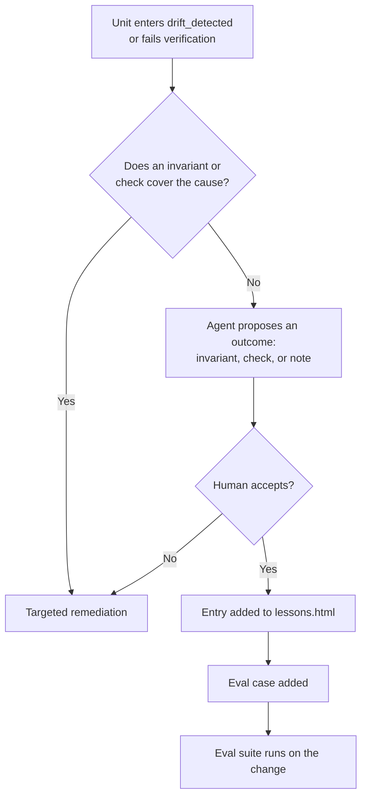

# Lessons Log Document Definition

The Lessons Log Document (`lessons.html`) is the project-level record of failures and what the project learned from them.
Each entry states what happened, the root cause, the fix, and the gotcha. Agents read the log at the start of an
investigation, so the same failure does not repeat.

The log is the output of the lessons loop. When a unit enters `drift_detected` or fails verification for a reason that no
invariant or check covers, the agent proposes one of three outcomes: a new invariant, a new verification check, or a note
for the project instructions. A human accepts or rejects the proposal. An accepted proposal adds an entry to this log and
adds one case to the eval suite.

This document serves a dual purpose:

1. **Human Interface:** Renders as a local, static XHTML web page utilizing Material Design 3 Web Components
   (`@material/web` / **M3**) without client-side bundlers or build steps.
2. **Agent / Harness Interface:** Serves as a deterministic, structured XML document queryable via XPath and the `tosh`
   CLI. An agent reads only the entries that match its task.

---

## Table of Contents

1. [File Location & Organization Standard](#1-file-location--organization-standard)
2. [XHTML Header & Metadata Standard](#2-xhtml-header--metadata-standard)
3. [Required Sections & M3 Component Structure](#3-required-sections--m3-component-structure)
    - 3.1. [Document Header & Metadata Bar](#31-document-header--metadata-bar)
    - 3.2. [Lesson Entries](#32-lesson-entries)
    - 3.3. [Lesson Outcomes](#33-lesson-outcomes)
    - 3.4. [Eval Cases](#34-eval-cases)
4. [Lessons Loop](#4-lessons-loop)
5. [Token Optimization & XPath Query Patterns](#5-token-optimization--xpath-query-patterns)
6. [Rules & Constraints](#6-rules--constraints)
7. [Revisions](#7-revisions)

---

## 1. File Location & Organization Standard

The lessons log resides at the root of `.tosh/work_items/`, beside the work item directories:

```text
.tosh/
└── work_items/
    ├── review_policy.html
    ├── lessons.html
    └── {work-item-id}/
```

- **File Name:** `lessons.html`
- **Format:** Strict XHTML (`application/xhtml+xml` compliant, standard XML syntax).
- **Encoding:** UTF-8.
- **Owner:** The project. A named human accepts each entry.
- **Runtime:** Fully static, runnable directly in any modern browser via local filesystem (`file://`) or served locally
  via the `tosh` CLI.

---

## 2. XHTML Header & Metadata Standard

Every `lessons.html` begins with the universal baseline `<meta>` tags, lesson tags, and the Material Web ES module
importmap loader:

```xhtml

<head>
    <meta charset="UTF-8"/>
    <meta name="viewport" content="width=device-width, initial-scale=1.0"/>
    <title>LESSONS LOG</title>

    <!-- Universal Baseline Metadata -->
    <meta name="doc-id" content="WI-PROJECT:LESSONS"/>
    <meta name="doc-type" content="lessons-log"/>
    <meta name="schema-version" content="1.0.0"/>
    <meta name="domain" content="work-items"/>
    <meta name="status" content="completed"/> <!-- pending | in-progress | completed | failed | blocked -->
    <meta name="created-at" content="2026-10-31T09:00:00Z"/>
    <meta name="updated-at" content="2026-10-31T09:00:00Z"/>

    <!-- Lessons Domain Metadata -->
    <meta name="lesson-count" content="1"/>
    <meta name="lesson-outcomes" content="invariant,check,note"/>
    <meta name="approved-by" content="human:tech-lead"/>

    <!-- M3 / Material Web Assets -->
    <link href="https://fonts.googleapis.com/css2?family=Roboto:wght@400;500;700&amp;display=swap" rel="stylesheet"/>
    <link href="https://fonts.googleapis.com/css2?family=Material+Symbols+Outlined" rel="stylesheet"/>
    <script type="importmap">
        {
          "imports": {
            "@material/web/": "https://esm.run/@material/web/"
          }
        }
    </script>
    <script type="module">
        import '@material/web/all.js';
        import {styles as typescaleStyles} from '@material/web/typography/md-typescale-styles.js';

        document.adoptedStyleSheets.push(typescaleStyles.styleSheet);
    </script>
</head>
```

---

## 3. Required Sections & M3 Component Structure

The Lessons Log contains 3 standardized sections. Each section combines semantic XHTML elements with Material Design 3
Web Components (`md-*`), typography scale classes (`md-typescale-*`), and explicit data attributes (`data-*`).

### 3.1. Document Header & Metadata Bar

Anchors the document with the lesson count, the outcome counts, the named approver, and the date of the latest entry.

### 3.2. Lesson Entries

Section id: `lessons`. Each entry is an `md-outlined-card` with a `data-lesson-id` attribute (for example `L-001`), a
`data-outcome` attribute, and a `data-source-intent` attribute. Each entry has these parts:

- **What happened:** The failure, in plain words, with the unit or finding that exposed it.
- **Root cause:** The cause that was found.
- **Fix:** The change that resolved the failure, with a commit reference.
- **Gotcha:** The trap that a future agent or engineer must avoid.
- **Outcome:** `invariant`, `check`, or `note`, with the identifier of the artifact it created (for example `INV-007`).
- **Eval case:** The eval case that the entry added (see Section 3.4).
- **Accepted by:** The named human who accepted the entry, and the date.

### 3.3. Lesson Outcomes

Section id: `outcomes`. Explains the three outcomes:

| Outcome     | Result                                                                                             |
|:------------|:---------------------------------------------------------------------------------------------------|
| `invariant` | A new invariant is added to the invariant set, with a shell command and an enforcement level.      |
| `check`     | A new command is added to a Verification Contract.                                                 |
| `note`      | A note is added to the project instructions that agents read at the start of a session.            |

An entry that changes the invariant set, a hook template, or a verification command changes the agent configuration. The
eval suite runs on that change.

### 3.4. Eval Cases

Section id: `eval-cases`. Lists the eval cases that entries added. An eval case has a prompt and the checks that define an
acceptable result (tests pass, lint clean, behavior unchanged, policy followed). The suite runs on a schedule and on any
change to the invariant set, the hook templates, or the verification commands. A change that lowers the pass rate needs
review before it merges. Each production incident adds one eval case.

---

## 4. Lessons Loop



- The agent writes the proposal. A named human accepts or rejects it.
- The log grows only from real failures.
- The time from a failure to its eval case is a telemetry value.

---

## 5. Token Optimization & XPath Query Patterns

| Extraction Objective          | XPath Query Pattern                                                       |
|:------------------------------|:--------------------------------------------------------------------------|
| All lesson entries            | `//section[@id='lessons']//md-outlined-card`                              |
| Entries that added invariants | `//section[@id='lessons']//md-outlined-card[@data-outcome='invariant']`   |
| Entries from one intent       | `//md-outlined-card[@data-source-intent='20260830T170936Z_user_auth_service']` |
| The gotcha of one entry       | `//md-outlined-card[@data-lesson-id='L-001']//*[@data-part='gotcha']`     |
| Eval cases                    | `//section[@id='eval-cases']//md-list-item`                               |

---

## 6. Rules & Constraints

1. A named human must accept each entry.
2. Every entry must have an outcome and an eval case.
3. An entry that creates an invariant must give the invariant a shell command and an enforcement level.
4. The log holds facts about failures and fixes. It must not hold design debate.
5. The `lesson-count` tag must match the number of entries.
6. Revision history is tracked exclusively in the `## Revisions` table at the bottom of this document.

---

## 7. Revisions

| Date       | Version | Description                                                                                                          | Source    |
|:-----------|:--------|:---------------------------------------------------------------------------------------------------------------------|:----------|
| 2026-10-31 | 0.1.0   | Initial specification of the project-level lessons log: entries, outcomes, eval cases, and the lessons loop.        | TOPIC-005 |
