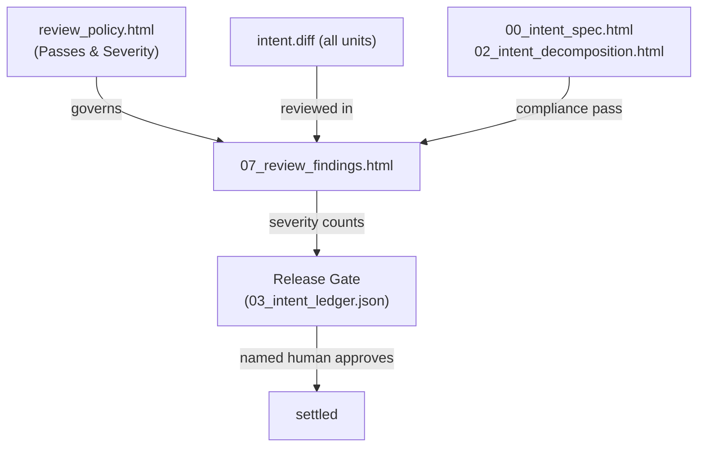

# Review Findings Document Definition

The Review Findings Document (`07_review_findings.html`) records the findings of each review pass for one work item. It
applies the passes and severity levels in [`review_policy.html`](review-policy.md) to the change that the work item
produced. Each finding has a pass, a severity, a location, and a status. The document also publishes severity counts in
its `<head>`, so that a gate can read them without parsing the body.

Findings do not approve or block a change alone. A named human code owner approves the change, using the findings as
input.

This document serves a dual purpose:

1. **Human Interface:** Renders as a local, static XHTML web page utilizing Material Design 3 Web Components
   (`@material/web` / **M3**) without client-side bundlers or build steps. Reviewers sort findings by pass and severity.
2. **Agent / Harness Interface:** Serves as a deterministic, structured XML document queryable via XPath and the `tosh`
   CLI. Fix agents read only the open Important findings.

---

## Table of Contents

1. [File Location & Organization Standard](#1-file-location--organization-standard)
2. [XHTML Header & Metadata Standard](#2-xhtml-header--metadata-standard)
3. [Required Sections & M3 Component Structure](#3-required-sections--m3-component-structure)
    - 3.1. [Document Header & Metadata Bar](#31-document-header--metadata-bar)
    - 3.2. [Severity Summary](#32-severity-summary)
    - 3.3. [Findings by Pass](#33-findings-by-pass)
    - 3.4. [Fix Loop Record](#34-fix-loop-record)
    - 3.5. [Approval Record](#35-approval-record)
4. [Token Optimization & XPath Query Patterns](#4-token-optimization--xpath-query-patterns)
5. [Lineage & Ledger Integration](#5-lineage--ledger-integration)
6. [Rules & Constraints](#6-rules--constraints)
7. [Revisions](#7-revisions)

---

## 1. File Location & Organization Standard

The review findings document resides at the root of the work item directory:

```text
.tosh/
└── work_items/
    └── {work-item-id}/
        ├── 04_intent_summary.html
        ├── 05_intent_conversation_summary.html
        ├── 06_intent_conversation_metrics.json
        └── 07_review_findings.html
```

- **File Name:** `07_review_findings.html`
- **Format:** Strict XHTML (`application/xhtml+xml` compliant, standard XML syntax).
- **Encoding:** UTF-8.
- **Authors:** One or more reviewer identities. Each finding names the reviewer that raised it.
- **Runtime:** Fully static, runnable directly in any modern browser via local filesystem (`file://`) or served locally
  via the `tosh` CLI.

---

## 2. XHTML Header & Metadata Standard

Every `07_review_findings.html` begins with the universal baseline `<meta>` tags, review tags, and the Material Web ES
module importmap loader:

```xhtml

<head>
    <meta charset="UTF-8"/>
    <meta name="viewport" content="width=device-width, initial-scale=1.0"/>
    <title>REVIEW FINDINGS: User Authentication Service</title>

    <!-- Universal Baseline Metadata -->
    <meta name="doc-id" content="WI-20260830T170936Z:07:REVIEW"/>
    <meta name="doc-type" content="review-findings"/>
    <meta name="schema-version" content="1.0.0"/>
    <meta name="domain" content="work-items"/>
    <meta name="intent-id" content="20260830T170936Z_user_auth_service"/>
    <meta name="status" content="completed"/> <!-- pending | in-progress | completed | failed | blocked -->
    <meta name="created-at" content="2026-08-30T19:10:00Z"/>
    <meta name="updated-at" content="2026-08-30T19:25:00Z"/>

    <!-- Review Domain Metadata -->
    <meta name="parent-doc-id" content="WI-20260830T170936Z:04:SUM"/>
    <meta name="review-pass" content="bugs,security,compliance"/>
    <meta name="severity-important-count" content="1"/>
    <meta name="severity-nit-count" content="3"/>
    <meta name="reviewer-identity" content="agent:reviewer@v1.1"/>
    <meta name="reviewer-mode" content="active"/> <!-- shadow | active -->
    <meta name="policy-versions" content="review-policy@1.0.0"/>
    <meta name="approved-by" content="human:code-owner"/>

    <!-- M3 / Material Web Assets -->
    <link href="https://fonts.googleapis.com/css2?family=Roboto:wght@400;500;700&amp;display=swap" rel="stylesheet"/>
    <link href="https://fonts.googleapis.com/css2?family=Material+Symbols+Outlined" rel="stylesheet"/>
    <script type="importmap">
        {
          "imports": {
            "@material/web/": "https://esm.run/@material/web/"
          }
        }
    </script>
    <script type="module">
        import '@material/web/all.js';
        import {styles as typescaleStyles} from '@material/web/typography/md-typescale-styles.js';

        document.adoptedStyleSheets.push(typescaleStyles.styleSheet);
    </script>
</head>
```

### Review Findings Header Metadata Contracts

| Metadata Tag               | Purpose                                                              | Example                |
|:---------------------------|:---------------------------------------------------------------------|:-----------------------|
| `review-pass`              | Comma-delimited passes that ran                                      | `bugs,security,compliance` |
| `severity-important-count` | Count of Important findings that are open                            | `1`                    |
| `severity-nit-count`       | Count of Nit findings reported                                       | `3`                    |
| `reviewer-identity`        | Identity of the reviewer                                             | `agent:reviewer@v1.1`  |
| `reviewer-mode`            | `shadow` or `active`                                                 | `active`               |
| `policy-versions`          | Version of the review policy in force                                | `review-policy@1.0.0`  |
| `approved-by`              | Named human code owner who approved the change                       | `human:code-owner`     |

---

## 3. Required Sections & M3 Component Structure

The Review Findings document contains 5 standardized sections. Each section combines semantic XHTML elements with
Material Design 3 Web Components (`md-*`), typography scale classes (`md-typescale-*`), and explicit data attributes
(`data-*`).

### 3.1. Document Header & Metadata Bar

Anchors the document with the work item ID, the reviewer identity, the reviewer mode chip, the open Important count, and
the link to `review_policy.html`.

### 3.2. Severity Summary

Section id: `severity-summary`. A table of counts by pass and severity. The counts match the `severity-important-count`
and `severity-nit-count` tags. A review reports at most the number of Nit findings that `nit-cap` allows and summarizes
the rest as a count.

### 3.3. Findings by Pass

Section id: `findings`. One group per pass. Each finding is an `md-outlined-card` with these attributes:

- `data-finding-id`: For example `F-001`.
- `data-pass`: `bugs`, `security`, `compliance`, or a pass that the policy adds.
- `data-severity`: `important` or `nit`.
- `data-status`: `open`, `fixed`, `dismissed`, or `accepted`.

Each card holds a description, the file path and line range, the evidence (for example the failing command and its
literal output), and the invariant or evidence requirement that the finding affects, if any. A compliance finding names
the document that the change departs from, for example a file outside the unit target scope.

### 3.4. Fix Loop Record

Section id: `fix-loop`. Records how each finding was handled. A reviewer or the author can request a fix. The agent
addresses the request and pushes the change. The record lists the request, the change, the commit reference, and the
status after the change. The agent works until the checks are green and the change waits only for the code owner.

### 3.5. Approval Record

Section id: `approval`. States the approval decision, the named human approver, the timestamp, and the writer identity of
the change. The approver identity differs from the writer identity. For a reviewer in `shadow` mode, the section records
the human decision on each finding.

---

## 4. Token Optimization & XPath Query Patterns

| Extraction Objective            | XPath Query Pattern                                                                 |
|:--------------------------------|:------------------------------------------------------------------------------------|
| Severity counts                 | `/html/head/meta[@name='severity-important-count']/@content`                        |
| Open Important findings         | `//section[@id='findings']//md-outlined-card[@data-severity='important' and @data-status='open']` |
| Findings of one pass            | `//section[@id='findings']//md-outlined-card[@data-pass='security']`                |
| Findings that affect an invariant | `//section[@id='findings']//md-outlined-card[@data-invariant-id]`                 |
| Approver                        | `/html/head/meta[@name='approved-by']/@content`                                     |

---

## 5. Lineage & Ledger Integration



- The ledger release gate can read `severity-important-count`. An open Important finding holds the intent in `verified`
  until a human accepts, dismisses, or fixes the finding.
- A finding that no invariant or check covers can start the lessons loop in [`lessons.html`](lessons-log.md).

---

## 6. Rules & Constraints

1. Every finding must carry a pass and a severity.
2. The severity counts in `<head>` must match the findings in the body.
3. Findings do not approve or block a change alone. A named human approves.
4. The approver identity must differ from the writer identity.
5. A finding from a reviewer in `shadow` mode needs a human decision before it counts.
6. Revision history is tracked exclusively in the `## Revisions` table at the bottom of this document.

---

## 7. Revisions

| Date       | Version | Description                                                                                                                | Source    |
|:-----------|:--------|:---------------------------------------------------------------------------------------------------------------------------|:----------|
| 2026-10-31 | 0.1.0   | Initial specification of per-intent review findings: passes, severity counts in metadata, fix loop record, and approval record. | TOPIC-005 |
