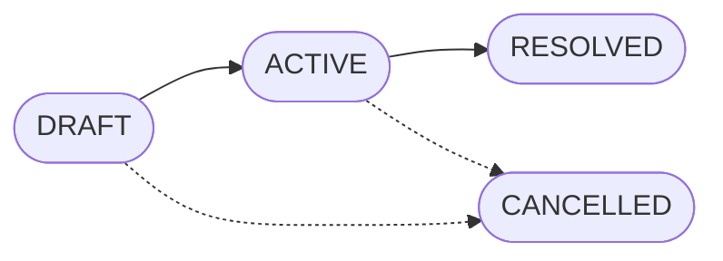

# Project Manager (project-mgr)

The project manager (`project-mgr`) is the part of `tosh` that manages a project from product requirements to released work. It has two parts. Product Management holds the requirements, the plan, and the release gates. The [Work Tracking System (WTS)](wts/README.md) holds the work items and their lifecycle.

Product Management defines what the product must do and how the system must behave. WTS tracks the units of work that deliver it. The two parts connect through traceability links, so each requirement leads to the work items and the evidence that satisfy it.

---

## Table of Contents

1. [Scope](#scope)
2. [Parts of project-mgr](#parts-of-project-mgr)
3. [Work Hierarchy](#work-hierarchy)
4. [Document Catalog](#document-catalog)
5. [Directory Layout](#directory-layout)
6. [Lifecycles](#lifecycles)
7. [Dependency Graph](#dependency-graph)
8. [Remediation Loop](#remediation-loop)
9. [Release Gates](#release-gates)
10. [Traceability Matrix](#traceability-matrix)
11. [Metadata Standard](#metadata-standard)
12. [XPath Query Patterns](#xpath-query-patterns)
13. [Command Surface](#command-surface)
14. [Subsystem Integration](#subsystem-integration)
15. [Rules & Constraints](#rules--constraints)
16. [Revisions](#revisions)

---

## Scope

`project-mgr` covers these items:

- The Product Requirements Document (PRD) and the Functional Specification Document (FSD).
- Initiatives, epics, and milestones.
- The work hierarchy and the dependency graph between work items.
- The traceability matrix from requirement to evidence.
- Release gates that block a milestone from closing.
- The work item backlog and lifecycle, which WTS specifies.

`project-mgr` does not cover the runtime intent package. The [Work Items domain](../docs/work-items/README.md) specifies that package. `project-mgr` does not cover technical design documents such as database schemas and API contracts. Those belong to the [OpenAPI](../docs/open-api/README.md) and [SDK & API](../docs/sdk-api/README.md) domains.

---

## Parts of project-mgr

| Part | Question it answers | Specification |
| :--- | :--- | :--- |
| Product Management | Why does the product exist, and what must it do? What makes a release complete? | This document. |
| Work Tracking System | Which units of work exist, and what is the state of each one? | [`wts/README.md`](wts/README.md) |

Requirements change as one connected narrative. Work items finish and close. For this reason, requirements live in Product Management documents and never in work item files. When work reveals a gap in a requirement, the owner amends the PRD or the FSD. A comment in a closed work item does not amend a requirement.

### PRD and FSD

The PRD states the problem, the users, the goals, and the success measures. It does not state how the system behaves. The FSD states how the system behaves for each requirement. It covers state models, input rules, business rules, error handling, and edge cases. It does not state commercial strategy or physical design.

| Dimension | PRD | FSD |
| :--- | :--- | :--- |
| Owner | Product owner. | Technical lead. |
| Core question | What problem do we solve, for whom, and what does success look like? | How must each component behave under each condition? |
| Content | Personas, goals, scope, user journeys, success measures, assumptions. | State models, field rules, business rules, error handling, access rules, audit rules. |
| Identifier | `PRD-REQ-###` | `FSD-FR-###` |
| Excludes | Implementation detail and data contracts. | Market analysis and physical design. |

Each FSD requirement names the PRD requirement that it implements.

---

## Work Hierarchy

Work decomposes into four levels. Levels 1 and 2 belong to Product Management. Level 3 belongs to WTS. Level 4 belongs to the Work Items domain.

```text
Level 1: Initiative         A strategic theme that spans milestones.
   │
Level 2: Epic               A group of work that delivers one FSD module or user journey.
   │
Level 3: Work Item          One declared intent (WTS).
   │
Level 4: Intent package     Strategy, sub-intents, and units (Work Items domain).
```

| Level | Parent | Child | Owner |
| :--- | :--- | :--- | :--- |
| Initiative | None. | Epics. | Product Management |
| Epic | One initiative. | Work items. | Product Management |
| Work item | One epic. | One intent package. | WTS |
| Intent package | One work item. | Sub-intents and units. | Work Items domain |

### Engineering Artifacts

A work item produces its engineering artifacts inside the intent package. No separate document type exists for them.

| Engineering artifact | Document in the intent package |
| :--- | :--- |
| Design specification | `01_solution_strategy.html` |
| Implementation plan | `02_intent_decomposition.html` and each `intent_unit_spec.html` |
| Test plan | The Verification Contract of each unit, and `03_intent_verification.html` |
| Delivery summary | `04_intent_summary.html` |

### Work Item Fields Added by project-mgr

Each work item file and each backlog record carries two extra fields.

| Field | Description |
| :--- | :--- |
| `epic` | The identifier of the parent epic, for example `EPIC-004`. |
| `implements` | The FSD requirement identifiers that the work item satisfies. |

---

## Document Catalog

All Product Management documents are strict XHTML. Each document follows the [Universal XHTML Document Standard](../docs/README.md#universal-xhtml-document-standard).

| # | Document | Target filename | Purpose |
| :--- | :--- | :--- | :--- |
| 1 | Product Requirements Document | `prd.html` | Problem, personas, goals, scope, user journeys, success measures, and assumptions. Each requirement has a `PRD-REQ-###` identifier. |
| 2 | Functional Specification Document | `fsd.html` | Functional requirements with state models, rules, and error handling. Each requirement has an `FSD-FR-###` identifier. |
| 3 | Initiative | `initiatives/INIT-###_{slug}.html` | Strategic theme, goal, and the list of epics. |
| 4 | Epic | `epics/EPIC-###_{slug}.html` | Scope, the FSD requirements that the epic delivers, and the list of work items. |
| 5 | Milestone | `milestones/{version}.html` | Target version, target date, requirement boundary, and release gate verdicts. |
| 6 | Traceability Matrix | `traceability.html` | Generated view of requirement, epic, work item, and evidence status. |
| 7 | Dependency Edges | `edges.jsonl` | One `blocks` edge per line between work items. |

`traceability.html` is generated. No person edits it by hand.

---

## Directory Layout

Product Management files live in `.tosh/project-mgr/` at the root of the consuming project. WTS files stay in `.tosh/wts/`.

```text
.tosh/
├── project-mgr/
│   ├── prd.html
│   ├── fsd.html
│   ├── edges.jsonl                        # Work item dependency edges.
│   ├── traceability.html                  # Generated. Never edited by hand.
│   ├── initiatives/
│   │   └── INIT-001_{slug}.html
│   ├── epics/
│   │   └── EPIC-001_{slug}.html
│   └── milestones/
│       └── v0.1.0.html
├── wts/                                   # Specified in wts/README.md
└── work_items/                            # Specified in docs/work-items/README.md
```

### Naming Conventions

- Initiative: `INIT-###_{kebab-case-slug}.html`
- Epic: `EPIC-###_{kebab-case-slug}.html`
- Milestone: `{semantic-version}.html`, for example `v0.1.0.html`
- Identifiers are three digits, zero-padded, sequential, and never reused.

---

## Lifecycles

### Epic



| Status | Meaning |
| :--- | :--- |
| `DRAFT` | The epic names its FSD requirements. No work item exists yet. |
| `ACTIVE` | At least one work item is past `BACKLOG`. |
| `RESOLVED` | Every work item is `DONE` or `CANCELLED`, and at least one is `DONE`. |
| `CANCELLED` | The epic is unnecessary or superseded. The reason is recorded in the file. |

An epic cannot become `RESOLVED` while a child work item is open. This rule rolls the health of children up to the parent.

### Milestone


| Status | Meaning |
| :--- | :--- |
| `PLANNED` | The milestone has a version and a requirement boundary. |
| `ACTIVE` | Work items are assigned and in progress. |
| `GATED` | Every work item is `DONE`. The release gates run. |
| `RELEASED` | Every release gate passed and a named human authorized the release. |

A failed release gate returns the milestone from `GATED` to `ACTIVE`.

### Initiative

An initiative has the status `ACTIVE` or `COMPLETED`. If all epics of an initiative are `RESOLVED` or `CANCELLED`, the initiative becomes `COMPLETED`.

### Work Item

The work item lifecycle is in the [WTS specification](wts/README.md#work-item-lifecycle).

---

## Dependency Graph

Work items form a directed acyclic graph (DAG) through `blocks` edges. A DAG is a set of nodes with one-way links and no path that returns to its start.

Each line of `edges.jsonl` is one edge.

```json
{"source": "WORK-ITEM-004", "target": "WORK-ITEM-007", "type": "blocks"}
```

`source` blocks `target`. `target` cannot leave `READY` until `source` is `DONE`.

### Algorithms

| Operation | Algorithm | When it runs |
| :--- | :--- | :--- |
| Cycle detection | Depth-first search with three-color marking. | Before `tosh pm edge add` writes an edge. The command rejects an edge that creates a cycle. |
| Execution order | Topological sort (Kahn's algorithm). | When `tosh pm graph` lists the work items that can start now. A work item with no open blockers can start. |
| Redundancy removal | Transitive reduction. | When `tosh pm graph --reduce` reports edges that other edges already imply. |

### Graph Rules

- A node cannot block itself.
- An edge must connect two existing work items.
- The WTS `Prerequisites` and `Enables` lists in section 9 of a work item file must match `edges.jsonl`. The command `tosh wts check` reports a difference.

---

## Remediation Loop

Verification and review produce findings. A finding that needs a fix returns its unit to targeted remediation, as the [Work Items domain](../docs/work-items/README.md#intent-convergence-state-machine) specifies.

The ledger counts each return to remediation in the `retries` field of the unit. The retry budget is 3 by default. When `retries` exceeds the budget, the ledger places a `retry_budget_exceeded` hold on the unit and on its parent sub-intent.

`project-mgr` reads that hold and acts on it.

- The work item moves to `BLOCKED`.
- A named human must approve a new approach before the work item returns to `IN_PROGRESS`.
- The release gates treat a unit with a hold as an unmet Convergence gate.

A review or verification agent reports a failing unit through the CLI or the MCP server. The report links the finding to the failing unit and to its work item.

---

## Release Gates

If every gate passes, the milestone moves from `GATED` to `RELEASED`. If any gate fails, the milestone stays in `GATED` or returns to `ACTIVE`.

| Gate | Condition |
| :--- | :--- |
| Completion | Every work item assigned to the milestone is `DONE` or `CANCELLED`. |
| Convergence | Every linked intent is `settled`. |
| Findings | No linked `07_review_findings.html` holds an unresolved Important finding. |
| Coverage | Every `PRD-REQ` inside the milestone boundary leads to at least one `DONE` work item. |
| Authorization | A named human authorizes the release. |

The agent can run the first four gates. The agent cannot pass the Authorization gate. The result of each gate is recorded in the milestone document.

---

## Traceability Matrix

The traceability matrix is a read-only view. `tosh pm trace` builds it from document metadata.


| From | To | Link |
| :--- | :--- | :--- |
| PRD requirement | FSD requirement | `implements-req` in `fsd.html`. |
| FSD requirement | Epic | `implements-req` in the epic document. |
| Epic | Work item | `epic` field of the work item. |
| Work item | Requirement | `implements` field of the work item. |
| Work item | Evidence | `Runtime Directory` field, then the evidence verdict in the intent package. |

For each requirement, the matrix shows one of these states: `unmapped`, `in-progress`, `verified`, or `failing`. A requirement with no linked work item is `unmapped`.

---

## Metadata Standard

Every Product Management document carries the seven universal baseline tags: `doc-id`, `doc-type`, `schema-version`, `domain`, `status`, `created-at`, and `updated-at`. The value of `domain` is `project-mgr`.

| Document type (`doc-type`) | Additional tags |
| :--- | :--- |
| `prd` | `requirement-count`, `milestone-id` |
| `fsd` | `parent-doc-id` (the PRD), `requirement-count` |
| `initiative` | `initiative-id`, `epic-ids` |
| `epic` | `epic-id`, `initiative-id`, `implements-req`, `milestone-id` |
| `milestone` | `milestone-id`, `target-date`, `gate-verdict` |

```html
<meta name="doc-id" content="PM:EPIC-012"/>
<meta name="doc-type" content="epic"/>
<meta name="schema-version" content="1.0.0"/>
<meta name="domain" content="project-mgr"/>
<meta name="status" content="in-progress"/>
<meta name="created-at" content="2026-11-01T09:00:00Z"/>
<meta name="updated-at" content="2026-11-01T09:00:00Z"/>
<meta name="epic-id" content="EPIC-012"/>
<meta name="initiative-id" content="INIT-003"/>
<meta name="implements-req" content="FSD-FR-204,FSD-FR-205"/>
<meta name="milestone-id" content="v0.1.0"/>
```

---

## XPath Query Patterns

Agents read the smallest part of a document that answers the question.

| Objective | Query |
| :--- | :--- |
| One requirement | `//section[@id='FSD-FR-204']` |
| The FSD requirements of an epic | `//meta[@name='implements-req']/@content` |
| The gate verdict of a milestone | `//meta[@name='gate-verdict']/@content` |
| The state model of a requirement | `//section[@id='FSD-FR-204']//*[@data-role='state-model']` |
| Active epics | `//meta[@name='doc-type' and @content='epic']/ancestor::head/meta[@name='status' and @content='in-progress']` |

Work item queries use the line-based queries that the [WTS specification](wts/README.md#agent-surface) defines.

---

## Command Surface

Product Management commands live under `tosh pm`. WTS commands stay under `tosh wts`.

| Command | Effect |
| :--- | :--- |
| `tosh pm init` | Creates `prd.html`, `fsd.html`, and the directories. |
| `tosh pm epic add` | Creates an epic document and registers it. |
| `tosh pm initiative add` | Creates an initiative document. |
| `tosh pm milestone add` | Creates a milestone document. |
| `tosh pm edge add` | Adds a `blocks` edge after the cycle check. |
| `tosh pm edge remove` | Removes an edge. |
| `tosh pm graph` | Prints the work items that can start now. The flag `--reduce` reports redundant edges. |
| `tosh pm trace` | Rebuilds `traceability.html`. |
| `tosh pm gate` | Runs the release gates for a milestone and records the verdicts. |
| `tosh pm check` | Reports drift between epics, work items, edges, and the matrix. It changes nothing. |

The MCP server exposes the same operations. It calls the same code as the CLI.

---

## Subsystem Integration

| Subsystem | Specification | Interface with project-mgr |
| :--- | :--- | :--- |
| CLI | [`build-docs/cli/`](../cli/README.md) | Hosts the `tosh pm` and `tosh wts` command groups. |
| MCP Server | [`build-docs/mcp/`](../mcp/README.md) | Exposes tools to read requirements, list startable work items, report a failing unit, and read gate state. |
| Static UI | [`build-docs/static-ui/`](../static-ui/README.md) | Renders the PRD, the FSD, the milestone board, the traceability matrix, and the dependency graph. |
| Work Items domain | [`build-docs/docs/work-items/`](../docs/work-items/README.md) | Supplies convergence state, review findings, `retries`, and holds. |

---

## Rules & Constraints

1. This document represents the current state of the design. History lives in `topics/`.
2. Requirements live in the PRD and the FSD. A work item never holds a requirement.
3. Every Product Management document is strict XHTML with the seven baseline tags.
4. Every FSD requirement names the PRD requirement that it implements.
5. Every epic names the FSD requirements that it delivers.
6. A work item belongs to exactly one epic.
7. The `blocks` edges contain no cycle. The cycle check runs before every write.
8. A parent never reaches a resolved state while a child is open.
9. A milestone is `RELEASED` only after a named human authorizes it. An agent never releases.
10. `traceability.html` is never edited by hand.
11. Identifiers are sequential and never reused.
12. Revision history of this document lives only in the table below.

---

## Revisions

| Date | Version | Description | Source |
| :--- | :--- | :--- | :--- |
| 2026-11-04 | 0.2.0 | Removed the REST API from the report path, the operations statement, and the subsystem table. | Removal of the REST API |
| 2026-11-01 | 0.1.0 | Initial specification of project-mgr: PRD and FSD, work hierarchy, epics, milestones, dependency graph, remediation loop, release gates, traceability matrix, and command surface. | TOPIC-006 |
