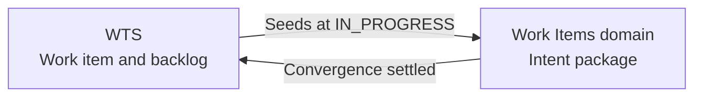
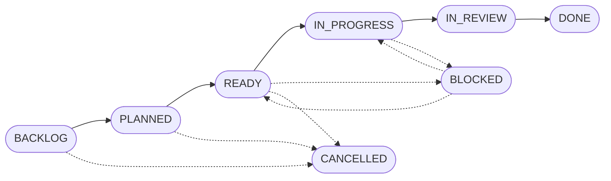

# Work Tracking System (WTS)

The Work Tracking System (WTS) is the part of `tosh` that tracks planned work. It holds the backlog, the work item files, and the lifecycle of each work item.

WTS is one of two parts of the [project manager](../README.md). The other part is Product Management, which holds requirements, epics, and milestones.

A work item declares one intent. It states the outcome that the system must achieve, the invariants that must hold, and the evidence that proves the result. A work item does not list steps. It holds no user story and no story points.

---

## Table of Contents

1. [Scope](#scope)
2. [Relationship to Other Domains](#relationship-to-other-domains)
3. [Directory Layout](#directory-layout)
4. [Work Item Lifecycle](#work-item-lifecycle)
5. [Work Item File](#work-item-file)
6. [Backlog Index](#backlog-index)
7. [Backlog View](#backlog-view)
8. [Command Surface](#command-surface)
9. [Agent Surface](#agent-surface)
10. [Traceability](#traceability)
11. [Rules & Constraints](#rules--constraints)
12. [Revisions](#revisions)

---

## Scope

WTS covers these items:

- The work item file format.
- The backlog index and the generated backlog view.
- The lifecycle and the gates between states.
- The commands, MCP tools, REST endpoints, and agent skills that read and change the backlog.

WTS does not cover the runtime intent package. The [Work Items domain](../../docs/work-items/README.md) specifies that package. WTS only seeds it.

WTS does not cover requirements, epics, milestones, or release gates. The [project manager specification](../README.md) covers those items.

---

## Relationship to Other Domains

A work item is the parent of all intent-driven SDLC documents. It plays the role that a story plays in a standard SDLC.

| Layer | Location | Purpose |
| :--- | :--- | :--- |
| Backlog | `.tosh/wts/` | Declared intents, priority, and lifecycle status. |
| Execution | `.tosh/work_items/{timestamp}_{slug}/` | Runtime intent package in strict XHTML. |



The WTS status and the `convergence-status` of the runtime package are separate values. A work item moves to `DONE` after the intent is `settled` and the pull request is merged.

---

## Directory Layout

WTS files live in `.tosh/wts/` at the root of the consuming project.

```text
.tosh/wts/
├── backlog.jsonl                      # Index. One JSON object per line.
├── backlog.md                         # Generated view. Never edited by hand.
├── backlog.template.md                # Layout of the generated view.
├── template.md                        # Template for new work item files.
└── WORK-ITEM-###_{slug}.md            # One file per work item.
```

The file name of a work item follows this pattern:

| Part | Rule |
| :--- | :--- |
| Prefix | `WORK-ITEM` in uppercase. |
| Identifier | Three digits, zero-padded, sequential (`001`, `002`, `042`). |
| Delimiter | One underscore (`_`). |
| Slug | Lowercase kebab-case summary of the intent. |
| Extension | `.md`. |

Example: `WORK-ITEM-001_initialize-cli-skeleton.md`.

---

## Work Item Lifecycle



| Status | Meaning | Exit criteria |
| :--- | :--- | :--- |
| `BACKLOG` | The idea is captured. Invariants and evidence are not final. | The work item is groomed and prioritized for a milestone. |
| `PLANNED` | The work item is assigned to a milestone. Scope and dependencies are in refinement. | The approach is agreed. |
| `READY` | The work item is fully refined. Dependencies are clear. | An assignee starts the work. |
| `IN_PROGRESS` | Development and test authoring are under way. | All tasks are done and a pull request is open. |
| `IN_REVIEW` | The pull request is open for review or audit. | The pull request is approved and merged. |
| `DONE` | Every invariant holds, every evidence item passes, and the code is merged. | Terminal state. |
| `BLOCKED` | An external dependency or impediment stops the work. | The blocker is resolved. The work item returns to its previous state. |
| `CANCELLED` | The work item is unnecessary, a duplicate, or superseded. The reason is recorded in the file. | Terminal state. |

### Gates

| Transition | Gate |
| :--- | :--- |
| To `READY` | The work item has at least one invariant with a command, and at least one evidence requirement with a command. |
| To `DONE` | Every invariant holds and every evidence requirement passes. |
| Any jump that skips a state | The command asks for confirmation before it continues. |

### Date Stamps

- `active` is set once, when the work item first leaves `BACKLOG`. It never changes afterward.
- `completed` is set when the status becomes `DONE` or `CANCELLED`.
- `updated` is set on every change.

---

## Work Item File

Each work item file has a metadata table and eleven numbered sections.

### Metadata

| Field | Description |
| :--- | :--- |
| Work Item ID | `WORK-ITEM-###` |
| Status | One of the eight lifecycle statuses. |
| Priority | `P0 - Blocker`, `P1 - High`, `P2 - Medium`, or `P3 - Low`. |
| Domain / Component | `CLI`, `MCP`, `REST API`, `Static UI`, `Work Items`, `Wiki`, `OpenAPI`, `SDK/API`, or `Core`. |
| Autonomy Tier | `observe`, `propose`, `change-with-review`, or `scoped-automation`. |
| Author, Assignee | GitHub handle or agent identifier. |
| Target Milestone | Release version, for example `v0.1.0`. |
| Epic | Identifier of the parent epic, such as `EPIC-004`. Before assignment, the value is `—`. |
| Implements | List of FSD requirement identifiers that the work item satisfies, such as `FSD-FR-204`. If none apply, the value is `—`. |
| Related Topic(s) | Links to originating topics. |
| Target Build-Doc(s) | Links to the specifications that the work item implements. |
| Runtime Directory | Path of the seeded intent package, or `—` before seeding. |
| Created Date, Active Date, Last Updated | Dates as `YYYY-MM-DD`, or `—` when not set. |

### Sections

| Section | Content |
| :--- | :--- |
| 1. Declared Intent | Desired outcome, affected users and systems, and motivation. |
| 2. Context & Background | Problem description and links to topics and build docs. |
| 3. System Invariants | Table of conditions that must hold. Each row has an ID, a class, a description, a command, and an enforcement level. |
| 4. Boundary Envelope | In-scope items, out-of-scope items, and constraints. |
| 5. Evidence Requirements | Table of observable outcomes. Each row has an ID and a command that returns pass or fail. |
| 6. Technical Approach & Design References | Specifications, affected paths, and token optimization notes. |
| 7. Candidate Sub-Intents | Milestones with dependencies. |
| 8. Definition of Done | Checklist for completion. |
| 9. Dependencies & Blockers | Prerequisites, enabled work items, and external dependencies. |
| 10. Open Questions | Table of questions with status, owner, and resolution. |
| 11. Activity Log & Notes | Dated entries. |

Invariant classes are `must-preserve`, `do-not-touch`, `performance-budget`, and `security-boundary`. Enforcement levels are `advisory`, `build-gate`, `ci-gate`, and `human-gate`. Each invariant command exits with code `0` when the invariant holds.

---

## Backlog Index

`backlog.jsonl` is the single source of truth for the index. It holds one JSON object per line.

| Field | Description |
| :--- | :--- |
| `id` | `WORK-ITEM-###` |
| `title` | Human-readable title. |
| `slug` | Kebab-case file name slug. |
| `status` | One of the eight lifecycle statuses. |
| `priority` | `P0`, `P1`, `P2`, or `P3`. |
| `domain` | Target subsystem. |
| `tier` | Autonomy tier. |
| `assignee` | Owner. |
| `milestone` | Target release. |
| `epic` | Parent epic identifier. If not set, the value is `—`. |
| `implements` | List of FSD requirement identifiers. If none apply, the list is empty. |
| `created`, `active`, `updated`, `completed` | Dates as `YYYY-MM-DD`, or `—` when not set. |

The work item file keeps the intent details. The record keeps only the index fields.

---

## Backlog View

`backlog.md` is generated from `backlog.jsonl` and `backlog.template.md`. WTS rebuilds it after every change to the index.

| Template marker | Replaced with |
| :--- | :--- |
| `{{METRICS_ROW}}` | One row of counts: total and each status. |
| `{{ACTIVE_ROWS}}` | One row for each work item that is not `DONE` or `CANCELLED`. |
| `{{ARCHIVE_ROWS}}` | One row for each work item that is `DONE` or `CANCELLED`. |

### Sorting Rule

Rows in the active table sort by `active` date, oldest first. Rows that still have `—` sort below all dated rows, by `created` date, oldest first. Ties sort by ID, lowest first.

---

## Command Surface

WTS commands live under `tosh wts`.

| Command | Effect |
| :--- | :--- |
| `tosh wts next-id` | Prints the next free `WORK-ITEM-###` identifier. |
| `tosh wts add` | Creates the work item file from the template, appends a record, and rebuilds `backlog.md`. |
| `tosh wts edit` | Changes fields of a record. A status change applies the gates and the date stamps. |
| `tosh wts remove` | Deletes the record and the work item file. The flag `--keep-file` keeps the file. |
| `tosh wts generate` | Rebuilds `backlog.md` without changing the data. |
| `tosh wts list` | Prints records as JSON lines. The flags `--status` and `--id` filter the output. |
| `tosh wts check` | Reports drift between `backlog.jsonl` and the work item files. It changes nothing. |
| `tosh wts start` | Seeds the runtime intent package, and sets the `Runtime Directory` field. |

The MCP server and the REST daemon expose the same operations. They call the same code as the CLI.

### Drift Checks

The `check` command reports each of these conditions:

- A record has no work item file.
- A work item file has no record.
- The status in a file differs from the status in its record.
- The generated `backlog.md` differs from a fresh build.
- The `Prerequisites` and `Enables` lists in section 9 of a file differ from the edges in `.tosh/project-mgr/edges.jsonl`.
- The `epic` field names an epic that does not exist.

---

## Agent Surface

`tosh` installs these agent assets for WTS.

| Asset | Purpose |
| :--- | :--- |
| `create-work-item` skill | Asks for the intent, invariants, boundary envelope, evidence, and autonomy tier. Then it writes and registers the work item. |
| `update-work-item-status` skill | Moves one work item to a new status and applies the gates. |
| `update-backlog` skill | Audits drift, rebuilds `backlog.md`, and applies bulk edits to fields other than status. |
| `backlog-manager` agent | Routes backlog requests to the three skills. It changes only files in `.tosh/wts/`. |

Agents read `backlog.jsonl` with XML-free line queries. They read a work item file by section instead of in full.

---

## Traceability

| From | To | Link |
| :--- | :--- | :--- |
| Topic | Work item | `Related Topic(s)` metadata row. |
| Build doc | Work item | `Target Build-Doc(s)` metadata row. |
| Work item | Intent package | `Runtime Directory` metadata row. |
| Work item | Work item | Section 9, `Prerequisites` and `Enables`. The `blocks` edges in `.tosh/project-mgr/edges.jsonl` hold the same links. |
| Epic | Work item | `Epic` metadata row. |
| Requirement | Work item | `Implements` metadata row. |

When `tosh wts start` seeds the intent package, WTS maps the work item as follows:

1. Sections 1, 3, 4, and 5 become `00_intent_spec.html`. The `Autonomy Tier` row becomes the `autonomy-tier` tag.
2. Section 6 informs `01_solution_strategy.html`.
3. Section 7 becomes the sub-intents in `02_intent_decomposition.html`.
4. Section 10 carries into the open questions of the intent specification.

---

## Rules & Constraints

1. The file `backlog.md` is never edited by hand.
2. Every change to the index goes through a WTS command.
3. After every command, each work item file, its record, and `backlog.md` agree.
4. Work item IDs are sequential and never reused.
5. A work item file name uses an underscore between the ID and the slug.
6. A work item holds an intent. It holds no implementation steps.
7. The `active` date is set once and never changes.
8. A `CANCELLED` work item records the reason in section 11 of its file.
9. Revision history of this document lives only in the table below.

---

## Revisions

| Date       | Version | Description                                                                                                                                  | Source |
|:-----------|:--------|:---------------------------------------------------------------------------------------------------------------------------------------------|:-------|
| 2026-11-01 | 0.2.0   | Linked to the project manager parent. Added the `Epic` and `Implements` fields, the dependency edge consistency check, and the epic and requirement traceability rows. | TOPIC-006 |
| 2026-11-01 | 0.1.0   | Initial specification of the Work Tracking System: layout, lifecycle, work item file, backlog index and view, command surface, agent assets. | `../../../todo` workspace |
