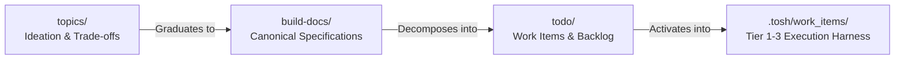
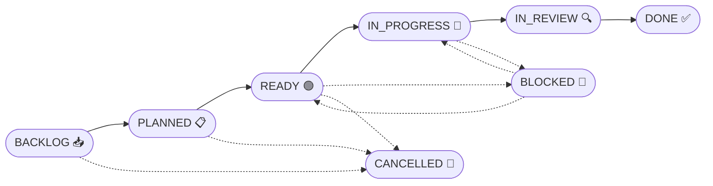

# Backlog & Work Item Management Framework

Welcome to the `todo/` workspace for **`tosh` (Token Optimized Software Harness)**.

This directory serves as the centralized backlog and development work item hub. It bridges the gap between high-level architectural ideation in [`topics/`](../topics/README.md), canonical specifications in [`build-docs/`](../build-docs/README.md), and granular code implementation.

Every discrete feature, enhancement, or bug fix is represented by an individual work item document following the convention [`WORK-ITEM-###_{file-name-slug}.md`](#file-naming--organization-conventions). All work items are indexed in [`backlog.jsonl`](backlog.jsonl) and shown centrally in the generated [`backlog.md`](backlog.md).

---

## Table of Contents

1. [Role & Relationship in Tosh](#role--relationship-in-tosh)
2. [Work Item Lifecycle & State Machine](#work-item-lifecycle--state-machine)
3. [File Naming & Organization Conventions](#file-naming--organization-conventions)
4. [Using `backlog.md`](#using-backlogmd)
5. [Authoring `WORK-ITEM-###_{file-name-slug}.md`](#authoring-work-item-file-name-slugmd)
6. [Work Item Template Structure](#work-item-template-structure)
7. [Step-by-Step Workflow](#step-by-step-workflow)
8. [Relationship to Work Items Runtime](#relationship-to-work-items-runtime)

---

## Role & Relationship in Tosh

Understanding how `todo/` fits into the overall `tosh` documentation ecosystem ensures clear separation of concerns:

| Dimension | `topics/` (Ideation & Deliberation) | `build-docs/` (Canonical Specs) | `todo/` (Development Backlog) | `.tosh/work_items/` (Execution Harness) |
| :--- | :--- | :--- | :--- | :--- |
| **Purpose** | Brainstorming, evaluating trade-offs, architectural consensus. | Authoritative blueprints, contracts, schemas, and current-state design. | Intent-declaring work items, prioritized backlog. | Runtime machine-parseable XHTML documents, telemetry, and execution logs. |
| **Document Format** | Markdown (`TOPIC-###_slug.md`) | Markdown specs across component domains | Markdown (`WORK-ITEM-###_slug.md` & `backlog.md`) | Strict XHTML 1.0/5 documents and JSON ledgers |
| **State** | Divergent, exploratory. | Convergent, normative, prescriptive. | Tactical, progressive, sprint-oriented. | Operational, atomic, task-oriented. |
| **Primary Audience** | Architects, designers, engineers in ideation. | Implementers, agentic LLMs, code generators. | Product owners, engineers, agent harnesses executing backlog tasks. | Running agent harness, static visualizer, automated verification loops. |



---

## Work Item Lifecycle & State Machine

Every work item transitions through a deterministic lifecycle from initial inception in the backlog to completion:



### State Definitions

| Status | Description | Exit Criteria |
| :--- | :--- | :--- |
| **`BACKLOG`** | Newly captured idea or task. High-level summary exists, but invariants and evidence are not yet finalized. | Groomed, scoped, and prioritized for a milestone. |
| **`PLANNED`** | Assigned to an upcoming milestone or sprint. Scope and dependencies are actively being refined. | Acceptance criteria written, technical approach agreed upon. |
| **`READY`** | Fully refined and groomed. Acceptance criteria defined, estimate assigned, dependencies unblocked. Ready for developer/agent pick-up. | Work begins by assignee. |
| **`IN_PROGRESS`** | Actively undergoing development and test authoring. | All tasks checked, unit tests pass locally, PR opened. |
| **`IN_REVIEW`** | Implementation complete. PR is submitted for code review, automated CI verification, or agent audit. | PR approved and merged. |
| **`DONE`** | Verification criteria met, code merged to `main`, documentation updated. | Archived in `backlog.md`. |
| **`BLOCKED`** | Work cannot proceed due to an external dependency, technical impediment, or upstream issue. | Blocker resolved; returned to previous state. |
| **`CANCELLED`** | Determined to be unnecessary, duplicate, or superseded. Rationale recorded in the work item file. | Terminal state. |

---

## File Naming & Organization Conventions

To ensure uniform parsing across human developers and automated tools, work item files adhere to a strict naming pattern:

$$\mathbf{\text{todo/###\_\{file-name-slug\}.md}}$$

### Breakdown:

1. **Prefix**: `` in uppercase.
2. **Identifier (`###`)**: Three-digit zero-padded sequential integer (`001`, `002`, `003`, ..., `042`, etc.).
3. **Delimiter**: An underscore (`_`) separating the work item ID and the slug.
4. **Slug (`{file-name-slug}`)**: Concise, lowercase, kebab-case descriptor summarizing the feature or task.
5. **Extension**: `.md` (Markdown).

### Valid Examples:

- `todo/001_initialize-cli-skeleton-and-root-command.md`
- `todo/002_xhtml-metadata-parser-and-xpath-evaluator.md`
- `todo/003_mcp-server-protocol-handshake-and-tools.md`
- `todo/004_static-ui-dashboard-scaffold.md`

> [!WARNING]
> Do not use a hyphen `-` as the separator between the ID and the slug (e.g., avoid `WORK-ITEM-001-slug.md`). Use an underscore `_` (e.g., `WORK-ITEM-001_slug.md`) to maintain clear syntactic distinction between the work item identifier and the descriptive slug.

---

## Using `backlog.md`

[`backlog.md`](backlog.md) is the central index and dashboard for all work items in the project. It mirrors the role of `topics/topic-registry.md` for topics.

`backlog.md` is a generated file. Do not edit it by hand. The data lives in [`backlog.jsonl`](backlog.jsonl), one JSON object per line. The script [`scripts/backlog.mjs`](scripts/backlog.mjs) changes the data and rebuilds `backlog.md` from [`backlog.template.md`](backlog.template.md) each time.

### Backlog Script

Run the script with Node.js from the repository root:

```bash
node todo/scripts/backlog.mjs next-id
node todo/scripts/backlog.mjs add --title "Initialize CLI Skeleton" --domain CLI --priority P1
node todo/scripts/backlog.mjs edit --id 1 --status PLANNED
node todo/scripts/backlog.mjs remove --id 1
node todo/scripts/backlog.mjs generate
node todo/scripts/backlog.mjs list --status READY
node todo/scripts/backlog.mjs check
```

| Command | Effect |
| :--- | :--- |
| `next-id` | Prints the next free `WORK-ITEM-###` identifier. |
| `add` | Appends a record, stamps the dates, and rebuilds `backlog.md`. |
| `edit` | Changes fields of a record. A status change stamps `active` on first leaving `BACKLOG` and `completed` on `DONE` or `CANCELLED`. |
| `remove` | Deletes the record and the `WORK-ITEM-###_*.md` file. Add `--keep-file` to keep the file. |
| `generate` | Rebuilds `backlog.md` without changing the data. |
| `list` | Prints records as JSON lines. Filter with `--status` or `--id`. |
| `check` | Reports drift between `backlog.jsonl` and the work item files. It changes nothing. |

### Record Schema (`backlog.jsonl`):

| Field | Description |
| :--- | :--- |
| `id` | `WORK-ITEM-###` |
| `title`, `slug` | Human-readable title and the kebab-case file name slug |
| `status` | `BACKLOG`, `PLANNED`, `READY`, `IN_PROGRESS`, `IN_REVIEW`, `DONE`, `BLOCKED`, `CANCELLED` |
| `priority` | `P0`, `P1`, `P2`, `P3` |
| `domain`, `tier` | Subsystem and autonomy tier |
| `assignee`, `milestone` | Owner and target release |
| `created`, `active`, `updated`, `completed` | Dates as `YYYY-MM-DD`, or `—` when not set |

The work item files keep the intent details (invariants, evidence, scope). The record keeps only the index fields.

### Key Responsibilities:

- **Single Source of Truth**: `backlog.jsonl` holds the index. Anyone looking for what to work on next, what is in flight, or what has been delivered reads `backlog.md`.
- **Status Synchronization**: When a work item changes status, the script updates `backlog.jsonl` and rebuilds `backlog.md` in the same run.
- **Metrics Ledger**: The script counts work items per state each time it generates `backlog.md`.
- **Layout Changes**: Edit `backlog.template.md` (markers `{{METRICS_ROW}}`, `{{ACTIVE_ROWS}}`, `{{ARCHIVE_ROWS}}`), then run `generate`.

### Table Schema:

| Column | Description | Example |
| :--- | :--- | :--- |
| **ID** | Markdown link to the individual work item file | `[`WORK-ITEM-001`](WORK-ITEM-001_cli-init.md)` |
| **Title** | Human-readable work item title | Initialize CLI Skeleton & Root Command |
| **Status** | Current lifecycle state | `READY`, `IN_PROGRESS`, `DONE` |
| **Priority** | Urgency and impact rating (`P0`, `P1`, `P2`, `P3`) | `P1` |
| **Autonomy Tier** | Agent autonomy level (`observe`, `propose`, `change-with-review`, `scoped-automation`) | `propose` |
| **Domain** | Target subsystem (`CLI`, `MCP`, `REST API`, `Static UI`, `Work Items`, `Wiki`, `Core`) | `CLI` |
| **Assignee** | GitHub handle or agent identifier | `@developer` |
| **Target Release** | Milestone or release version | `v0.1.0` |
| **Active** | Date the work item first left `BACKLOG` (`YYYY-MM-DD` or `—` if still in `BACKLOG`) | `2026-09-06` |
| **Last Updated** | Date of last state or content modification (`YYYY-MM-DD`) | `2026-09-06` |

### Sorting Rule (Active & Planned Work Items):

Rows in the **Active & Planned Work Items** table are sorted by **Active Date** ascending — the work item that has been active longest sits at the top. Rows with `—` (still in `BACKLOG`) sort below all dated rows, ordered by **Created Date** ascending. Tie-break: `WORK-ITEM-###` ascending.

---

## Authoring `WORK-ITEM-###_{file-name-slug}.md`

> [!TIP]
> **Tooling Support**: The supported way to create and register work items is the `/create-work-item` skill (or the `backlog-manager` agent). It allocates the ID, captures the intent in short rounds, writes the file from the template, and registers the record through `scripts/backlog.mjs`.

A work item declares an intent. It states what the system must achieve, which invariants must hold, and which evidence proves the result. It does not prescribe steps, and it holds no user story and no story points.

When creating a work item manually:

1. **Copy the Template**: Copy [`todo/template.md`](template.md) to `todo/WORK-ITEM-###_{file-name-slug}.md`.
2. **Fill the Metadata Table**: Set the ID, status, priority, domain, autonomy tier, author, and `Active Date` (`—` if `BACKLOG`, stamped if `PLANNED` or later).
3. **Declare the Intent**: Write the desired outcome, the affected users and systems, and the motivation.
4. **Add Context**: Link the problem to [`topics/`](../topics/README.md) and [`build-docs/`](../build-docs/README.md).
5. **Define Invariants**: Write each invariant with a class, a shell command, and an enforcement level.
6. **Set the Boundary Envelope**: List in-scope items, out-of-scope items, and constraints.
7. **Define Evidence**: Write each observable outcome with a verification command.
8. **List Candidate Sub-Intents**: Name the milestones and their dependencies.
9. **Register in the Backlog**: Run `node todo/scripts/backlog.mjs add ...`. The script updates `backlog.jsonl` and rebuilds `backlog.md`.

---

## Work Item Template Structure

Each work item file contains these sections:

```markdown
# WORK-ITEM-###: [Work Item Title]

| Metadata | Value |
| :--- | :--- |
| **Work Item ID** | `WORK-ITEM-###` |
| **Status** | `BACKLOG` |
| **Priority** | `P2 - Medium` |
| **Domain / Component** | `CLI` |
| **Autonomy Tier** | `propose` |
| **Author** | @username |
| **Assignee** | Unassigned |
| **Target Milestone** | `v0.1.0` |
| **Related Topic(s)** | [`TOPIC-###`](../topics/TOPIC-###_slug.md) |
| **Target Build-Doc(s)** | [`build-docs/...`](../build-docs/README.md) |
| **Runtime Directory** | — |
| **Created Date** | YYYY-MM-DD |
| **Active Date** | — |
| **Last Updated** | YYYY-MM-DD |

## 1. Declared Intent
## 2. Context & Background
## 3. System Invariants
## 4. Boundary Envelope
## 5. Evidence Requirements
## 6. Technical Approach & Design References
## 7. Candidate Sub-Intents
## 8. Definition of Done (DoD)
## 9. Dependencies & Blockers
## 10. Open Questions
## 11. Activity Log & Notes
```

---

## Step-by-Step Workflow

Follow this procedure when creating, executing, and resolving a work item (use `/create-work-item`, `/update-work-item-status`, and `/update-backlog` to automate these steps):

```
┌─────────────────────────────────────────────────────────────┐
│ 1. Work Item Creation (/create-work-item)                   │
│    - Allocate next ID: WORK-ITEM-###                        │
│    - Capture intent, invariants, evidence                   │
│    - Write WORK-ITEM-###_{slug}.md                          │
│    - Register record via scripts/backlog.mjs add            │
└──────────────────────────────┬──────────────────────────────┘
                               │
                               ▼
┌─────────────────────────────────────────────────────────────┐
│ 2. Grooming (/update-work-item-status)                      │
│    - Add commands to invariants and evidence                │
│    - Assign priority and autonomy tier                      │
│    - Set status to READY (needs both gates)                 │
│    - Use /update-backlog for bulk field edits               │
└──────────────────────────────┬──────────────────────────────┘
                               │
                               ▼
┌─────────────────────────────────────────────────────────────┐
│ 3. Execution (/update-work-item-status)                     │
│    - Assignee claims it (status IN_PROGRESS)                │
│    - Seed .tosh/work_items/ and set Runtime Directory       │
│    - Agent converges the sub-intents and units              │
└──────────────────────────────┬──────────────────────────────┘
                               │
                               ▼
┌─────────────────────────────────────────────────────────────┐
│ 4. Verification & Review (/update-work-item-status)         │
│    - Open PR (status IN_REVIEW)                             │
│    - Every invariant holds, every evidence item passes      │
│    - Satisfy the Definition of Done                         │
└──────────────────────────────┬──────────────────────────────┘
                               │
                               ▼
┌─────────────────────────────────────────────────────────────┐
│ 5. Merge & Archive (/update-work-item-status)               │
│    - Merge PR into main                                     │
│    - Set status to DONE                                     │
│    - Row moves to Completed & Archived                      │
│    - Metrics update (or run /update-backlog)                │
└─────────────────────────────────────────────────────────────┘
```

---

## Relationship to Work Items Runtime

A work item is the parent of all intent-driven SDLC documents. It plays the role that a story plays in a standard SDLC, where the standard documents are children of the story. When an agentic LLM or human engineer begins active execution of a work item, the file seeds a runtime intent package under `.tosh/work_items/{timestamp}_{slug}/`. The `Runtime Directory` metadata row records the path.

1. **Declared Intent, Boundary Envelope, Invariants, and Evidence Requirements** become `00_intent_spec.html`. The `Autonomy Tier` row becomes the `autonomy-tier` tag.
2. **Technical Approach** informs `01_solution_strategy.html`.
3. **Candidate Sub-Intents** become the sub-intents in `02_intent_decomposition.html`. The ledger `03_intent_ledger.json` governs their state.
4. **Open Questions** carry into the open questions section of the intent specification.

The backlog status (`BACKLOG` to `DONE`) is separate from the `convergence-status` of the runtime package. The work item moves to `DONE` after the intent is `settled` and the pull request is merged.

This keeps end-to-end traceability from ideation in `topics/`, through canonical architecture in `build-docs/`, planned work in `todo/`, and live execution in `.tosh/work_items/`.
