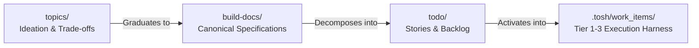

# Backlog & Story Management Framework

Welcome to the `todo/` workspace for **`tosh` (Token Optimized Software Harness)**.

This directory serves as the centralized backlog and development story hub. It bridges the gap between high-level architectural ideation in [`topics/`](../topics/README.md), canonical specifications in [`build-docs/`](../build-docs/README.md), and granular code implementation.

Every discrete feature, enhancement, or bug fix is represented by an individual story document following the convention [`STORY-###_{file-name-slug}.md`](#file-naming--organization-conventions). All stories are indexed and tracked centrally in [`backlog.md`](backlog.md).

---

## Table of Contents

1. [Role & Relationship in Tosh](#role--relationship-in-tosh)
2. [Story Lifecycle & State Machine](#story-lifecycle--state-machine)
3. [File Naming & Organization Conventions](#file-naming--organization-conventions)
4. [Using `backlog.md`](#using-backlogmd)
5. [Authoring `STORY-###_{file-name-slug}.md`](#authoring-story-file-name-slugmd)
6. [Story Template Structure](#story-template-structure)
7. [Step-by-Step Workflow](#step-by-step-workflow)
8. [Relationship to Work Items Runtime](#relationship-to-work-items-runtime)

---

## Role & Relationship in Tosh

Understanding how `todo/` fits into the overall `tosh` documentation ecosystem ensures clear separation of concerns:

| Dimension | `topics/` (Ideation & Deliberation) | `build-docs/` (Canonical Specs) | `todo/` (Development Backlog) | `.tosh/work_items/` (Execution Harness) |
| :--- | :--- | :--- | :--- | :--- |
| **Purpose** | Brainstorming, evaluating trade-offs, architectural consensus. | Authoritative blueprints, contracts, schemas, and current-state design. | Actionable user stories, implementation checklists, prioritized backlog. | Runtime machine-parseable XHTML documents, telemetry, and execution logs. |
| **Document Format** | Markdown (`TOPIC-###_slug.md`) | Markdown specs across component domains | Markdown (`STORY-###_slug.md` & `backlog.md`) | Strict XHTML 1.0/5 documents and JSON ledgers |
| **State** | Divergent, exploratory. | Convergent, normative, prescriptive. | Tactical, progressive, sprint-oriented. | Operational, atomic, task-oriented. |
| **Primary Audience** | Architects, designers, engineers in ideation. | Implementers, agentic LLMs, code generators. | Product owners, engineers, agent harnesses executing backlog tasks. | Running agent harness, static visualizer, automated verification loops. |



---

## Story Lifecycle & State Machine

Every story transitions through a deterministic lifecycle from initial inception in the backlog to completion:


### State Definitions

| Status | Description | Exit Criteria |
| :--- | :--- | :--- |
| **`BACKLOG`** | Newly captured idea or task. High-level summary exists, but acceptance criteria and points are not yet finalized. | Groomed, scoped, and prioritized for a milestone. |
| **`PLANNED`** | Assigned to an upcoming milestone or sprint. Scope and dependencies are actively being refined. | Acceptance criteria written, technical approach agreed upon. |
| **`READY`** | Fully refined and groomed. Acceptance criteria defined, estimate assigned, dependencies unblocked. Ready for developer/agent pick-up. | Work begins by assignee. |
| **`IN_PROGRESS`** | Actively undergoing development and test authoring. | All tasks checked, unit tests pass locally, PR opened. |
| **`IN_REVIEW`** | Implementation complete. PR is submitted for code review, automated CI verification, or agent audit. | PR approved and merged. |
| **`DONE`** | Verification criteria met, code merged to `main`, documentation updated. | Archived in `backlog.md`. |
| **`BLOCKED`** | Work cannot proceed due to an external dependency, technical impediment, or upstream issue. | Blocker resolved; returned to previous state. |
| **`CANCELLED`** | Determined to be unnecessary, duplicate, or superseded. Rationale recorded in the story file. | Terminal state. |

---

## File Naming & Organization Conventions

To ensure uniform parsing across human developers and automated tools, story files adhere to a strict naming pattern:

$$\mathbf{\text{todo/STORY-###\_\{file-name-slug\}.md}}$$

### Breakdown:

1. **Prefix**: `STORY-` in uppercase.
2. **Identifier (`###`)**: Three-digit zero-padded sequential integer (`001`, `002`, `003`, ..., `042`, etc.).
3. **Delimiter**: An underscore (`_`) separating the story ID and the slug.
4. **Slug (`{file-name-slug}`)**: Concise, lowercase, kebab-case descriptor summarizing the feature or task.
5. **Extension**: `.md` (Markdown).

### Valid Examples:

- `todo/STORY-001_initialize-cli-skeleton-and-root-command.md`
- `todo/STORY-002_xhtml-metadata-parser-and-xpath-evaluator.md`
- `todo/STORY-003_mcp-server-protocol-handshake-and-tools.md`
- `todo/STORY-004_static-ui-dashboard-scaffold.md`

> [!WARNING]
> Do not use a hyphen `-` as the separator between the ID and the slug (e.g., avoid `STORY-001-slug.md`). Use an underscore `_` (e.g., `STORY-001_slug.md`) to maintain clear syntactic distinction between the story identifier and the descriptive slug.

---

## Using `backlog.md`

[`backlog.md`](backlog.md) is the central index and dashboard for all stories in the project. It mirrors the role of `topics/topic-registry.md` for stories.

### Key Responsibilities:

- **Single Source of Truth**: Anyone looking for what to work on next, what is in flight, or what has been delivered consults `backlog.md`.
- **Status Synchronization**: Whenever a story changes status in its individual file, the corresponding row in `backlog.md` must be updated immediately.
- **Metrics Ledger**: Keep the summary table at the top of `backlog.md` updated with accurate counts of stories per state.

### Table Schema:

| Column | Description | Example |
| :--- | :--- | :--- |
| **ID** | Markdown link to the individual story file | `[`STORY-001`](STORY-001_cli-init.md)` |
| **Title** | Human-readable story title | Initialize CLI Skeleton & Root Command |
| **Status** | Current lifecycle state | `READY`, `IN_PROGRESS`, `DONE` |
| **Priority** | Urgency and impact rating (`P0`, `P1`, `P2`, `P3`) | `P1` |
| **Pts** | Story points estimate (Fibonacci scale: 1, 2, 3, 5, 8, 13) | `3` |
| **Domain** | Target subsystem (`CLI`, `MCP`, `REST API`, `Static UI`, `Work Items`, `Wiki`, `Core`) | `CLI` |
| **Assignee** | GitHub handle or agent identifier | `@developer` |
| **Target Release** | Milestone or release version | `v0.1.0` |
| **Active** | Date story first left `BACKLOG` (`YYYY-MM-DD` or `—` if still in `BACKLOG`) | `2026-09-06` |
| **Last Updated** | Date of last state or content modification (`YYYY-MM-DD`) | `2026-09-06` |

### Sorting Rule (Active & Planned Stories):

Rows in the **Active & Planned Stories** table are sorted by **Active Date** ascending — the story that has been active longest sits at the top. Rows with `—` (still in `BACKLOG`) sort below all dated rows, ordered by **Created Date** ascending. Tie-break: `STORY-###` ascending.

---

## Authoring `STORY-###_{file-name-slug}.md`

> [!TIP]
> **Tooling Support**: The supported way to create and register stories is using the `/create-story` skill (or delegating to the `backlog-manager` agent). It automates ID allocation, interactive capture of story details, template scaffolding, and `backlog.md` registration.

When creating a new story manually:

1. **Copy the Template**: Duplicate [`todo/template.md`](template.md) into `todo/STORY-###_{file-name-slug}.md` (or run `/create-story`).
2. **Fill Metadata Table**: Set the next sequential ID, status (`BACKLOG` or `READY`), priority, domain, points, author, and `Active Date` (`—` if `BACKLOG`, stamped if `PLANNED` or later).
3. **Draft the User Story**: Write the standard user story framing (`As a... I want... So that...`).
4. **Establish Context & Scope**: Detail what problem this solves and explicitly state what is in scope vs. out of scope.
5. **Define Testable Acceptance Criteria**: Write unambiguous criteria using Given/When/Then or verifiable checklist items.
6. **Reference Specifications**: Link to relevant blueprints in [`build-docs/`](../build-docs/README.md) or ideation topics in [`topics/`](../topics/README.md).
7. **Break Down Tasks**: Create an actionable implementation checklist for the engineer or agent.
8. **Register in `backlog.md`**: Add the new story to the Active & Planned Stories table in [`backlog.md`](backlog.md) at the sorted position, or run `/update-backlog` to reconcile.

---

## Story Template Structure

Each story file contains the following standardized sections:

```markdown
# STORY-###: [Story Title]

| Metadata | Value |
| :--- | :--- |
| **Story ID** | `STORY-###` |
| **Status** | `BACKLOG` |
| **Priority** | `P2 - Medium` |
| **Story Points** | `3` |
| **Domain / Component** | `CLI` |
| **Author** | @username |
| **Assignee** | Unassigned |
| **Target Milestone** | `v0.1.0` |
| **Related Topic(s)** | [`TOPIC-###`](../topics/TOPIC-###_slug.md) |
| **Target Build-Doc(s)** | [`build-docs/...`](../build-docs/README.md) |
| **Created Date** | YYYY-MM-DD |
| **Active Date** | — |
| **Last Updated** | YYYY-MM-DD |

---

## 1. User Story
As a <role>, I want <capability>, So that <benefit>.

## 2. Context & Background
Problem description, motivation, and links to topics/build-docs.

## 3. Scope
Explicit In-Scope and Out-of-Scope lists.

## 4. Acceptance Criteria
Verifiable Given/When/Then scenarios and validation criteria.

## 5. Technical Approach & Design References
Target files, architecture notes, token optimization impact.

## 6. Implementation Checklist
Step-by-step ordered tasks.

## 7. Definition of Done (DoD)
Quality gates: lint, tests, docs, PR review.

## 8. Dependencies & Blockers
Preceding and succeeding stories or blockers.

## 9. Activity Log & Notes
Chronological updates on progress and decisions.
```

---

## Step-by-Step Workflow

Follow this procedure when creating, executing, and resolving a story (use `/create-story`, `/update-story-status`, and `/update-backlog` to automate these steps):

```
┌─────────────────────────────────────────────────────────────┐
│ 1. Story Creation (run /create-story)                       │
│    - Allocate next ID: STORY-###                            │
│    - Copy template.md -> STORY-###_{slug}.md                │
│    - Register row in todo/backlog.md                        │
└──────────────────────────────┬──────────────────────────────┘
                               │
                               ▼
┌─────────────────────────────────────────────────────────────┐
│ 2. Grooming & Refinement (run /update-story-status)         │
│    - Define User Story & Acceptance Criteria                │
│    - Estimate Story Points & Assign Priority                │
│    - Set Status to: READY                                   │
│    - Use /update-backlog for bulk field edits               │
└──────────────────────────────┬──────────────────────────────┘
                               │
                               ▼
┌─────────────────────────────────────────────────────────────┐
│ 3. Implementation (run /update-story-status)                │
│    - Assignee claims story (Status -> IN_PROGRESS)          │
│    - Execute tasks from Implementation Checklist            │
│    - Maintain local unit tests and documentation            │
└──────────────────────────────┬──────────────────────────────┘
                               │
                               ▼
┌─────────────────────────────────────────────────────────────┐
│ 4. Verification & Review (run /update-story-status)         │
│    - Open PR / Submit for review (Status -> IN_REVIEW)      │
│    - Verify all Acceptance Criteria pass                    │
│    - Satisfy Definition of Done (DoD)                       │
└──────────────────────────────┬──────────────────────────────┘
                               │
                               ▼
┌─────────────────────────────────────────────────────────────┐
│ 5. Merge & Archive (run /update-story-status)               │
│    - Merge PR into main branch                              │
│    - Set Story Status to: DONE                              │
│    - Move row in backlog.md to Completed & Archived         │
│    - Update backlog metrics counters (or run /update-backlog)│
└─────────────────────────────────────────────────────────────┘
```

---

## Relationship to Work Items Runtime

`tosh` is designed around token-optimized, parseable documentation. When an agentic LLM or human engineer begins active execution of a story in `todo/`, the story can optionally serve as the initial input to seed a full runtime **Work Item** under `.tosh/work_items/{timestamp}_{slug}/`:

1. **`STORY-###` User Story, Scope & AC** become the basis for `00_intent_spec.html`. The user story states the intent, the out-of-scope list informs the boundary envelope, and the acceptance criteria become the evidence requirements.
2. **Technical Approach** in the story informs `01_solution_strategy.html`.
3. **Implementation Checklist** steps translate into the sub-intents (`02_intent_decomposition.html`) and the intent units, whose state the ledger `03_intent_ledger.json` governs.

This maintains end-to-end traceability from early product ideation in `topics/`, through canonical architecture in `build-docs/`, planned development tasks in `todo/`, and live execution logs in `.tosh/work_items/`.
