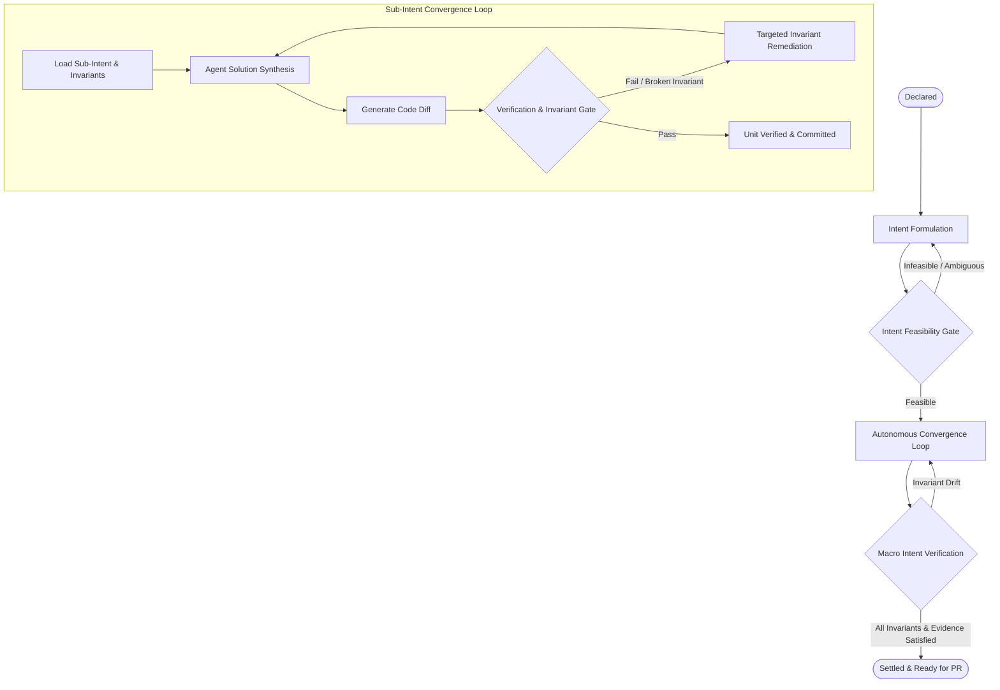

# TOPIC-005: Intent-Based SDLC Architecture & Work Item Transformation

| Metadata | Value |
| :--- | :--- |
| **Topic ID** | `TOPIC-005` |
| **Status** | `IN_DISCUSSION` |
| **Facilitator** | @architect |
| **Participants** | @architect, @team |
| **Created Date** | 2026-10-31 |
| **Last Updated** | 2026-10-31 |
| **External Sources** | [The AI-native SDLC playbook](https://claude.com/resources/articles/the-ai-native-sdlc-playbook), [How Anthropic secures its AI-native SDLC](https://claude.com/resources/articles/how-anthropic-secures-its-ai-native-software-development-lifecycle), [AI CI/CD on-call](https://claude.com/resources/articles/ai-ci-cd-on-call), [Hooks guide](https://code.claude.com/docs/en/hooks-guide), [Redesigning source control](https://www.anthropic.com/engineering/redesigning-source-control), `AI Native SDLC Playbook_designv2.pdf` (54-page PDF in the repo root, same playbook with full plays) |
| **Target Build-Docs** | `build-docs/docs/work-items/README.md`, `build-docs/docs/README.md`, `build-docs/docs/work-items/*.md` |
| **Impacted Domains** | `Work Items` \| `CLI` \| `MCP` \| `Static UI` \| `REST API` |

---

## 1. Problem Statement & Context

### 1.1 Problem Description

The current Work Item domain specifications in `build-docs/docs/work-items/` are structured around a **Traditional Software Development Life Cycle (SDLC)**:
- User stories framed in agile narrative format (*"As a [role], I want [capability], So that [benefit]"*), accompanied by story point estimation.
- Imperative, procedural task specifications (`task_spec.html`) detailing step-by-step implementation instructions (*"how"* to modify code).
- Time-and-ceremony waterfall/agile milestone divisions (Phases and Tasks) modeled after human sprint workflows.
- Verification focused on running individual tests rather than proving satisfaction of declared intent and enforcing system invariants.

While this structure was converted into XHTML for token optimization via XPath extraction, the underlying conceptual model remains human-centric, prescriptive, and procedural.

### 1.2 Context & Trigger

AI coding agents do not operate like human sprint teams. When presented with rigid, imperative step-by-step instructions, agents frequently suffer from:
1. **Instruction Drift & Hallucination**: Overly prescriptive procedural steps often conflict with actual codebase nuances at runtime, causing agents to blindly follow outdated plan steps or hallucinate code paths.
2. **Token Inefficiency**: Verbose user-story narratives, sprint ceremonies, and step-by-step micro-instructions consume significant prompt context without improving model reasoning.
3. **Lack of Guardrails & Invariants**: Traditional SDLC specifications emphasize what code to *add*, but fail to formally enforce *what must never break* (invariants, security boundaries, performance budgets, and architectural constraints).

An **Intent-Based SDLC for AI** re-anchors development around declarative intent:
- **What** the system must achieve (Desired Outcome / Intent).
- **What boundaries must be preserved** (System Invariants, Protected Files, Non-Negotiable Constraints).
- **What constitutes undeniable evidence of satisfaction** (Deterministic Verification Commands, Behavioral Assertions, Contract Envelopes).

Under this paradigm, the AI agent is not treated as a typist following a procedural recipe, but as an autonomous reasoning engine guided by declarative boundaries, converging iteratively toward the desired state.

---

## 2. Goals & Non-Goals

### Goals

- [ ] Formulate the core philosophy and taxonomy of an **Intent-Based SDLC** tailored for autonomous AI agents within `tosh`.
- [ ] Redefine the Three-Tier Execution Hierarchy from procedural artifacts (Work Item &rarr; Phase &rarr; Task) into an Intent-Driven Hierarchy (Intent Package &rarr; Sub-Intent Milestones &rarr; Atomic Intent Execution Units).
- [ ] Establish explicit Intent terminology across document naming, schemas, and directories (e.g., `intent_spec.html`, `intent_decomposition.html`, `intent_ledger.json`, `intent_unit_spec.html`).
- [ ] Define the Intent Convergence State Machine (`declared` &rarr; `formulating` &rarr; `converging` &rarr; `verified` &rarr; `settled`, with a `drift_detected` guard).
- [ ] Map the migration and replacement strategy for all 18 existing documents in `build-docs/docs/work-items/`.
- [ ] Detail token optimization benefits, XPath extraction patterns, and local CLI query mechanisms under declarative intent.
- [ ] Align the Intent hierarchy with the stage model of the AI-native SDLC playbook (Plan, Design, Build, Test, Deploy, Maintain) and record where `tosh` follows or differs from it (see Section 9).
- [ ] Define how invariants are enforced deterministically (hooks and CI gates) instead of only being declared in documents.
- [ ] Define autonomy tiers, approval gates, and the rule that the agent that writes a change cannot approve it.
- [ ] Define a "lessons" feedback loop so that failures become permanent invariants or verification checks.
- [ ] Define stage handoff triggers and confidence gates, so that a state change in the ledger starts the next stage and unattended runs stop at a gate (see Section 9.9).
- [ ] Define a plan-drift check that compares each `intent.diff` with its declared Target Scope (see Section 9.10).

### Non-Goals

- Modifying the other four document domains (`wiki/`, `sdk-api/`, `open-api/`, `report/`), except where they link to work-item metadata.
- Re-architecting the foundational XHTML 1.0/5 polyglot standard or Material 3 web component UI rendering engine (both are retained and leveraged).

---

## 3. Traditional SDLC vs. Intent-Based SDLC for AI

| Dimension | Traditional SDLC (Current Work Items) | Intent-Based SDLC for AI (Proposed) |
| :--- | :--- | :--- |
| **Core Paradigm** | **Imperative / Procedural**: Prescribes *how* to implement code through step-by-step instructions. | **Declarative**: Declares *what* desired outcome to achieve, *invariants* to preserve, and *evidence* required. |
| **Primary Unit** | **Story & Task**: User stories (*"As a..."*), story points, sprint tickets, checklist of edits. | **Intent & Invariant**: Goal specification, behavioral contracts, architectural boundaries, invariant rules. |
| **Planning Approach** | Rigid upfront decomposition into micro-steps; sensitive to code reality mismatches. | Goal-oriented decomposition into a DAG of sub-intents; agent autonomously explores and converges on solution. |
| **Guardrails** | Implicit; rely on developer review and generic unit test suites. | Explicit, machine-enforceable Invariants (`must-preserve`, `do-not-touch`, `performance-budget`, `security-boundary`). |
| **Validation Model** | Test execution pass/fail verdict. | **Intent Verification & Drift Detection**: Proves intent satisfaction AND validates that no invariants or boundaries were violated. |
| **Agent Role** | Subservient code generator following procedural instructions. | Autonomous optimizer converging diffs against intent contracts and invariant guardrails. |
| **Token Profile** | Verbose narrative descriptions, story templates, procedural steps inflate prompt size. | Lean, structured XML sub-trees of goals, constraints, and contracts save up to 40% more tokens. |

---

## 4. Proposed Architecture: The Intent-Driven Hierarchy

The execution hierarchy is refactored from a procedural Waterfall/Agile model into a three-tier Intent Convergence Hierarchy:

```
┌─────────────────────────────────────────────────────────────────────────┐
│ TIER 1: INTENT PACKAGE (Macro Intent Root)                              │
│ Intent Spec (00) ──> Solution Strategy (01) ──> Intent Decomposition (02)│
│ Intent Ledger (03) <──> Verification Plan (03) ──> Intent Summary (04)  │
└────────────────────────────────────┬────────────────────────────────────┘
                                     │
                                     ▼
┌─────────────────────────────────────────────────────────────────────────┐
│ TIER 2: SUB-INTENT MILESTONES                                           │
│ Sub-Intent Spec (sub_intent_spec.html)                                  │
│ Milestone Verification (milestone_verification.html)                    │
│ Milestone Summary (milestone_summary.html)                              │
└────────────────────────────────────┬────────────────────────────────────┘
                                     │
                                     ▼
┌─────────────────────────────────────────────────────────────────────────┐
│ TIER 3: ATOMIC INTENT UNITS                                             │
│ Intent Unit Spec (intent_unit_spec.html) ──> Verification (verification)│
│ Intent Diff (intent.diff)                ──> Summary & Telemetry        │
└─────────────────────────────────────────────────────────────────────────┘
```

### 4.1 Tier 1: Intent Package (Macro Intent Root)

Represents the macro engineering objective initiated by a human or upstream system:

1. **`00_intent_spec.html`** *(formerly `00_requirements.html`)*:
   - **Declared Intent**: Objective, motivation, business rationale.
   - **System Invariants**: Strict non-negotiables (e.g., zero regression on public API, no schema locks >100ms, backwards compatibility).
   - **Boundary Envelope**: In-scope vs. strictly out-of-scope capabilities.
   - **Evidence Requirements**: High-level behavioral assertions and observable outcomes required to settle the intent.
   - *(Eliminates agile story points, velocity metrics, and user story templates).*

2. **`01_solution_strategy.html`** *(formerly `01_design_spec.html`)*:
   - **Solution Hypothesis**: Architectural approach, system topology, and module interactions.
   - **Invariant Preservation Strategy**: How the proposed architecture protects declared invariants.
   - **Contract & Schema Changes**: Data definitions, interface delta, and API boundaries.
   - **Agent Capabilities & Tooling**: Required LLM roles, tools (MCP), and skills needed for convergence.
   - **Micro-ADRs**: Architectural decision records and trade-offs.

3. **`02_intent_decomposition.html`** *(formerly `02_implementation_plan.html`)*:
   - **Sub-Intent DAG**: High-level decomposition of the macro intent into discrete, verifiable sub-intents (milestones).
   - **Dependency Graph**: Execution ordering, critical paths, and parallelizable sub-intent branches.
   - **Protected Resource Registry**: Repository-wide "do-not-touch" boundaries and shared contracts.

4. **`03_intent_ledger.json`** *(formerly `03_implementation_ledger.json`)*:
   - Single source of truth tracking state of every sub-intent and atomic unit.
   - Records intent convergence state, dependency satisfaction, file pointers, and aggregated telemetry.

5. **`03_intent_verification.html`** *(formerly `03_plan_validation.html`)*:
   - Master verification harness specifying end-to-end integration tests, property-based tests, performance audits, and invariant monitors required to certify the entire intent.

6. **`04_intent_summary.html`** *(formerly `04_plan_summary.html`)*:
   - Post-convergence synthesis detailing intent satisfaction, final diff stats, and milestone outcomes.

7. **`05_intent_conversation_summary.html` & `06_intent_conversation_metrics.json`**:
   - Preserves planning dialogues, model reasoning traces, and token economics during intent formulation.

---

### 4.2 Tier 2: Sub-Intent Milestones (Intermediate Goals)

Partitions execution into cohesive, testable functional sub-goals (e.g., `sub_intent_01_auth_schema`, `sub_intent_02_jwt_token_service`):

- **`sub_intents/{sub_intent_id}/sub_intent_spec.html`** *(formerly `phase_spec.html`)*:
  - Scopes the milestone intent, prerequisites, invariant constraints, and atomic execution units manifest.
- **`sub_intents/{sub_intent_id}/sub_intent_verification.html`** *(formerly `phase_validation.html`)*:
  - Multi-unit integration verification, cross-component invariant checks, and milestone gating verdict.
- **`sub_intents/{sub_intent_id}/sub_intent_summary.html`** *(formerly `phase_summary.html`)*:
  - Milestone convergence metrics, realized commits, and rollup summary.

---

### 4.3 Tier 3: Atomic Intent Units (Execution & Convergence)

The atomic unit of agent execution. Rather than prescribing procedural micro-steps, the specification defines the **Intent Target**, **Invariant Bounds**, and **Verification Contract**:

- **`units/{unit_id}/intent_unit_spec.html`** *(formerly `task_spec.html`)*:
  - **Unit Goal**: Specific functional outcome (e.g., "Implement argon2id password hashing utility with salt generation").
  - **Target Scope**: Explicit files to create or modify.
  - **Invariants & "Do Not Touch" Constraints**: Protected modules, forbidden dependencies, signature invariants.
  - **Reference Anchors**: Links to existing codebase patterns and contracts.
  - **Verification Contract**: Deterministic terminal commands, exit codes, and output assertions.
  - *(Removes imperative "step 1, step 2, step 3" line-editing recipes, allowing the agent to autonomously generate the solution).*
- **`units/{unit_id}/intent.diff`** *(formerly `task.diff`)*:
  - The unified git diff produced by the agent to satisfy the atomic intent.
- **`units/{unit_id}/verification.html`** *(formerly `validation.html`)*:
  - Verification run logs, exit codes, invariant audit results, and drift detection report.
- **`units/{unit_id}/summary.html`** *(formerly `summary.html`)*:
  - Realized diff statistics, summary of changes, and commit reference.
- **`units/{unit_id}/conversation.jsonl` & `metrics.json`**:
  - Verbatim model interaction trace and token consumption telemetry.

---

## 5. Intent Convergence State Machine

The state machine reflects autonomous convergence rather than static ticket statuses:



### State Definitions:
1. **`declared`**: Intent is registered with raw objectives and desired outcomes.
2. **`formulating`**: Architectural strategy, invariant definitions, and sub-intent DAG are being authored.
3. **`converging`**: AI agents are actively synthesizing solutions, generating diffs, and testing against invariants.
4. **`verified`**: The unit, milestone, or macro intent has passed all deterministic verification and invariant checks.
5. **`drift_detected`**: Output satisfies tests but violates a declared invariant or boundary; triggers automated remediation.
6. **`settled`**: The intent is fully realized, verified, and locked ready for pull request merge.

---

## 6. Directory Structure Comparison

```text
TRADITIONAL SDLC (BEFORE):                 INTENT-BASED SDLC FOR AI (AFTER):
.tosh/work_items/                          .tosh/work_items/
└── {timestamp}_{slug}/                    └── {timestamp}_{slug}/
    ├── 00_requirements.html                   ├── 00_intent_spec.html
    ├── 01_design_spec.html                    ├── 01_solution_strategy.html
    ├── 02_implementation_plan.html            ├── 02_intent_decomposition.html
    ├── 03_implementation_ledger.json          ├── 03_intent_ledger.json
    ├── 03_plan_validation.html                ├── 03_intent_verification.html
    ├── 04_plan_summary.html                   ├── 04_intent_summary.html
    ├── 05_plan_conversation_summary.html      ├── 05_intent_conversation_summary.html
    ├── 06_plan_conversation_metrics.json      ├── 06_intent_conversation_metrics.json
    └── phases/                                └── sub_intents/
        └── phase_01_{slug}/                       └── sub_intent_01_{slug}/
            ├── phase_spec.html                        ├── sub_intent_spec.html
            ├── phase_validation.html                  ├── sub_intent_verification.html
            ├── phase_summary.html                     ├── sub_intent_summary.html
            └── tasks/                                 └── units/
                └── task_001_{slug}/                       └── unit_001_{slug}/
                    ├── task_spec.html                         ├── intent_unit_spec.html
                    ├── validation.html                        ├── verification.html
                    ├── task.diff                              ├── intent.diff
                    ├── summary.html                           ├── summary.html
                    ├── conversation.jsonl                     ├── conversation.jsonl
                    └── metrics.json                           └── metrics.json
```

---

## 7. Token Optimization & Performance Impact

*`tosh` prioritizes minimizing LLM token consumption and maximizing development velocity through local processing.*

1. **Elimination of Procedural Bloat**:
   - Prescribing micro-steps in `task_spec.html` bloated prompts with 800–1,500 tokens of step-by-step instructions that were frequently ignored or hallucinated.
   - Declaring concise **Goals**, **Target Files**, **Invariants**, and **Verification Commands** reduces specification size to ~300–450 tokens (a 60% reduction in spec ingestion).

2. **High-Value XPath Invariant Extraction**:
   - Instead of loading whole documents, agents extract exact guardrails:
     - Invariants: `//section[@id='invariants']//md-list-item`
     - Forbidden Files: `//meta[@name='protected-files']/@content`
     - Verification Commands: `//section[@id='verification-contract']//code`
     - Target Goal: `//section[@id='unit-goal']//p`

3. **Autonomous Drift Minimization**:
   - Giving agents clear invariant constraints reduces invalid code generations and costly multi-turn retries, cutting overall work-item token burn by an estimated 25–40%.

---

## 8. Document Migration Mapping (18 Specifications)

| # | Current Traditional SDLC Spec | Proposed Intent-Based SDLC Spec | Core Conceptual Evolution |
|:--|:------------------------------|:--------------------------------|:--------------------------|
| 1 | `requirements.md` | `intent-specification.md` | Drops user stories & story points; introduces Desired State, System Invariants, and Evidence Contracts. |
| 2 | `technical-design.md` | `solution-strategy.md` | Shifts from static blueprints to Solution Hypothesis, Invariant Preservation Strategy, and Agent Tooling contracts. |
| 3 | `implementation-plan.md` | `intent-decomposition.md` | Replaces timeline phases with a Sub-Intent DAG, dependency bounds, and protected boundary catalog. |
| 4 | `work-item-ledger.md` | `intent-ledger.md` | Replaces task state machine with Intent Convergence lifecycle (`declared`, `converging`, `verified`, `drift_detected`, `settled`). |
| 5 | `plan-validation.md` | `intent-verification.md` | Reframes validation from test checklist to Invariant & Intent satisfaction gating. |
| 6 | `plan-summary.md` | `intent-summary.md` | Synthesizes verified intents, invariant compliance, and convergence duration. |
| 7 | `plan-conversation-summary.md` | `intent-conversation-summary.md` | Captures deliberations on intent ambiguity, invariant trade-offs, and architectural strategies. |
| 8 | `plan-conversation-metrics.md` | `intent-conversation-metrics.md` | Unchanged format; tracks token economics of intent formulation. |
| 9 | `phase-specification.md` | `sub-intent-specification.md` | Defines milestone sub-intent, prerequisites, invariant boundaries, and unit manifest. |
| 10 | `phase-validation.md` | `sub-intent-verification.md` | Multi-unit integration verification and milestone invariant audit. |
| 11 | `phase-summary.md` | `sub-intent-summary.md` | Milestone completion summary and diff rollup. |
| 12 | `task-specification.md` | `intent-unit-specification.md` | Replaces imperative step-by-step instructions with Unit Goal, Target Files, Invariants, and Verification Commands. |
| 13 | `task-validation.md` | `unit-verification.md` | Records verification test logs, exit codes, and drift detection assertions. |
| 14 | `task-diff.md` | `intent-diff.md` | Authoritative git patch realizing the intent unit. |
| 15 | `task-summary.md` | `unit-summary.md` | Documents realized changes, diff stats, and commit linkage. |
| 16 | `task-conversation.md` | `unit-conversation.md` | Preserves raw agent interaction during convergence. |
| 17 | `task-conversation-metrics.md`| `unit-conversation-metrics.md` | Tracks token consumption, latency, and cost of unit convergence. |
| 18 | `work-item-document-metadata-definition.md` | `intent-document-metadata-definition.md` | Updates metadata tags (`intent-id`, `parent-intent-id`, `invariants-hash`, `convergence-status`, `evidence-verdict`). |

---

## 9. External Reference: The AI-Native SDLC Playbook

Source: [The AI-native SDLC playbook](https://claude.com/resources/articles/the-ai-native-sdlc-playbook), its connected pages, and the PDF edition `AI Native SDLC Playbook_designv2.pdf`. The PDF adds the full play for each stage (prerequisites, steps, governance, measures). Sections 9.9 to 9.14 record what the PDF adds. The playbook argues that code generation now runs faster than planning, review, and deployment. It moves the SDLC from a line to a loop. Each stage commits an artifact (a file in version control) that the next stage reads. Humans review at gates instead of at every edit.

### 9.1 Playbook Principles and Their Fit with This Topic

| Playbook principle | Fit with the Intent-Based SDLC | Action for `tosh` |
| :--- | :--- | :--- |
| Linear becomes a loop. Each stage commits an artifact. | Matches the Convergence State Machine (Section 5) and the XHTML document set. | Keep every state change tied to a committed document. |
| Committed artifacts are the audit trail (`intent.md`, `spec.md`, `plan.md`, diffs, review findings, incident records). | Matches the document set in Section 4. `tosh` adds XHTML metadata and XPath access. | Add a review-findings document and an incident document (see 9.3). |
| Attention moves to gates. | Matches the Verification & Invariant Gate. | Name each gate and its human approver in the ledger. |
| Policy is enforced while work happens. Skills advise and hooks enforce. | The topic declares invariants but does not yet say how they are enforced. | Add an enforcement model (see 9.4). |
| One source of truth per artifact. | `intent_ledger.json` is the source of truth for state. | State which file owns each fact, and link legacy tickets by commit SHA. |
| The agent that writes code cannot approve it. | Not covered. | Add as a rule in Section 5 and in the metadata (see 9.5). |
| Every incident becomes a permanent eval. | Not covered. | Add a lessons loop (see 9.6). |

### 9.2 Stage Mapping

| Playbook stage | Playbook artifact | `tosh` Intent artifact | Note |
| :--- | :--- | :--- | :--- |
| Plan | `intent.md`, a proto-spec in the originator's own words, reviewed by the product owner | `00_intent_spec.html` in state `declared` | Capture the raw statement first. Add invariants and evidence in `formulating`. |
| Design | `spec.md`, built from `intent.md` and constrained by organization skills | `01_solution_strategy.html` | The playbook merges requirements and design into one session. `tosh` keeps two documents but can author them in one session. |
| Build | `plan.md` reviewed in plan mode, then code | `02_intent_decomposition.html`, `intent_unit_spec.html`, `intent.diff` | The Sub-Intent DAG is the reviewed plan. The playbook commits the plan before any code change. |
| Test | A single test command, a measurable target, a failing test first for bug fixes | `verification.html`, Verification Contract | Matches the Verification Contract. Add "failing test first" and "tests are read-only during a fix" as optional unit constraints. |
| Deploy | `REVIEW.md` review policy, approval gates as hooks, named release authorization | `sub_intent_verification.html`, `03_intent_verification.html` | Add a review policy document and a release authorization field. |
| Maintain | Control-band monitoring, scheduled scans, findings written as `intent.md` | A new intent with a `source` link to the finding | Closes the loop. A finding becomes a new `declared` intent. |

### 9.3 Candidate New Documents and Metadata

- **Review policy** (`REVIEW.md` in the playbook): defines review passes (bugs, security, compliance) and severity levels. Candidate `tosh` form: one project-level XHTML document, and a per-intent `review_findings.html`.
- **Lessons log** (`lessons.md` in the on-call article): records what happened, root cause, fix, and gotcha. Claude reads it at the start of each investigation. Candidate `tosh` form: a project-level `lessons.html`, queried by XPath.
- **Origin link**: a metadata tag such as `origin-ref` so that an intent created from a production finding or an alert points back to it.
- **Approver identity**: metadata tags for the named human approver of each gate and for the agent identity that produced the change.

### 9.4 Invariant Enforcement Model

The playbook states that a skill is advisory and a hook is deterministic. Each non-negotiable policy needs a hook. The security article adds that Anthropic places its hard gate in CI, and that invariant tests (for example "user A can never read user B's data") trigger manual review when they fail.

The proposal for `tosh` is that each invariant declares one enforcement level:

| Level | Mechanism | Example |
| :--- | :--- | :--- |
| `advisory` | Text in the unit spec that the agent reads. | Follow the existing error-handling pattern. |
| `build-gate` | A hook that runs fast, file-scoped checks during the build and can block an edit. | Block edits to protected paths. Run the linter after each edit. |
| `ci-gate` | A command in the Verification Contract that must exit with code 0 before `verified`. | Run the invariant test suite. |
| `human-gate` | The ledger holds the state until a named approver signs. | Changes to regulated or critical code. |

This model gives a first answer to Q3. An invariant assertion is a shell command with an exit code, plus an enforcement level. The playbook advises heavy checks at commit or pull request time, so `build-gate` checks must stay fast and file-scoped.

### 9.5 Autonomy Tiers and Separation of Duties

The playbook and the on-call article describe a gradient of autonomy: read-only, proposal, human-reviewed change, and scoped automation. The playbook also advises tiering autonomy by environment and keeping production release authorization with a named human.

Proposal for `tosh`:
- Each intent declares an `autonomy-tier`: `observe`, `propose`, `change-with-review`, or `scoped-automation`.
- The agent identity that writes a unit must differ from the identity that approves it. The ledger records both.
- Each agent identity has the least permissions needed. For example, an incident agent can write documents and read logs but cannot deploy.
- New automated reviewers start in shadow mode. They post findings for a human to approve until trust exists. The ledger records a sampled audit of automated approvals.

### 9.6 Lessons Loop

The playbook says to update `CLAUDE.md` when Claude makes the same error twice, and to turn every incident into an eval. The security article calls this "closing the loop". The on-call article promotes recurring entries in `lessons.md` into the investigation skill.

Proposal for `tosh`: when a unit enters `drift_detected` or fails verification for a reason not yet covered, the agent proposes one of three outputs. These are a new invariant, a new verification check, or a note for the project instructions. A human accepts or rejects the proposal. This keeps the invariant set growing from real failures.

### 9.7 Token and Metric Notes

- The playbook lists leading and lagging indicators for each stage. Candidates for `tosh` telemetry: time from `declared` to `formulating` complete, specification rework after build starts, first-pass verification rate, time from plan approval to `settled`, and repeat failures that an existing invariant should have caught.
- The playbook keeps `CLAUDE.md` under one page. This supports the lean XPath extraction approach in Section 7. `tosh` agents read only the sub-tree that they need.
- The estimates in Section 3 and Section 7 (40%, 60%, 25-40%) are design targets. The playbook gives no matching figures. Treat them as unmeasured until `tosh` collects its own telemetry.

### 9.8 Differences to Keep

- The playbook uses Markdown files (`intent.md`, `spec.md`, `plan.md`). `tosh` keeps strict XHTML so that humans get a rendered view and agents get XPath access.
- The playbook leaves invariants mostly implicit in skills, hooks, and CI. `tosh` makes invariants a first-class, queryable part of the intent document.
- The source-control article describes review that checks the intent of a change instead of every line, and review rules that separate comment-only edits from sensitive logic edits. This supports the invariant-first review model, but the article does not describe a spec workflow, so it is not a precedent for the document set.

### 9.9 Stage Handoff Triggers and Confidence Gates (from the PDF)

The PDF says that a stage ends by committing an artifact, and that the commit starts the next stage. An accepted `intent.md` starts the design pass. An approved `spec.md` starts plan mode. A merged pull request starts the pipeline. A breached control band writes the next `intent.md`. Teams first run each step by hand, then automate the trigger.

Proposal for `tosh`:
- A ledger state change is the trigger. For example, when `00_intent_spec.html` moves to `formulating`, a non-interactive job can author `01_solution_strategy.html` and open it for review.
- A human accepts or rejects each artifact at a gate. Acceptance is recorded in the ledger as a named approver and a timestamp.
- In unattended runs, an independent confidence gate sits between stages. It is either a deterministic check or an adversarial reviewing agent. The gate decides whether the output continues or goes to a human.
- The PDF says that the product owner reviews the design spec and does not write it. The spec lists flagged concerns, and the owner resolves each concern with its policy owner before build starts. Candidate `tosh` form: a `concerns` section in `01_solution_strategy.html`, with one owner per concern.

### 9.10 Plan Drift, Parallel Work, and Verification Detail (from the PDF)

- **Plan drift.** The PDF commits `plan.md` before code, tells the engineer to update the plan in the same commit when the work departs from it, and suggests a hook to keep both in sync. Review then checks the diff against the plan. For `tosh`, the Target Scope of each unit plays the role of the plan. If `intent.diff` touches a file outside the Target Scope, the unit enters `drift_detected` until the spec or the diff changes.
- **Parallel work.** The PDF runs one session per task in a separate git worktree. Tasks that share files run one after another in one session. For `tosh`, each unit can list the files that it touches. The CLI can then compute which branches of the Sub-Intent DAG are safe to run in parallel. Two to three parallel sessions is the PDF's starting point, and the limit is how many streams one person can review.
- **Feedback loop and verifier.** The PDF separates two things. The feedback loop runs during the whole task. The verifier is a fresh-context check that runs once, after the session believes that the work is done, so that the verdict does not carry the assumptions that produced the code. For `tosh`, `verification.html` records the verifier result apart from the loop log.
- **Measurable targets.** Each target must be quantifiable, for example "all tests in `test_status.py` pass" or "the endpoint returns 200 with the new field". This sets a rule for the Verification Contract: every assertion must be a command with a pass or fail result.
- **Evidence from the toolchain.** The PDF names the literal output of the test command, the build log, or the screenshot diff as the evidence. The agent summary is not evidence. `verification.html` must store the literal output.
- **Test files in a fix.** The PDF blocks edits to test files during a fix task, because an agent that fixes code must not weaken the check on that code. This supports the optional unit constraint in Section 9.2.

### 9.11 Control Bands and the Maintain Stage (from the PDF)

The PDF closes the loop with a deterministic script that watches production metrics. The script invokes the agent only when a band is breached, and the tier sets what the agent may do:

| Tier | Action | Maps to autonomy tier |
| :--- | :--- | :--- |
| 1 sigma | Log only. | None |
| 2 sigma | Invoke the agent read-only to diagnose. | `observe` |
| 3 sigma | The agent opens a pull request into the review gate or runs a pre-approved runbook. | `propose` or `scoped-automation` |

The agent writes its diagnosis in the intent format: the anomaly and its evidence, a proposed outcome, affected systems, and open questions. A service owner then chooses to fix now, schedule, or dismiss. Dismissals tune the bands. When a fix ships, the team adds an eval for the incident.

Notes for `tosh`:
- Detection stays outside `tosh`. The `origin-ref` tag (Section 9.3) links the new intent to the alert or finding. See Q9.
- The tier table gives a concrete meaning to each autonomy tier in Section 9.5.
- Slack or ticket triage can also create an intent. A small, well-bounded fix goes straight to a pull request. A larger one becomes a new `declared` intent.
- The PDF names a version-controlled lessons file that the agent writes after an incident (for example `lessons/2026-06-checkout-cache.md`). This confirms the `lessons.html` candidate in Section 9.3.

### 9.12 Evals for Agent Configuration (from the PDF)

The PDF treats the agent configuration as code that needs regression tests. The configuration is the project instruction file, skills, and hooks. An eval suite runs on a schedule and on any change to that configuration. A change that lowers the pass rate is reviewed before it merges. The PDF suggests 20 to 50 real tasks as a start, each with a prompt and checks that define an acceptable result. Each production incident adds one eval.

Proposal for `tosh`:
- Invariants, hook templates, and verification commands are agent configuration. A change to any of them can run the eval suite before it is accepted.
- The lessons loop (Section 9.6) ends with an eval, not only with a new invariant. An accepted lesson adds one eval case.
- Report the time from incident to permanent eval as a telemetry value.

### 9.13 Source of Truth, Hook Scope, and Review Detail (from the PDF)

- **Source of truth.** The PDF says to name one system as the source of truth for each artifact. It lists three configurations: the repository owns the record, the legacy system owns the record, or both hold a link to each other as a minimum. For `tosh`, the repository is the owner by default. Each document can carry an `external-ref` tag for a legacy record ID, and the legacy record holds the commit SHA. See Q10.
- **Hook scope.** Team hooks live in the project settings file in version control. Non-negotiable hooks live in managed settings that engineers cannot switch off. This adds a second dimension to the enforcement levels in Section 9.4: the owner of the hook. The hook templates in Q5 must say which scope each template needs.
- **Block messages.** A hook that blocks an action must state the reason and the route to approval. The CLI and the MCP server must pass that text to the agent.
- **Ask decision.** A hook can allow, ask, or block. The `ask` decision pauses the action until a named person approves. This is the mechanism for the `human-gate` level in Section 9.4. The PDF keeps `ask` hooks out of the build stage, because an approval prompt puts a person on the critical path of all parallel sessions.
- **Environment tiers.** In development, the agent deploys freely. In production, the agent prepares the release and a named release manager authorizes it. The agent has no direct path to the main branch. The PDF says that the rollback path must be the most rehearsed path in the pipeline.
- **Review passes.** The review policy defines passes (bugs, security, compliance with spec and plan) and what counts as Important or as a Nit. It caps the nit count and lists paths to skip. Findings do not approve or block a change alone, and a code owner still approves. For `review_findings.html`, each finding needs a `pass` value and a `severity` value, and the document needs a severity count that a gate can read.

### 9.14 Intent Format and Metrics Additions (from the PDF)

- **Intent format.** The PDF sample `intent.md` has these parts: author and status, problem, proposed outcome, affected users and systems, constraints, and open questions. `00_intent_spec.html` should hold the same parts, written first in the originator's own words, before invariants and evidence are added. Open questions need a place in the document, and the PDF expects the design pass to answer them or carry them forward.
- **Entry routes.** An intent can start from a person, a ticket, or an alert. People without git experience can commit through a connector. For `tosh`, the MCP server is the matching connector, so non-engineers can declare an intent.
- **Policy versions.** The PDF logs the spec, the prompt that produced it, and the skill versions in force. Candidate metadata tags: `prompt-ref` and `policy-versions`.
- **Auto mode.** The PDF moves human attention from each edit to the review of artifacts after long autonomous sessions. This supports the `change-with-review` tier in Section 9.5, with approval at the plan and at the final diff.
- **Git-derived metrics.** The PDF reads most measures from timestamps and history, so no extra tracking is needed. Candidates for `tosh`:
  - Time from first conversation to a committed `00_intent_spec.html`.
  - Intent survival rate: the share of intents that are accepted into design instead of closed.
  - Edits to the intent after the first strategy commit.
  - Strategy commits after the first decomposition commit (rework after build starts).
  - Share of changes that merge from the first implementation pass.
  - How often the merged diff still matches the committed plan.
  - Time to first review, and the share of review comments resolved without a human touching the branch.
  - Time from a band breach to an intent in the triage queue.
  - Share of findings that become merged fixes.
- **Estimates.** The PDF gives no token or cost figures. The note in Section 9.7 still applies.

---

## 10. Open Questions & Spikes

- [ ] **Q1**: Should the parent directory remain `.tosh/work_items/` or be renamed to `.tosh/intents/`? *(Owner: @architect)*
- [ ] **Q2**: How should the CLI command surface evolve? (e.g., `tosh intent new`, `tosh intent converge`, `tosh intent verify` vs. `tosh work-item ...`). *(Owner: @cli-team)*
- [ ] **Q3**: What standard format should Invariant assertions take to allow automated CLI drift checks? (e.g., regex, AST rules, or custom shell commands). *(Owner: @team)* Partial input from Section 9.4: a shell command with an exit code plus an enforcement level.
- [ ] **Q4**: Should `tosh` merge `00_intent_spec` and `01_solution_strategy` into one document, as the playbook merges requirements and design? *(Owner: @architect)*
- [ ] **Q5**: Should `tosh` ship hook templates that enforce `build-gate` invariants for Claude Code, and how does the MCP server expose gate state? *(Owner: @cli-team)*
- [ ] **Q6**: Do review policy and lessons log belong in the Work Items domain, the Wiki domain, or the Report domain? *(Owner: @architect)*
- [ ] **Q7**: Which autonomy tiers does `tosh` support in its first release? *(Owner: @team)*
- [ ] **Q8**: Which confidence gates does `tosh` support between stages: a deterministic check, an adversarial reviewing agent, or both? Who owns the escalation to a human? *(Owner: @architect)* Input from Section 9.9.
- [ ] **Q9**: Does `tosh` own control-band detection, or does it only receive findings as new intents through `origin-ref`? *(Owner: @architect)* Input from Section 9.11.
- [ ] **Q10**: Is the repository the source of truth for every document by default, and how does `tosh` store `external-ref` links to legacy records? *(Owner: @team)* Input from Section 9.13.
- [ ] **Q11**: Does the unit spec list the files that it touches, so that the CLI can compute parallel-safe branches and detect plan drift? *(Owner: @cli-team)* Input from Section 9.10.

---

## 11. Discussion Log & Meeting Notes

- **2026-10-31** (@architect): Initial topic created following user directive to convert work-item documentation from a Traditional SDLC to an Intent-Based SDLC for AI. Defined core philosophy, 3-tier intent hierarchy, state machine, directory conventions, and 18-document migration matrix.
- **2026-10-31** (@architect): Reviewed the AI-native SDLC playbook and four connected pages. Added Section 9. Findings: the stage model fits the Intent hierarchy. The topic lacked an enforcement model for invariants, autonomy tiers, separation of duties between writer and approver, and a lessons loop. Added Q4 to Q7. The 40%, 60%, and 25-40% token figures have no external support and are marked as unmeasured design targets.
- **2026-10-31** (@architect): Reviewed the PDF edition of the playbook (`AI Native SDLC Playbook_designv2.pdf`, 54 pages). Added Sections 9.9 to 9.14: stage handoff triggers and confidence gates, plan drift and parallel work, control bands for the Maintain stage, evals for agent configuration, source of truth and hook scope, and the intent format with git-derived metrics. Added Q8 to Q11 and two goals. The PDF confirms the stage mapping in Section 9.2 and gives no token or cost figures.

---

## 12. Decision & Rationale

- **Decision**: Adopt the Intent-Based SDLC paradigm for all work-item specifications in `tosh`. Replace traditional procedural/agile artifacts (user stories, story points, step-by-step task instructions) with declarative Intent, System Invariants, Sub-Intent DAGs, and deterministic Verification Contracts.
- **Core Rationale**:
  1. AI agents execute significantly better against declarative outcomes and guardrails than against rigid procedural recipes.
  2. Reduces token waste by stripping out irrelevant human sprint ceremonies and procedural verbosity.
  3. Guarantees safety and architectural integrity through explicit, machine-checkable Invariants.
- **Accepted Trade-offs**: Requires migrating and updating the 18 specification documents under `build-docs/docs/work-items/` and updating references in master documentation.
- **Decision Date**: 2026-10-31
- **Sign-off**: @architect, @team

---

## 13. Build-Docs Conversion Plan

### 13.1 Target Build-Docs Destinations
- [ ] `build-docs/docs/work-items/README.md` (Rewrite master architecture)
- [ ] `build-docs/docs/README.md` (Update domain overview and directory mappings)
- [ ] `build-docs/README.md` (Update Work Item domain summary)
- [ ] `build-docs/docs/work-items/*.md` (Update all 18 individual specifications according to the migration matrix)

### 13.2 Specification Authoring Checklist
- [ ] Resolve Q3 to Q11 before transcribing Section 9 content (enforcement levels, autonomy tiers, lessons loop, new documents) into build-docs.
- [ ] Drafted normative, prescriptive technical specifications.
- [ ] Verified compliance with [`build-docs/README.md`](../build-docs/README.md) rules:
  - [ ] Content represents the **current state** of the design.
  - [ ] Content is **strictly void** of references to past decisions, debate, or rejected alternatives (those remain preserved in this topic).
- [ ] Added entry to the `## Revisions` table in all updated build-docs referencing `TOPIC-005`.
- [ ] Updated status in this topic to `GRADUATED` once build-docs migration is completed.
- [ ] Updated Topic Registry table in [`topics/topic-registry.md`](topic-registry.md).
